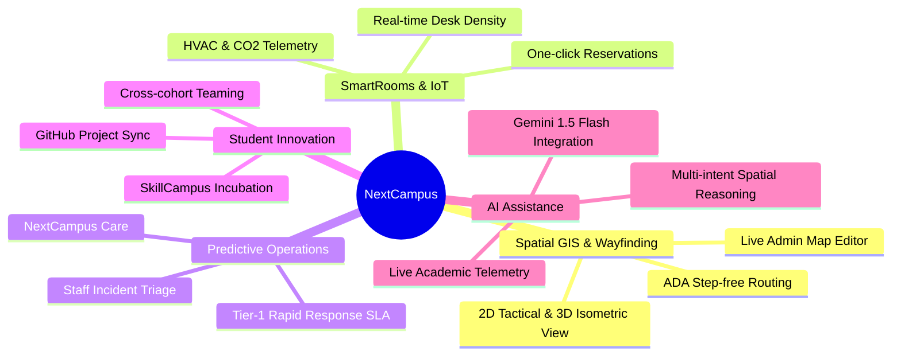

# About NextCampus

> **Document:** `docs/ABOUT.md`  
> **Last Reviewed:** 2026-10-10  
> **Project Status:** Production Ready / Master Audit Passed

---

## 1. Project Identity & Mission

**NextCampus** is an advanced smart campus operations and student experience platform designed for premier universities, research institutions, and higher education academies.

* **Tagline:** *"The Next Generation of Smart Campuses."*
* **Core Philosophy:** Unifying disparate academic micro-systems—GIS wayfinding, classroom IoT telemetry, facility incident triage, microgrid sustainability, peer project incubation, and generative AI copilot assistance—into a cohesive, low-latency, privacy-first interface.
* **Origin:** Developed as a comprehensive solution for the MU Hackathon 2026 and evolved into an institutional-grade platform modeled on the spatial and operational topology of modern campuses.

---

## 2. Institutional Background

Traditional higher education campuses suffer from fragmented digital experiences:
1. **Siloed Systems**: Timetabling sits in an isolated ERP; facility maintenance sits in an archaic ticketing portal; wayfinding requires third-party consumer maps without indoor accuracy.
2. **Inaccessible Physical Spaces**: Students with mobility requirements lack real-time information regarding step-free access, elevators, and covered skybridges.
3. **Reactive Facilities Maintenance**: Classroom equipment glitches (e.g., failed HDMI transmitters, broken projectors, HVAC fluctuations) go unnoticed until faculty or students file cumbersome paper or portal tickets.
4. **Underutilized Student Talent**: Students lack an internal institutional marketplace to find cross-disciplinary collaborators for hackathons, capstone projects, and research papers.

NextCampus resolves these challenges by introducing a **Single Pane of Glass** for students, faculty, facility managers, and university leadership.

---

## 3. Brand Identity & Aesthetic Values

NextCampus follows the **Google Stitch Design Language**, rejecting generic enterprise blue palettes in favor of a curated 5-color dark-licorice palette designed for visual comfort, long reading sessions, and focus:

| Color Token | Hex Value | Psychological Role |
| :--- | :--- | :--- |
| **Licorice** | `#191516` | Grounded, calm canvas base minimizing OLED power consumption and eye fatigue |
| **Raisin Black** | `#382E31` | Subtle surface elevation, giving depth to cards and toolbars |
| **Amaranth Purple** | `#AC274F` | Purposeful, high-energy primary accent for active navigation and CTAs |
| **Blush** | `#EB638B` | Engaging secondary highlight, hover focus, and active spatial pins |
| **Misty Rose** | `#FFD9DA` | Gentle, legible contrast for typography, subtitles, and status pills |

---

## 4. Key Architectural Pillars

---

## 5. Target Stakeholders

1. **Undergraduate & Postgraduate Students**: Navigate campus, discover quiet study pods, view personalized timetables, lodge equipment maintenance tickets, find hackathon teammates, and interact with the AI campus copilot.
2. **Faculty & Department Staff**: Inspect classroom equipment status before lectures, broadcast room availability, and publish office consultation hours.
3. **Facilities & Maintenance Operations (Care Staff)**: Triage incident reports, maintain SLA timelines (<45 min for active learning spaces), order replacement parts, and record internal engineering notes.
4. **Campus Leadership & Administrators**: Oversee building footprints, floor allocation schemas, energy consumption metrics, and campus security policies.

---

## 6. Related Documentation
* [PROJECT_OVERVIEW.md](PROJECT_OVERVIEW.md) — Problem statement, solution architecture, and persona analysis.
* [DESIGN_SYSTEM.md](DESIGN_SYSTEM.md) — Comprehensive visual guidelines and tokens.
* [ROADMAP.md](ROADMAP.md) — Evolutionary phases from Phase 1 through production release.
