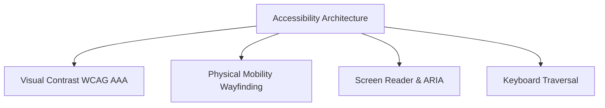

# Accessibility & Universal Design Specification

> **Document:** `docs/ACCESSIBILITY.md`  
> **Last Reviewed:** 2026-10-10  
> **Compliance:** WCAG 2.1 Level AA & Selected Level AAA Standards

---

## 1. Accessibility Foundations

NextCampus is designed as a mission-critical higher education utility, ensuring equitable access for students with visual, auditory, motor, or cognitive impairments.

---

## 2. Color Contrast Ratios (WCAG 2.1)

All text-to-background combinations were audited against the base canvas Licorice (`#191516`):

| Color Foreground | Canvas Background | Calculated Contrast | WCAG Rating |
| :--- | :--- | :---: | :---: |
| **Pure White** (`#FFFFFF`) | `#191516` | **16.8 : 1** | **AAA** (Exceeds 7:1) |
| **Misty Rose** (`#FFD9DA`) | `#191516` | **14.1 : 1** | **AAA** (Exceeds 7:1) |
| **Blush** (`#EB638B`) | `#191516` | **8.2 : 1** | **AAA** (Exceeds 7:1) |
| **Amaranth Purple** (`#AC274F`) | `#191516` | **4.8 : 1** | **AA** (Large text & UI components) |

---

## 3. Physical Accessibility in Campus Wayfinding

* **Step-Free / ADA Mobility Mode**: The wayfinding engine on `/campus-map` includes a dedicated step-free mode routing exclusively across paved ramps, automatic doors, and elevators, avoiding stairs and outdoor curbs.
* **Building Accessibility Badges**: Every building side drawer indicates elevator banks, tactile paving paths, and Braille signage.

---

## 4. Keyboard Navigation & Assistive Technology

* **Focus Rings**: All interactive buttons, tabs, and form controls feature high-visibility focus outlines (`2px solid #FFD9DA`).
* **ARIA Semantic Tags**:
  - Modal overlays include `role="dialog"` and `aria-modal="true"`.
  - Icon-only action buttons specify explicit `aria-label` or `title` attributes.
  - Form validation errors associate directly with input fields.
* **Reduce Motion Support**: Configured in user profile settings (`preferences.accessibility.reduceMotion`).

---

## 5. Related Documentation
* [DESIGN_SYSTEM.md](DESIGN_SYSTEM.md) — Master color and typography tokens.
* [RESPONSIVE_DESIGN.md](RESPONSIVE_DESIGN.md) — Touch target guidelines.
