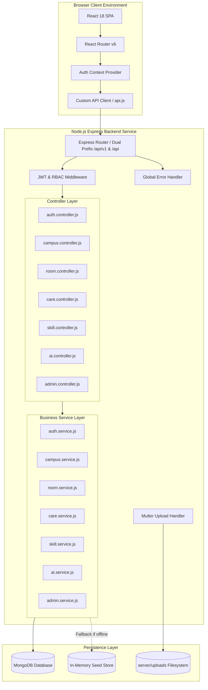

# Systems Architecture

> **Document:** `docs/ARCHITECTURE.md`  
> **Last Reviewed:** 2026-10-10  
> **Scope:** High-Level Technical Architecture, Layered Boundaries, and Concurrency Model

---

## 1. Architectural Philosophy

NextCampus utilizes a decoupled, modern three-tier web architecture:
1. **Presentation Layer (SPA)**: React 18 functional components compiled via Vite 5, utilizing client-side routing and reactive state.
2. **Application & API Gateway Layer**: Express 4 REST microservice operating in a non-blocking Node.js event loop, providing request validation, role isolation, and business logic processing.
3. **Data Layer**: MongoDB document database modeled with Mongoose schemas, supplemented by an in-memory transactional fallback store for test decoupling and offline resilience.

---

## 2. High-Level Component Diagram

---

## 3. Layered Responsibilities & Boundaries

### Presentation Layer (`src/`)
* **Strict Separation of Concerns**: Pages (`src/pages`) represent full route views; common components (`src/components/common`) encapsulate reusable UI primitives; layout components (`src/components/layout`) handle the application frame.
* **Declarative API Client**: All network communication is abstracted through `src/services/api.js`. UI components never invoke raw `fetch()` directly, ensuring centralized token injection, error handling, and proxy fallbacks.
* **Client-Side Role Guards**: `AppLayout.jsx` intercepts unauthorized page transitions, keeping administrative interfaces inaccessible to student tokens.

### Middleware & Routing Layer (`server/routes/` & `server/middleware/`)
* **Dual Endpoint Mounting**: Express mounts all feature routers on both `/api/v1` and `/api` prefixes, preventing legacy path breakages.
* **Role-Based Guards**: `authenticateUser` parses and verifies JWT headers; `authorizeRoles('admin', 'staff')` strictly blocks unauthorized actors with HTTP 403 Forbidden.
* **File Upload Filtering**: `upload.js` enforces a 10MB file limit and accepts image mime types (`image/jpeg`, `image/png`, `image/webp`).
* **Error Sanitization**: `errorHandler.js` intercepts uncaught exceptions, strips database stack traces in production, and standardizes error JSON structures.

### Business Logic & Service Layer (`server/services/`)
* **Decoupled from HTTP**: Services receive pure JavaScript payloads and return data objects. They never interact directly with `req` or `res`, enabling unit tests to invoke business logic without mocking Express objects.
* **Dual-Persistence Failover**: Every service method checks `mongoose.connection.readyState === 1`. If MongoDB is connected, operations execute via Mongoose models; if offline, operations seamlessly execute against the pre-seeded in-memory store.

### Data Layer (`server/models/`)
* **Schema Validation**: Mongoose enforces required fields, string trimming, unique indexes (`email`, `code`, `ticketId`, `roomNumber`), and enum constraints (`status`, `category`, `priority`, `role`).
* **Data Privacy**: Passwords are flagged with `select: false` to prevent accidental leakage in user queries.

---

## 4. Concurrency & Process Model

* In development, `concurrently` executes both the Express server (via `nodemon`) and the Vite dev server simultaneously via `npm run dev`.
* Express listens on port 5000; Vite serves on port 3000 and proxies `/api` and `/api/v1` to `http://localhost:5000`.
* In production, the built static client (`dist/`) can be served directly by Nginx or Express, while Node.js handles API requests behind a reverse proxy.

---

## 5. Related Documentation
* [TECH_STACK.md](TECH_STACK.md) — Exhaustive inventory of dependencies.
* [DATA_FLOW.md](DATA_FLOW.md) — Sequence diagrams of operational workflows.
* [DATABASE.md](DATABASE.md) — Database schema specifications.
