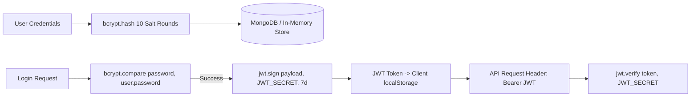

# Authentication & Identity Architecture

> **Document:** `docs/AUTHENTICATION.md`  
> **Last Reviewed:** 2026-10-10  
> **Scope:** JWT Tokens, Password Hashing, Session Lifecycles, and Seed Credentials

---

## 1. Authentication Specifications

NextCampus implements stateless token-based authentication using **JSON Web Tokens (JWT)** and **bcryptjs**:



---

## 2. Token Format & Payload Claims

Signed using `HS256` with `JWT_SECRET` (default: `'nextcampus_dev_secret_key_2026'`) and expiring in 7 days (`JWT_EXPIRES_IN=7d`).

```json
{
  "id": "usr_student_01",
  "role": "student",
  "email": "rakesh@nextcampus.edu",
  "iat": 1791608318,
  "exp": 1792213118
}
```

---

## 3. Seed Testing Credentials

The system provides pre-seeded accounts with verified bcrypt hashes for offline and development testing:

| Role | Email / Identifier | Password | Student / Staff ID | Primary Landing Route |
| :--- | :--- | :--- | :--- | :--- |
| **Student** | `rakesh@nextcampus.edu` | `password123` | `MUR2502101` | `/dashboard` |
| **Administrator** | `admin@nextcampus.edu` | `adminpassword123` | `ADM-001` | `/admin` |

---

## 4. Password Security Standards

1. **Hashing**: Passwords are never stored in plaintext. They are salted and hashed using `bcrypt.genSalt(10)` and `bcrypt.hash(password, salt)`.
2. **Schema Masking**: In `server/models/User.js`, `password: { type: String, required: true, select: false }`. Normal database queries never include the password hash unless explicitly selected with `.select('+password')`.
3. **Password Rotation**: `PUT /api/v1/auth/change-password` requires verification of the current password before writing a new bcrypt hash.

---

## 5. Related Documentation
* [AUTHORIZATION.md](AUTHORIZATION.md) — Role-based access rules.
* [SECURITY.md](SECURITY.md) — Threat modeling.
