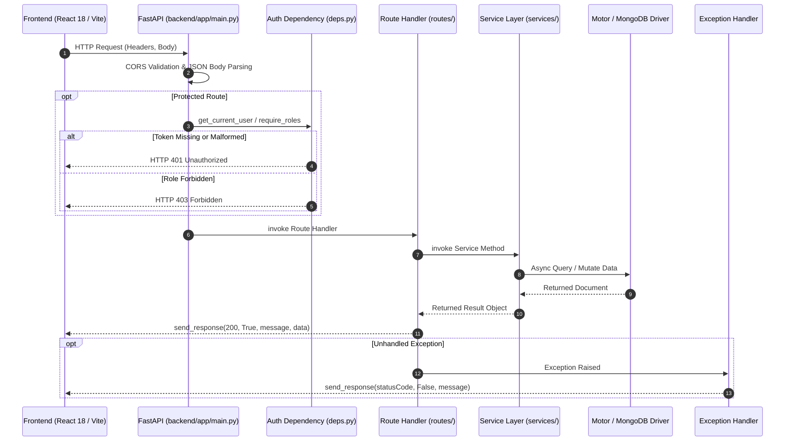

# Backend Architecture & Service Layer (Python FastAPI)

> **Document:** `docs/BACKEND.md`  
> **Last Reviewed:** 2026-10-10  
> **Scope:** FastAPI Application, Services, Motor MongoDB Integration, Middleware, and Upload Pipeline

---

## 1. Backend Overview

The NextCampus backend is powered by a high-performance **Python 3.11+ / FastAPI** ASGI microservice layered cleanly into routers, services, schemas, and persistence adapters:

```text
backend/
├── app/
│   ├── main.py                   # Application bootstrap, CORS, JSON parsing, dual route mounting
│   ├── core/
│   │   ├── config.py             # Pydantic Settings & environment variable validation
│   │   ├── security.py           # Bcrypt password hashing & PyJWT token utilities
│   │   └── logging.py            # Standard structured logging configuration
│   ├── db/
│   │   ├── connection.py         # Motor async MongoDB client & lifecycle management
│   │   └── seed_data.py          # Canonical pre-seeded campus records & test fixtures
│   ├── schemas/                  # Typed Pydantic request and response schemas
│   ├── services/                 # Core domain business logic with dual DB/in-memory failover
│   ├── api/
│   │   ├── deps.py               # Authentication and RBAC dependencies
│   │   ├── router.py             # Unified router
│   │   └── routes/               # Domain endpoints (auth, campus, room, care, skill, ai, etc.)
│   └── utils/
│       └── helpers.py            # Standardized API response envelopes & BSON serializers
├── tests/
│   ├── conftest.py               # PyTest client & session lifecycle fixtures
│   └── test_all_workflows.py     # Comprehensive automated test suite
├── requirements.txt              # Pinned Python package dependencies
├── .env.example                  # Template configuration file
└── README.md                     # Dedicated backend documentation
```

---

## 2. Request Lifecycle Pipeline



---

## 3. Dual Endpoint Mounting (`backend/app/main.py`)

To ensure complete backward compatibility with existing frontend builds and dev proxies, all endpoints are mounted symmetrically on both `/api/v1` and `/api`:

```python
# backend/app/main.py
app.include_router(create_api_router(), prefix="/api/v1")
app.include_router(create_api_router(), prefix="/api")
```

---

## 4. Standard Response Envelope

All API responses follow the standard NextCampus JSON envelope:

```json
{
  "success": true,
  "message": "User logged in successfully",
  "data": { ... },
  "meta": null,
  "timestamp": "2026-10-10T06:30:00.000Z"
}
```

---

## 5. Development & Run Commands

```bash
# Start FastAPI backend
./backend/.venv/bin/uvicorn backend.app.main:app --reload --host 127.0.0.1 --port 5000

# Run automated tests
PYTHONPATH=. ./backend/.venv/bin/pytest backend/tests -v
```

---

## 6. Related Documentation
* [API_REFERENCE.md](API_REFERENCE.md) — Comprehensive endpoint catalogue.
* [DATABASE.md](DATABASE.md) — MongoDB schema and persistence design.
* [ARCHITECTURE.md](ARCHITECTURE.md) — High-level system architecture.
