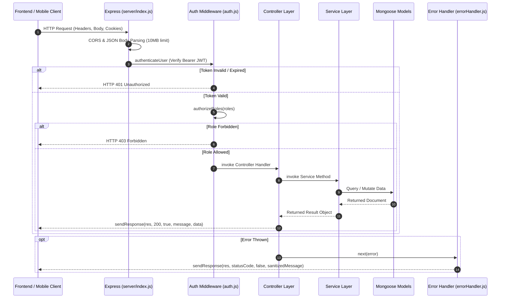

# Backend Architecture & Service Layer

> **Document:** `docs/BACKEND.md`  
> **Last Reviewed:** 2026-10-10  
> **Scope:** Express 4 Server, Controllers, Services, Middleware, and Upload Pipeline

---

## 1. Backend Overview

The NextCampus backend is a modular Node.js/Express service built on a layered architecture:

```text
server/
├── index.js                  # Application bootstrap, CORS, JSON parsing, route mounting
├── config/
│   └── db.js                 # Mongoose connection with resilient error handling
├── controllers/              # HTTP Request/Response translation layer
├── middleware/               # Express middleware (auth, errorHandler, upload, validation)
├── models/                   # Mongoose schemas & data models
├── routes/                   # REST route definitions
├── services/                 # Core business logic with dual DB/in-memory failover
├── uploads/                  # Multipart image attachment storage
└── utils/
    └── helpers.js            # Standardized API response wrappers & JWT utilities
```

---

## 2. Request Lifecycle Pipeline



---

## 3. Dual Endpoint Mounting (`server/index.js`)

To ensure complete interoperability across development proxies and direct API calls, all route modules are mounted symmetrically on both `/api/v1` and `/api`:

```javascript
// server/index.js
const mountApiEndpoints = (prefix) => {
  app.use(`${prefix}/auth`, authRoutes);
  app.use(`${prefix}/campus`, campusRoutes);
  app.use(`${prefix}/smartrooms`, roomRoutes);
  app.use(`${prefix}/rooms`, roomRoutes);
  app.use(`${prefix}/care`, careRoutes);
  app.use(`${prefix}/skillcampus`, skillRoutes);
  app.use(`${prefix}/sustainability`, sustainabilityRoutes);
  app.use(`${prefix}/ai`, aiRoutes);
  app.use(`${prefix}/admin`, adminRoutes);
};

mountApiEndpoints('/api/v1');
mountApiEndpoints('/api');
```

---

## 4. Standard Response Envelope (`server/utils/helpers.js`)

All responses are packaged into a standardized JSON envelope:

```json
{
  "success": true,
  "message": "User logged in successfully",
  "data": { ... },
  "meta": null,
  "timestamp": "2026-10-10T05:00:00.000Z"
}
```

---

## 5. Related Documentation
* [API_REFERENCE.md](API_REFERENCE.md) — Comprehensive endpoint catalogue.
* [DATABASE.md](DATABASE.md) — Data models and fallback stores.
* [ERROR_HANDLING.md](ERROR_HANDLING.md) — Error handler middleware details.
