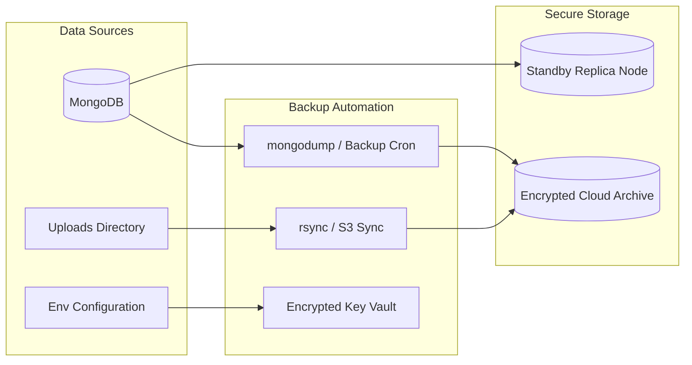

# Backup and Disaster Recovery Strategy

*Last Reviewed: October 2026*

This document defines the backup procedures, disaster recovery protocols, and data restoration workflows for the **NextCampus** platform.

---

## 1. Resilience Overview

NextCampus stores operational data across three distinct domains:
1. **Database Tier**: MongoDB collections (users, facilities, rooms, complaints, projects, eco-telemetry).
2. **File Storage Tier**: Uploaded media in `server/uploads/` (profile avatars, complaint photos).
3. **Configuration & Secrets**: Environment variables in `.env` and Docker container runtime settings.



---

## 2. MongoDB Backup Procedures

### 2.1 Automated Logical Backups (`mongodump`)
Logical backups should be scheduled every 6 hours in production environments.

#### Manual Dump Command:
```bash
# Dump the nextcampus database to a compressed archive
mongodump --uri="mongodb://localhost:27017/nextcampus" --archive="./backups/nextcampus_$(date +%Y%m%d_%H%M%S).gz" --gzip
```

#### Automated Daily Backup Script (`backup_db.sh`):
```bash
#!/bin/bash
BACKUP_DIR="/var/backups/nextcampus"
TIMESTAMP=$(date +"%Y%m%d_%H%M%S")
ARCHIVE_NAME="nextcampus_${TIMESTAMP}.gz"

mkdir -p "$BACKUP_DIR"

# Execute compressed backup
mongodump --uri="${MONGODB_URI:-mongodb://localhost:27017/nextcampus}" \
          --archive="${BACKUP_DIR}/${ARCHIVE_NAME}" \
          --gzip

# Retain only last 14 days of backups
find "$BACKUP_DIR" -type f -name "*.gz" -mtime +14 -exec rm {} \;

echo "[BACKUP] Completed backup: ${ARCHIVE_NAME}"
```

### 2.2 Point-in-Time Recovery with Replica Sets (Oplog)
For high-availability clusters using MongoDB Atlas or self-hosted replica sets, ensure continuous oplog backup is enabled. This allows rolling back or restoring to an exact microsecond prior to an incident.

---

## 3. Uploaded Media Backup Procedures

The `server/uploads/` directory contains student profile pictures and maintenance evidence attachments.

### 3.1 Local Archive
```bash
tar -czvf /var/backups/nextcampus_uploads_$(date +%Y%m%d).tar.gz ./server/uploads
```

### 3.2 Offsite Object Storage Sync
```bash
# Synchronize uploads to AWS S3 bucket
aws s3 sync ./server/uploads s3://nextcampus-production-backups/uploads/ --delete
```

---

## 4. Disaster Recovery & Restoration Procedures

### 4.1 Database Restoration from Archive
To restore a corrupted or empty database from a `.gz` archive:

```bash
# Step 1: Drop or clean the existing database (Caution: Irreversible)
mongosh mongodb://localhost:27017/nextcampus --eval "db.dropDatabase()"

# Step 2: Restore from archive
mongorestore --uri="mongodb://localhost:27017/nextcampus" \
             --archive="./backups/nextcampus_20261010_000000.gz" \
             --gzip --drop
```

### 4.2 Restoring Seed Data from Clean State
If a development or staging server needs an immediate fresh start:
```bash
# Clean database and run automated seeder
node server/seed.js
```

### 4.3 Media Restoration
```bash
# Extract archived uploads
tar -xzvf /var/backups/nextcampus_uploads_20261010.tar.gz -C ./
```

---

## 5. Recovery Time Objective (RTO) & Recovery Point Objective (RPO)

| Metric | Target | Description |
| :--- | :--- | :--- |
| **RPO (Recovery Point Objective)** | < 6 Hours | Maximum acceptable data loss window. Ensured by 6-hour automated snapshot backups. |
| **RTO (Recovery Time Objective)** | < 30 Minutes | Maximum downtime duration required to spin up a replacement node and restore data. |

---

## 6. Cold Start Verification Checklist

Following a disaster recovery restoration, verify system health using:
1. Verify database connectivity: Check terminal log for `[DB] Connected successfully to MongoDB`.
2. Run automated verification suite:
   ```bash
   npm test
   ```
3. Test primary workflows:
   - Login as student: `student@nextcampus.edu` / `student123`.
   - Submit a test complaint on `/complaints`.
   - Inspect facilities on `/campus-map` and `/directory`.
   - Verify SmartRoom telemetry on `/smartroom`.

---

## 7. Related Documentation
- [Database](file:///run/media/rudra/534a134c-69cb-49e5-9a9c-284e9ad8ee1b/NextCampus/docs/DATABASE.md)
- [Deployment](file:///run/media/rudra/534a134c-69cb-49e5-9a9c-284e9ad8ee1b/NextCampus/docs/DEPLOYMENT.md)
- [Troubleshooting Guide](file:///run/media/rudra/534a134c-69cb-49e5-9a9c-284e9ad8ee1b/NextCampus/docs/TROUBLESHOOTING.md)
