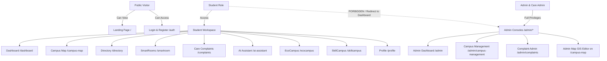
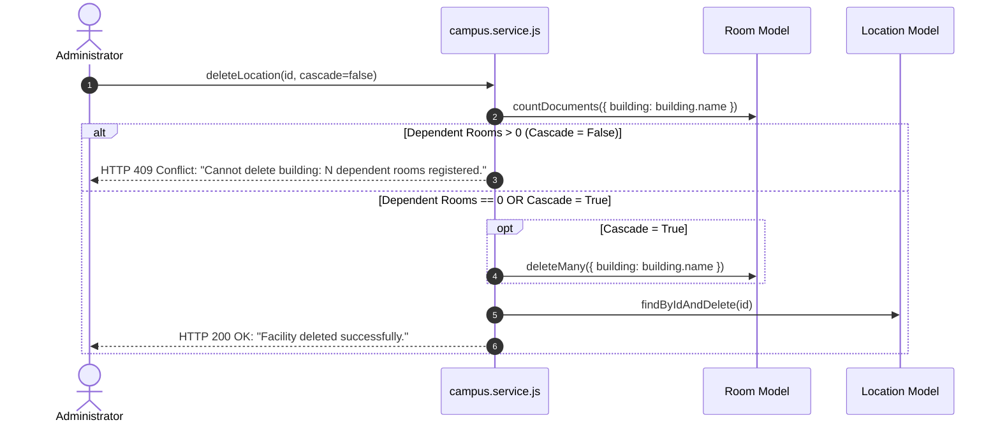

# Business Logic & Rules Engine

> **Document:** `docs/BUSINESS_LOGIC.md`  
> **Last Reviewed:** 2026-10-10  
> **Scope:** Institutional Rules, SLA Algorithms, Safe Cascading, and Access Control Policies

---

## 1. Role-Based Access Control (RBAC) Rules

The NextCampus permission system strictly categorizes user privileges across four tiers:

### Self-Registration Privilege Enforcement
* In `server/services/auth.service.js` (`registerUser`), any incoming `role` parameter in the registration payload is discarded and overwritten with `role: 'student'`.
* Administrative accounts (`usr_admin_01`, `admin@nextcampus.edu`) can only be provisioned through seed scripts or administrative database management.

---

## 2. NextCampus Care SLA Rules Engine

### 1. Tier-1 Rapid Response SLA (<45 min)
* **Trigger**: A complaint logged in an active academic learning facility (e.g., Alan Turing Hall B-204, Lecture Theatres, Science Prototyping Labs) with category `av`, `electrical`, or priority `high`/`critical`.
* **Action**: System automatically tags the ticket with `slaHours: 0.75` (45 minutes) and prioritizes it on the administrator triage queue.

### 2. Standard Facility SLA (24–48 hours)
* **Trigger**: General maintenance items (cleanliness, furniture adjustment, minor aesthetic repairs).
* **Action**: Assigned a standard 24–48 hour turnaround window.

### 3. Dual-Note Information Barrier
* **Internal Notes (`internalNotes`)**: Reserved for engineering observations (e.g., *“Hardware PCB needs re-flash”*, supplier details, parts cost). Visible only to `admin` and `care_admin`.
* **Public Updates (`updates`)**: Sanitized notices dispatched to students (*“Technician Marcus Vance dispatched with diagnostic tools”*).
* In `care.service.js`, `sanitizeComplaint` purges `internalNotes` unless `includeInternal === true`.

---

## 3. Safe Cascading Deletion Policy (Campus GIS)

To prevent data corruption where rooms or complaints reference non-existent buildings:

---

## 4. SkillCampus Teaming Rules

* **Duplicate Membership Protection**:
  - A student cannot join a project if they are already listed in `currentMembers`.
  - A project creator (`leadStudent`) is automatically recorded as a member and cannot apply to join their own project.
* **Capacity Limit**:
  - `currentMembers.length` cannot exceed `membersNeeded`. If the team is full, status automatically updates to `in_progress`.

---

## 5. Dual API Prefix Normalization Rules

* All routes are mounted symmetrically on both `/api/v1` and `/api` in `server/index.js`.
* `src/services/api.js` ensures that any URL containing `/api` is normalized to include `/v1` if missing, and falls back to same-origin proxy `/api/v1` if browser privacy shields intercept cross-origin localhost ports.

---

## 6. Related Documentation
* [SECURITY.md](SECURITY.md) — Security mechanisms supporting these rules.
* [API_REFERENCE.md](API_REFERENCE.md) — Endpoints enforcing these rules.
* [TESTING.md](TESTING.md) — Automated tests validating business logic.
