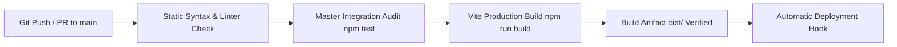

# CI/CD Pipeline & Automated Quality Gates

> **Document:** `docs/CI_CD.md`  
> **Last Reviewed:** 2026-10-10  
> **Scope:** GitHub Actions Workflows, Automated Audit Verification, and Build Gates

---

## 1. Continuous Integration Pipeline Overview



---

## 2. GitHub Actions Workflow Configuration (`.github/workflows/ci.yml`)

```yaml
name: NextCampus Master CI Pipeline

on:
  push:
    branches: [ main ]
  pull_request:
    branches: [ main ]

jobs:
  audit-and-build:
    runs-on: ubuntu-latest

    steps:
      - name: Checkout Codebase
        uses: actions/checkout@v4

      - name: Set up Node.js 20.x
        uses: actions/setup-node@v4
        with:
          node-version: 20
          cache: 'npm'

      - name: Install Dependencies
        run: npm ci

      - name: Execute 10-Phase Master Integration Audit
        run: npm test

      - name: Compile Production Build
        run: npm run build
```

---

## 3. Quality Gate Pass Criteria

1. **Test Gate**: All 10 workflows in `tests/master_audit.test.js` must exit with code `0`.
2. **Build Gate**: `vite build` must compile without unhandled import errors or missing icon declarations.
3. **Secrets Gate**: Commits must be free of real `.env` secrets or production passwords.

---

## 4. Related Documentation
* [TESTING.md](TESTING.md) — Master audit test specifications.
* [GIT_WORKFLOW.md](GIT_WORKFLOW.md) — Commit and branching guidelines.
