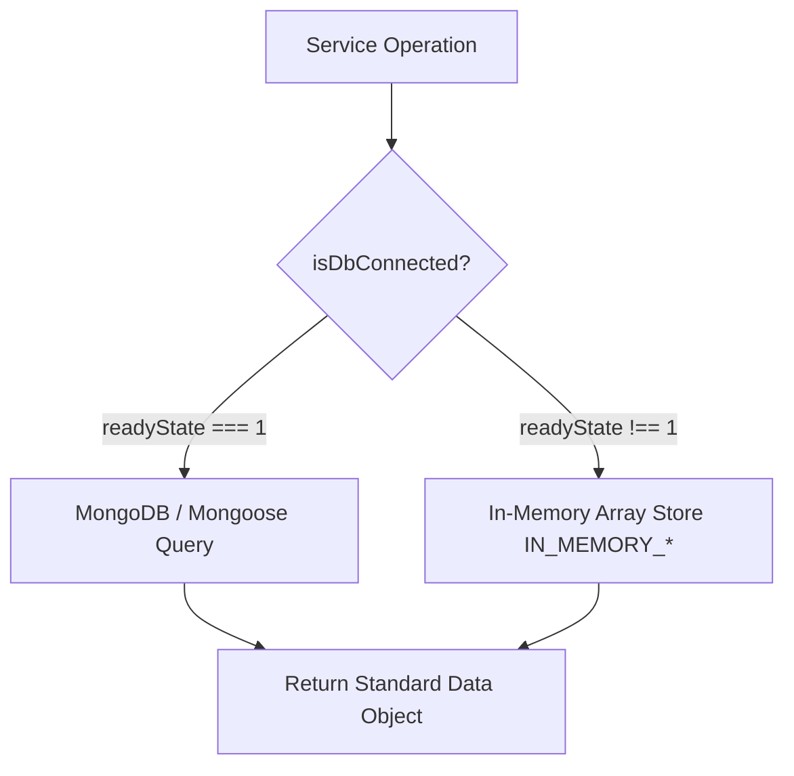

# Database Architecture & Schemas

> **Document:** `docs/DATABASE.md`  
> **Last Reviewed:** 2026-10-10  
> **Engine:** MongoDB 7.0+ (Mongoose 8.3 ODM) with Decoupled In-Memory Fallback

---

## 1. Database Architecture & Dual-Persistence Pattern

NextCampus is designed to work with a live MongoDB database, while providing a decoupled in-memory store if MongoDB is offline or unavailable during automated test suites.

---

## 2. Mongoose Schemas & Models Overview

### 1. `User.js` (`User` Collection)
* **Fields**:
  - `name` (String, required, trim)
  - `preferredName` (String, default: `''`)
  - `email` (String, required, unique, lowercase, trim)
  - `password` (String, required, `select: false`)
  - `role` (String, enum: `['student', 'admin', 'staff', 'care_admin']`, default: `'student'`)
  - `studentId` (String, default: `''`)
  - `department` (String, default: `'Computer Science & Engineering'`)
  - `academicYear` (String, default: `'Class of 2026'`)
  - `semester` (String, default: `'3rd Year • Semester 5'`)
  - `avatar`, `bio`, `phone`, `residence`, `emergencyContact` (Strings)
  - `skills` (`[String]`)
  - `societies` (`[{ name, role, badge }]`)
  - `preferences` (Object: `notifications`, `accessibility`, `privacy`)
* **Timestamps**: Enabled (`createdAt`, `updatedAt`).

### 2. `Complaint.js` (`Complaint` Collection)
* **Fields**:
  - `ticketId` (String, required, unique, e.g. `#NC-9402`)
  - `title` (String, required)
  - `category` (String, enum: `['infrastructure', 'network', 'cleanliness', 'electrical', 'academic', 'av', 'plumbing', 'hvac', 'furniture', 'sanitation', 'other']`)
  - `priority` (String, enum: `['low', 'medium', 'high', 'critical', 'urgent']`)
  - `status` (String, enum: `['open', 'in_progress', 'parts_ordered', 'in_review', 'resolved', 'closed']`)
  - `description`, `location`, `buildingName`, `roomNumber` (Strings)
  - `studentId` (`ObjectId`, ref: `'User'`, required)
  - `assignedTo` (`ObjectId`, ref: `'User'`)
  - `assignedToName` (String)
  - `slaHours` (Number, default: `24`, Tier 1: `0.75`)
  - `attachments` (`[String]`)
  - `updates` (`[{ message, updatedBy, createdAt }]`)
  - `internalNotes` (`[{ note, author, authorName, createdAt }]`)

### 3. `Room.js` (`Room` Collection)
* **Fields**:
  - `roomNumber` (String, required, unique, e.g. `B-204`)
  - `name` (String)
  - `building` (String, required, e.g. `'Alan Turing Hall'`)
  - `buildingCode` (String, e.g. `'A-01'`)
  - `floor` (String, default: `'Level 2'`)
  - `type` (String, e.g. `'Multi-Media Theatre'`)
  - `capacity` (Number, required)
  - `currentOccupancy` (Number, default: `0`)
  - `temperature` (Number, default: `22`)
  - `lightingStatus` (String, enum: `['on', 'off', 'dimmed']`)
  - `status` (String, enum: `['available', 'occupied', 'reserved', 'maintenance']`)
  - `features` (`[String]`)
  - `timetableRule` (String)
  - `schedule` (`[{ subject, instructor, startTime, endTime }]`)

### 4. `Location.js` (`Location` Collection)
* **Fields**:
  - `name` (String, required)
  - `category` (String, enum: `['academic', 'facility', 'dining', 'hostel', 'sports', 'admin', 'research', 'library', 'cleanroom']`)
  - `code` (String, required, unique, e.g. `'A-01'`)
  - `precinct` (String, default: `'North Quadrangle'`)
  - `totalFloors` (Number, default: `4`)
  - `departments` (`[String]`)
  - `grossFloorArea` (Number, default: `14200`)
  - `cadSchema` (String)
  - `coordinates` (`{ x: Number, y: Number, floor: String }`)
  - `openingHours` (String)
  - `status` (String, enum: `['open', 'restricted', 'closed', 'under_maintenance']`)
  - `image` (String)
  - `floors` (`[{ floorNumber, name, cadVersion, roomsCount }]`)

### 5. `Project.js` (`Project` Collection)
* **Fields**:
  - `title`, `category`, `description` (Strings)
  - `tags` (`[String]`)
  - `status` (enum: `['recruiting', 'in_progress', 'completed']`)
  - `leadStudent` (`ObjectId`, ref: `'User'`, required)
  - `membersNeeded` (Number, default: `3`)
  - `currentMembers` (`[ObjectId]`, ref: `'User'`)
  - `githubRepo` (String)

### 6. `Sustainability.js` (`Sustainability` Collection)
* **Fields**:
  - `metricName` (String)
  - `category` (enum: `['solar', 'water', 'waste', 'carbon']`)
  - `value` (Number), `unit` (String), `trendPercentage` (Number)
  - `status` (enum: `['optimal', 'warning', 'critical']`)
  - `historicalData` (`[{ timestamp, val }]`)

### 7. `Announcement.js` (`Announcement` Collection)
* **Fields**:
  - `title`, `content` (Strings)
  - `category` (enum: `['academic', 'event', 'urgent', 'general']`)
  - `author` (String), `priority` (enum: `['normal', 'high', 'pinned']`)

---

## 3. Related Documentation
* [BUSINESS_LOGIC.md](BUSINESS_LOGIC.md) — Cascading and constraints.
* [BACKUP_AND_RECOVERY.md](BACKUP_AND_RECOVERY.md) — Database backup runbook.
