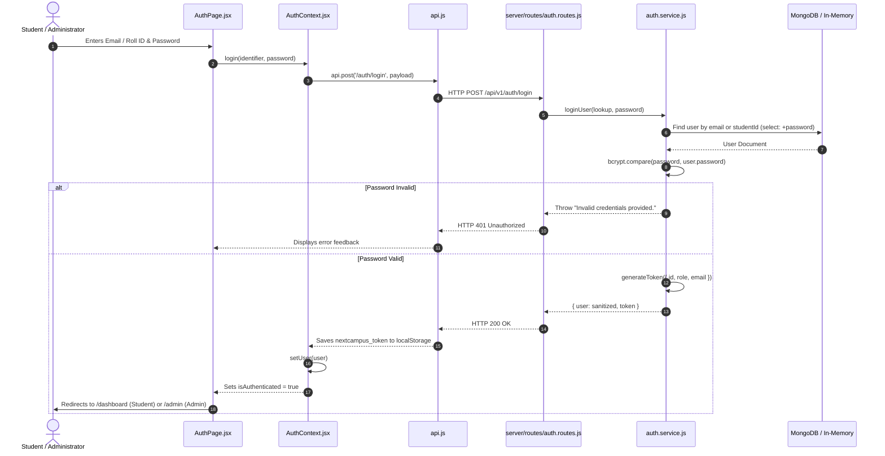
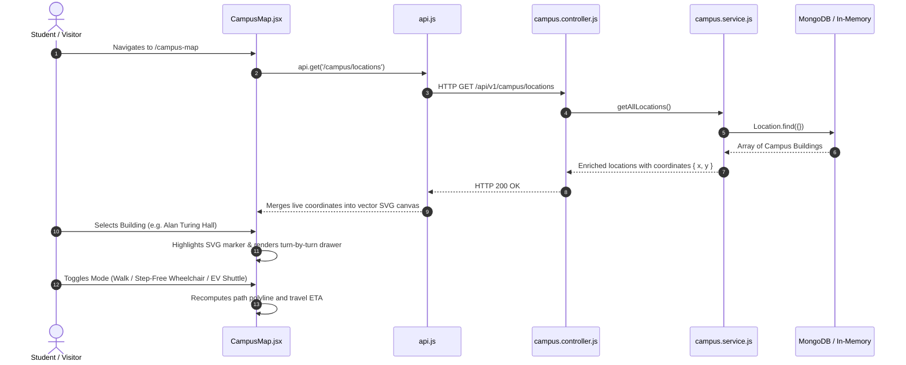
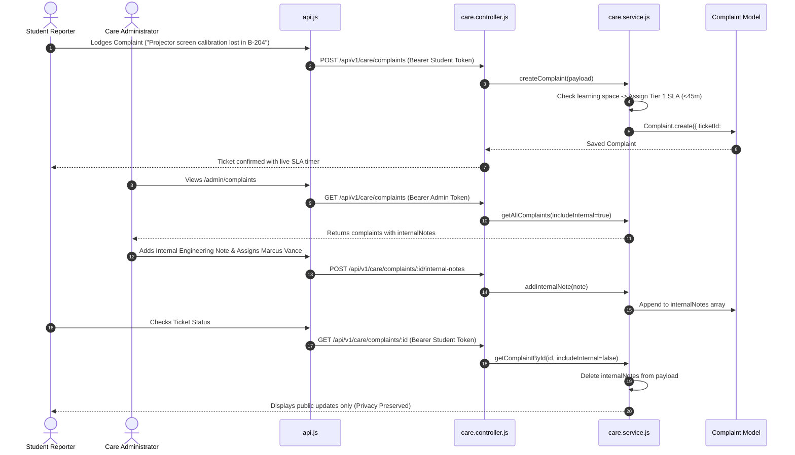
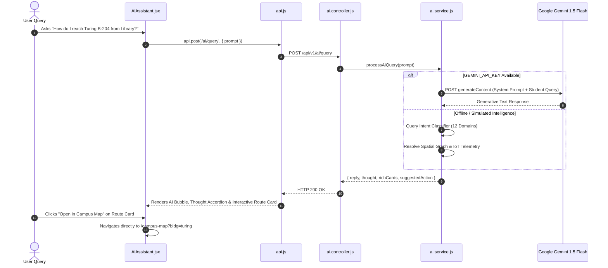

# System Data Flow & Lifecycles

> **Document:** `docs/DATA_FLOW.md`  
> **Last Reviewed:** 2026-10-10  
> **Scope:** End-to-End Sequence Diagrams for Authentication, Wayfinding, IoT Telemetry, and Care Triage

---

## 1. Authentication & Session Initialization Lifecycle

---

## 2. Interactive Campus GIS & Map Wayfinding Flow

---

## 3. Incident Triage & Dual-Note Complaint Lifecycle (NextCampus Care)

---

## 4. AI Assistant Multi-Intent Query Processing

---

## 5. Related Documentation
* [ARCHITECTURE.md](ARCHITECTURE.md) — System layers and boundaries.
* [BUSINESS_LOGIC.md](BUSINESS_LOGIC.md) — Rules governing these lifecycles.
* [API_REFERENCE.md](API_REFERENCE.md) — Endpoints executing these requests.
