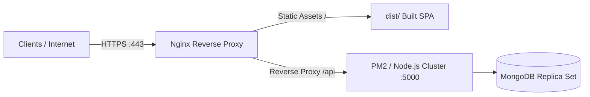

# Production Deployment Runbook

> **Document:** `docs/DEPLOYMENT.md`  
> **Last Reviewed:** 2026-10-10  
> **Scope:** Linux VPS, Docker Containerization, Reverse Proxy, and Process Management

---

## 1. Production Architecture Overview

In a production environment (Linux VPS / Ubuntu 24.04 LTS), NextCampus is deployed behind Nginx:



---

## 2. Linux VPS Deployment Runbook

### Step 1: Build Frontend Assets
```bash
npm install --frozen-lockfile
npm run build
```
This generates production files in `dist/`.

### Step 2: Configure PM2 for Backend Process Management
```bash
npm install -g pm2
pm2 start server/index.js --name "nextcampus-api" -i max
pm2 save
pm2 startup
```

### Step 3: Nginx Reverse Proxy Configuration
```nginx
server {
    listen 80;
    server_name campus.youruniversity.edu;

    root /var/www/nextcampus/dist;
    index index.html;

    # Frontend Single Page App Routing
    location / {
        try_files $uri $uri/ /index.html;
    }

    # Backend API Routing (Dual Prefix)
    location ~ ^/(api|api/v1)/ {
        proxy_pass http://localhost:5000;
        proxy_http_version 1.1;
        proxy_set_header Upgrade $http_upgrade;
        proxy_set_header Connection 'upgrade';
        proxy_set_header Host $host;
        proxy_cache_bypass $http_upgrade;
        proxy_set_header X-Forwarded-For $proxy_add_x_forwarded_for;
        proxy_set_header X-Forwarded-Proto $scheme;
    }

    # Uploads Static Assets
    location /uploads/ {
        alias /var/www/nextcampus/server/uploads/;
        expires 30d;
        add_header Cache-Control "public, no-transform";
    }
}
```

---

## 3. Related Documentation
* [RELEASE_CHECKLIST.md](RELEASE_CHECKLIST.md) — Pre-flight release checks.
* [BACKUP_AND_RECOVERY.md](BACKUP_AND_RECOVERY.md) — Database backup runbooks.
