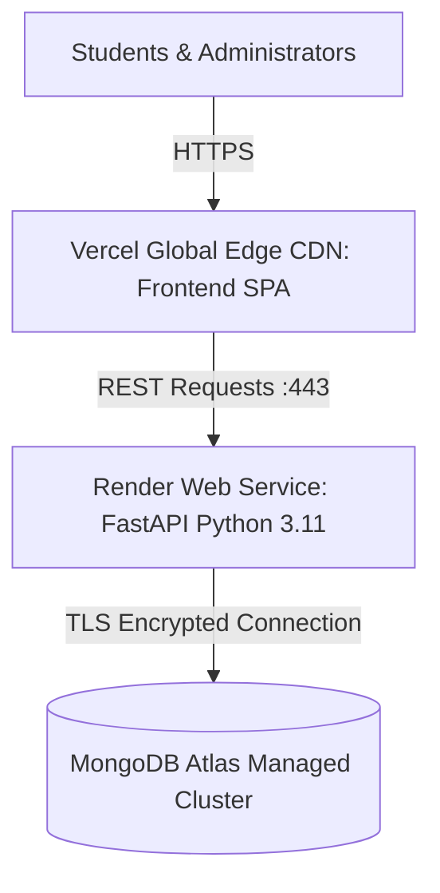

# Production Deployment Runbook

> **Document:** `docs/DEPLOYMENT.md`  
> **Last Reviewed:** 2026-10-11  
> **Scope:** Cloud PaaS (Vercel + Render + MongoDB Atlas) & Linux VPS Containerization

---

## 1. Production Architecture Options



NextCampus supports two distinct deployment tiers:
1. **Cloud PaaS (Vercel + Render + MongoDB Atlas)** *(Recommended for rapid zero-ops deployment)*:
   - Frontend hosted on Vercel with automatic edge CDN caching and branch previews.
   - Backend hosted on Render as a managed Python FastAPI web service.
   - Database hosted on MongoDB Atlas (free M0 tier or dedicated cluster).
2. **Dedicated Linux VPS / Ubuntu Server**:
   - Single-server deployment using Nginx reverse proxy, PM2 or Systemd Uvicorn service, and local MongoDB.

---

## 2. Cloud PaaS Deployment Guide (Vercel + Render + MongoDB Atlas)

### Step 1: Provision MongoDB Atlas Database
1. Go to [MongoDB Atlas](https://www.mongodb.com/cloud/atlas) and create a free shared cluster (`M0 Sandbox`), choosing a cloud provider region closest to your campus (e.g. AWS `ap-south-1` Mumbai).
2. **Security ➔ Database Access**: Create a database user (e.g., `nextcampus_admin`) with password authentication and `readWriteAnyDatabase` privileges.
3. **Security ➔ Network Access**: Click **Add IP Address** and select **Allow Access from Anywhere** (`0.0.0.0/0`), as Render's dynamic free tier uses rotating outbound IP pools.
4. **Connect ➔ Drivers**: Copy the SRV connection URI:
   ```text
   mongodb+srv://nextcampus_admin:<PASSWORD>@cluster0.xxxxx.mongodb.net/nextcampus?retryWrites=true&w=majority
   ```

---

### Step 2: Deploy Backend Web Service on Render
You can deploy using Render's Blueprint (`render.yaml`) or manually:

#### Method A: Using Render Blueprint (`render.yaml`)
1. In Render Dashboard, click **New ➔ Blueprint**.
2. Connect your GitHub repository `pixel-library/NextCampus`.
3. Render reads `render.yaml` and auto-provisions the web service.
4. Fill in the required `MONGODB_URI` environment variable with your Atlas URI.

#### Method B: Manual Web Service Setup
1. In Render Dashboard, click **New ➔ Web Service**.
2. Select your repository `pixel-library/NextCampus`.
3. Configure the service settings:
   - **Name**: `nextcampus-api`
   - **Region**: Oregon or Frankfurt (pick closest to your MongoDB Atlas region)
   - **Branch**: `main`
   - **Runtime**: `Python 3`
   - **Build Command**: `pip install -r backend/requirements.txt`
   - **Start Command**: `uvicorn backend.app.main:app --host 0.0.0.0 --port $PORT`
   - **Instance Type**: `Free`
4. Configure **Environment Variables**:
   - `PYTHON_VERSION`: `3.11.9`
   - `ENVIRONMENT`: `production`
   - `MONGODB_URI`: `mongodb+srv://<user>:<password>@cluster0.xxxxx.mongodb.net/nextcampus?retryWrites=true&w=majority`
   - `JWT_SECRET`: `<Generate a random 64-character secret string>`
   - `CORS_ORIGINS`: `*` (or your Vercel URL once provisioned)
5. Click **Create Web Service**. Once deployed, copy your backend URL:
   `https://nextcampus-api-xxxx.onrender.com`
   Test it via browser: `https://nextcampus-api-xxxx.onrender.com/api/health`.

---

### Step 3: Deploy Frontend SPA on Vercel
1. Go to [Vercel](https://vercel.com/) and click **Add New ➔ Project**.
2. Import the `pixel-library/NextCampus` Git repository.
3. Vercel automatically detects the Vite framework and settings from [`vercel.json`](file:///run/media/rudra/534a134c-69cb-49e5-9a9c-284e9ad8ee1b/NextCampus/vercel.json):
   - **Framework Preset**: `Vite`
   - **Build Command**: `npm run build`
   - **Output Directory**: `dist`
4. Expand **Environment Variables** and add:
   - `VITE_API_URL`: `https://nextcampus-api-xxxx.onrender.com/api/v1`
5. Click **Deploy**.
6. When deployment finishes, your platform is live at `https://your-project.vercel.app`!

---

### Step 4: Keep-Alive for Free Render Instances
On Render's free tier, web services spin down after 15 minutes of inactivity. To ensure zero cold-start delay for campus users:
1. Set up a free monitor at [UptimeRobot](https://uptimerobot.com/) or [cron-job.org](https://cron-job.org/).
2. Point an HTTP check to `https://nextcampus-api-xxxx.onrender.com/api/health` every 10 minutes.

---

## 3. Alternative: Linux VPS / Ubuntu 24.04 Runbook

### Step 1: Build Frontend Assets
```bash
npm install --frozen-lockfile
npm run build
```
This generates production assets in `dist/`.

### Step 2: Configure Systemd for Uvicorn Backend
Create `/etc/systemd/system/nextcampus-api.service`:
```ini
[Unit]
Description=NextCampus FastAPI Backend Service
After=network.target

[Service]
User=www-data
WorkingDirectory=/var/www/nextcampus
ExecStart=/var/www/nextcampus/backend/.venv/bin/uvicorn backend.app.main:app --host 127.0.0.1 --port 5000 --workers 4
Restart=always

[Install]
WantedBy=multi-user.target
```

### Step 3: Nginx Reverse Proxy Configuration
```nginx
server {
    listen 80;
    server_name campus.youruniversity.edu;

    root /var/www/nextcampus/dist;
    index index.html;

    # Frontend Single Page App Routing
    location / {
        try_files $uri $uri/ /index.html;
    }

    # Backend API Routing (Dual Prefix)
    location ~ ^/(api|api/v1)/ {
        proxy_pass http://127.0.0.1:5000;
        proxy_http_version 1.1;
        proxy_set_header Upgrade $http_upgrade;
        proxy_set_header Connection 'upgrade';
        proxy_set_header Host $host;
        proxy_cache_bypass $http_upgrade;
        proxy_set_header X-Forwarded-For $proxy_add_x_forwarded_for;
        proxy_set_header X-Forwarded-Proto $scheme;
    }

    # Uploads Static Assets
    location /uploads/ {
        alias /var/www/nextcampus/server/uploads/;
        expires 30d;
        add_header Cache-Control "public, no-transform";
    }
}
```

---

## 4. Related Documentation
* [RELEASE_CHECKLIST.md](RELEASE_CHECKLIST.md) — Pre-flight release checks.
* [BACKUP_AND_RECOVERY.md](BACKUP_AND_RECOVERY.md) — Database backup runbooks.
* [ENVIRONMENT_VARIABLES.md](ENVIRONMENT_VARIABLES.md) — Environment variables glossary.

