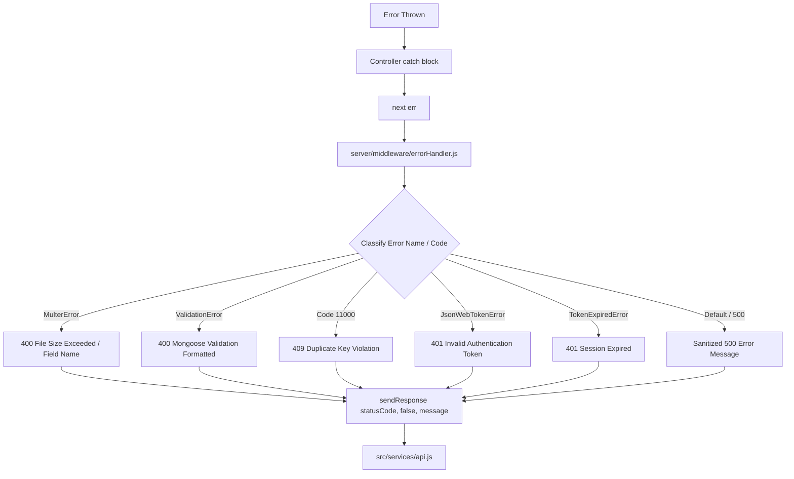

# Error Handling & Resilience Specification

> **Document:** `docs/ERROR_HANDLING.md`  
> **Last Reviewed:** 2026-10-10  
> **Scope:** Global Server Error Middleware, Client Fetch Interception, and Sanitization

---

## 1. Error Handling Architecture

NextCampus employs an end-to-end error sanitization pipeline preventing raw stack traces or internal driver messages from reaching browser clients:

---

## 2. Server Middleware Implementation (`server/middleware/errorHandler.js`)

Key sanitization rules:
1. **Multer Errors**: Transforms code `LIMIT_FILE_SIZE` into `"File upload failed: File size exceeds the permitted 10MB limit."`.
2. **Mongoose Duplicate Keys (Code 11000)**: Formats duplicate index errors into `"Duplicate key violation: A record with this [field] already exists."`.
3. **JWT Expiration**: Formats `TokenExpiredError` into `"Authentication session has expired. Please sign in again."`.
4. **Production Masking**: When `NODE_ENV === 'production'`, internal 500 exceptions mask internal driver messages with `"An unexpected server error occurred. Please contact NextCampus IT Helpdesk."`.

---

## 3. Client-Side Resilience & Proxy Fallback (`src/services/api.js`)

In `src/services/api.js`:
* **Proxy Fallback**: If a direct fetch to `http://localhost:5000` is blocked by browser loopback shielding (e.g., Brave Shields), it automatically catches the `TypeError` and transparently retries via `/api/v1` through the Vite same-origin proxy.
* **Non-JSON Handling**: If a 502/504 gateway returns an HTML error page, `data` falls back to `{}` safely, avoiding uncaught `SyntaxError: Unexpected token <`.
* **Descriptive Messages**: Extracts `data.message || data.errors` to show specific error text (e.g. *"Invalid credentials provided"*) rather than generic failures.

---

## 4. Related Documentation
* [BACKEND.md](BACKEND.md) — Backend middleware pipeline.
* [DEBUGGING.md](DEBUGGING.md) — Diagnosing system exceptions.
