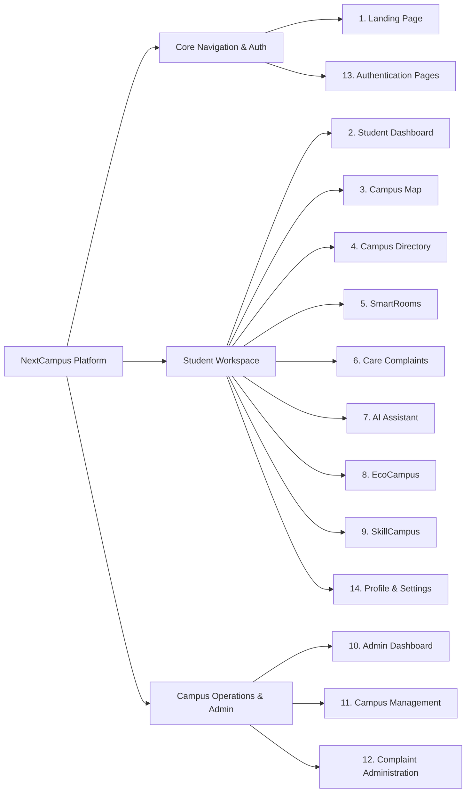

# Platform Feature Catalog

> **Document:** `docs/FEATURES.md`  
> **Last Reviewed:** 2026-10-10  
> **Catalog Scope:** Full Functional Feature Inventory Across All 14 Modules

---

## 1. Feature Matrix by Module

---

## 2. Detailed Module Catalog

### 1. Platform Landing Page (`/`)
* **Public Showcase**: High-impact hero section with ambient glow and authentic institutional imagery.
* **Campus Preview & Node Inspection**: Live interactive preview of Academic Block A, Central Library, Innovation Center, and Student Activity Center.
* **Core Capabilities Carousel**: Highlights IoT spaces, rapid care triage, eco-microgrid telemetry, and skill matching.
* **Dynamic Header Routing**: Guides visitors to Sign In/Registration, and logged-in users directly to their designated workspace (`/dashboard` for students, `/admin` for administrators).

### 2. Student Dashboard (`/dashboard`)
* **Personalized Greeting**: Dynamic name, semester classification, and active node status.
* **Current Lecture HUD**: Real-time card showing active lecture (CS402 Systems Architecture), room number, comfort level (21.8°C), and 1-click navigation.
* **Today's Timeline**: Chronological schedule cards for upcoming lectures and lab workbenches.
* **Embedded AI Assistant**: Instant query box and prompt chips with quick navigation links.
* **Campus Notice Board**: Pinned academic notices and hackathon announcements.

### 3. Interactive Campus Map & GIS Wayfinding (`/campus-map`)
* **Dual-Engine Spatial Canvas**: Full-bleed Leaflet interactive map with custom dark tiles ([`src/components/map/CampusGisMap.jsx`](file:///run/media/rudra/534a134c-69cb-49e5-9a9c-284e9ad8ee1b/NextCampus/src/components/map/CampusGisMap.jsx)) paired with vector schematic overview ([`src/pages/CampusMap.jsx`](file:///run/media/rudra/534a134c-69cb-49e5-9a9c-284e9ad8ee1b/NextCampus/src/pages/CampusMap.jsx)).
* **20 Real Mewar University Locations**: Authentic satellite ground-truth coordinates and OSM polygon footprints (Gate 1, Gate 2, Main Building, Engineering Block, Teacher Building, Badal Hostel, Law Faculty, Basketball Court, Football Arena, Mess, Park, Bhamasha, Sanaga, Kumbha, Pratap, Gora & Hospital, Panna & Mira, Guest House, Central Library, Transport Hub).
* **Multi-Layer Resilient Tile Fallback**: Seamless CartoDB Dark Matter / OSM / Esri fallback eliminating missing tiles during high zoom (zooms 14–20).
* **Topological Road Routing Graph (`MEWAR_CAMPUS_ROADS`)**: Computes shortest pedestrian paths across 17 arterial walkway junctions with turn-by-turn guidance and walking time estimation.
* **Building Detail Drawer**: Slide-out drawer with occupancy, HVAC, air quality, target rooms, and turn-by-turn route breakdown.
* **Admin GIS Editor Mode**: Real-time spatial editing toolbar allowing:
  - Drag-and-drop marker repositioning with 6-decimal precision.
  - Coordinate arrow nudgers (`←`, `↑`, `↓`, `→` in `0.0001°` increments).
  - Facility modal to update names, codes, categories, and coordinates in place.

### 4. Campus Directory (`/directory`)
* **Facility & Department Directory**: Searchable index of campus buildings, schools, faculties, and dean offices.
* **Contact & Office Cards**: Shows faculty email, phone extensions, office locations, and office hours.
* **Map Connection**: Direct link from directory entries to campus wayfinding routes.

### 5. SmartRooms IoT & Capacity (`/smartroom`)
* **Indoor Floor-Plan Explorer**: Visual floor view showing rooms B-201 through B-208.
* **IoT Environmental Sensors**: Live telemetry displaying temperature (21.5°C–22.5°C), ambient lighting, CO₂ ppm, and desk occupancy percentage.
* **Capacity Tracking**: Displays desk pod availability (e.g., 18/60 pods in B-204, 4/16 study pods in Library).
* **Timetable Lock Sync**: Displays smart lock synchronization status tied to university schedules.

### 6. NextCampus Care (Complaint Management) (`/complaints`)
* **One-Click Incident Logging**: Pre-populates location from spatial context or allows custom entry.
* **Tier-1 Rapid Response SLA**: Automatic tagging of critical learning spaces (<45 min turnaround).
* **Category & Priority Triage**: Categories cover AV, electrical, HVAC, plumbing, infrastructure, network, and cleanliness.
* **Live Ticket Tracking**: Real-time timeline of public status updates (Open ➔ In Progress ➔ Resolved).

### 7. NextCampus AI Assistant (`/ai-assistant`)
* **Multi-Intent Intelligence**: Understands 12 campus domains (Routes, SmartRooms, Care, Faculty, Timetable, Eco, Projects, Dining, Shuttles, Admin).
* **Spatial Reasoning Accordion**: Collapsible drawer showing the internal reasoning graph (*"⚡ Graph queried...", "⚡ Telemetry verified..."*).
* **Interactive UI Cards**: Embeds interactive route cards, telemetry cards, and care dispatch cards into conversation bubbles.
* **Live Gemini 1.5 Flash Support**: Seamlessly communicates with Google Gemini API when configured.

### 8. EcoCampus Sustainability (`/ecocampus`)
* **Institutional Green Score**: Grade A- (78%) comprehensive environmental index.
* **Solar Microgrid Metrics**: Daily solar yield (88.8 MWh) generated across 14 rooftop arrays.
* **Waste Diversion Telemetry**: 82% solid waste diversion rate tracked across 48 IoT SmartBins.
* **Net-Zero Carbon Offset**: Building-by-building energy drilldowns.

### 9. SkillCampus Collaboration (`/skillcampus`)
* **Peer Incubation**: Student project cards with title, description, team size, and role openings.
* **Skill Tags**: Filter projects by Python, ROS2, React, Embedded IoT, Computer Vision, and UI/UX.
* **Join Project Workflows**: Validates team capacity and prevents duplicate applications.
* **Create Project Modal**: Intuitive project registration form.

### 10. Admin Dashboard (`/admin`)
* **Campus-Wide Metrics**: Population counters (Students: 4,820, Faculty: 340, Active Rooms: 64).
* **Energy & Operations Health**: Substation loads, open maintenance tickets, and average SLA resolution times.
* **Administrative Navigation**: Direct access to Campus Management and Complaint Admin.

### 11. Campus Management (`/admin/campus-management`)
* **Facility CRUD Operations**: Create, update, and delete campus buildings and facilities.
* **Safe Cascading Deletion**: Detects dependent rooms and prevents accidental orphan deletion without cascade confirmation.
* **Floor & Room Registry**: Manage room numbers, capacities, features, and CAD schemas (Revit IFC4).

### 12. Complaint Administration (`/admin/complaints`)
* **Triage Table**: Searchable, filterable list of all student-submitted complaints.
* **Staff Assignment**: Assign tickets to specialized maintenance leads (Marcus Vance, Tech Operations, etc.).
* **Dual-Note Separation**: Internal engineering notes are strictly hidden from student views while public updates are transmitted.

### 13. Login & Registration (`/auth`)
* **Tabbed Interface**: Seamless toggle between Sign In and New Student Registration.
* **Bcrypt Password Security**: Enforces strong password requirements and hashes with 10 salt rounds.
* **Demo Credentials Quick-Fill**: 1-click helper buttons for testing student and admin accounts.
* **Dual-Endpoint API Client**: Automatic recovery between `/api/v1` and `/api` paths with Brave Shield proxy fallback.

### 14. Student Profile & Settings (`/profile`)
* **Academic Profile Card**: Shows student ID, program, cohort, semester, and society badges.
* **Editable Information**: Update preferred name, phone, residence hall, emergency contacts, and skill tags.
* **Master Password Rotation**: Verify current password and securely rotate to a new password.
* **Accessibility Preferences**: Configures High Contrast, Reduce Motion, Screen Reader, and Text Scale.

---

## 3. Related Documentation
* [MODULES DIRECTORY](modules/LANDING_PAGE.md) — Deep-dive documentation for each individual module.
* [API_REFERENCE.md](API_REFERENCE.md) — Backend endpoints supporting these features.
* [ROADMAP.md](ROADMAP.md) — Future evolution of these features.
