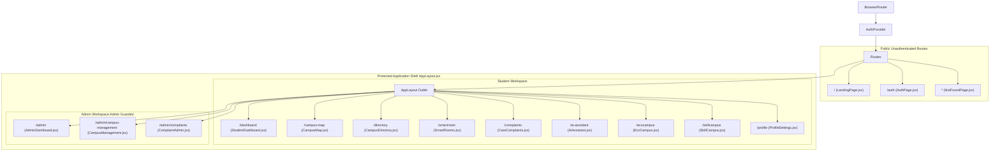

# Frontend Architecture & Technical Specification

> **Document:** `docs/FRONTEND.md`  
> **Last Reviewed:** 2026-10-10  
> **Scope:** React 18 Single-Page Application (SPA), Routing Hierarchy, and Component Layouts

---

## 1. Frontend Architectural Overview

The NextCampus frontend is a high-performance Single Page Application (SPA) built with React 18 and bundled via Vite 5.

```text
src/
├── main.jsx                          # React DOM initialization & global CSS binding
├── App.jsx                           # Top-level Routing Provider & Layout Shell
├── index.css                         # Master CSS Design System tokens & utilities
├── components/
│   ├── common/                       # Reusable UI primitives (Badge, Button, Card, Modal, Input, Logo)
│   └── layout/                       # Structural layouts (AppLayout, Navbar, Sidebar, MobileNav)
├── context/
│   └── AuthContext.jsx               # Global JWT Session & User State Provider
├── hooks/
│   ├── useAuth.js                    # Convenience consumer for AuthContext
│   └── useFetch.js                   # Generic REST data fetcher
├── pages/                            # 14 Full Application Page Shells
├── services/
│   └── api.js                        # Declarative REST API client wrapper
└── utils/                            # Formatting & calculation utilities
```

---

## 2. Routing Hierarchy & Public vs. Private Shells

The routing structure in `src/App.jsx` cleanly isolates public marketing/auth pages from the internal student/admin application frame:



---

## 3. Structural Layout Components (`src/components/layout/`)

### 1. `AppLayout.jsx`
* Wraps all authenticated pages with desktop `Sidebar.jsx`, top `Navbar.jsx`, and mobile bottom navigation `MobileNav.jsx`.
* **Authentication Guard**: Unauthenticated guests visiting any internal route are immediately redirected to `/auth` with the attempted location preserved in `location.state.from`.
* **Administrative Role Guard**: Students attempting to load any route starting with `/admin` are intercepted and redirected to `/dashboard`.

### 2. `Sidebar.jsx`
* Sticky desktop navigation rail (`240px` width) displaying the NextCampus isometric logo.
* Dynamically filters nav groups based on `user.role`:
  - **Admins** see *Administration* (Admin Dashboard, Campus Management, Complaint Admin), *Campus Operations* (Map, SmartRooms, Directory, EcoCampus, AI Assistant), and *Account*.
  - **Students** see *Student Workspace* (Dashboard, Map, Directory, SmartRooms, Care, AI Assistant, EcoCampus, SkillCampus) and *Account*.

### 3. `Navbar.jsx`
* Top horizontal header (`64px` height) with global search trigger, system node status pill, emergency broadcast indicator, and active user profile pill.

### 4. `MobileNav.jsx`
* Sticky bottom mobile navigation drawer (`60px` height) activating on viewports `<768px`.
* Shows quick-access icons: Dashboard/Admin, Map, SmartRooms/Campus, Care, and AI Assistant.

---

## 4. Reusable Common Primitives (`src/components/common/`)

| Component | Props | Purpose |
| :--- | :--- | :--- |
| `Button.jsx` | `variant` (`primary`, `secondary`, `ghost`), `size` (`sm`, `md`, `lg`), `icon`, `disabled`, `loading` | Standardized interactive trigger with blush hover transitions. |
| `Badge.jsx` | `status` (`active`, `pending`, `resolved`, `warning`, `info`), `children` | Status tag pill utilizing calibrated soft contrast backgrounds. |
| `Card.jsx` | `style`, `className`, `children`, `onClick` | Raisin Black (`#382E31`) elevated container with subtle border sheen. |
| `Input.jsx` | `label`, `error`, `icon`, `type`, `value`, `onChange`, `placeholder` | Accessible input field with blush focus ring. |
| `Modal.jsx` | `isOpen`, `onClose`, `title`, `children` | Backdrop-blurred overlay dialog for administrative and creation flows. |
| `Logo.jsx` | `size` (`sm`, `md`, `lg`), `showText` | Isometric geometric "N" brand icon with optional text wordmark. |

---

## 5. Related Documentation
* [ROUTES_AND_PAGES.md](ROUTES_AND_PAGES.md) — Exhaustive routing registry.
* [COMPONENTS.md](COMPONENTS.md) — Detailed common component documentation.
* [DESIGN_SYSTEM.md](DESIGN_SYSTEM.md) — Master color and typography tokens.
