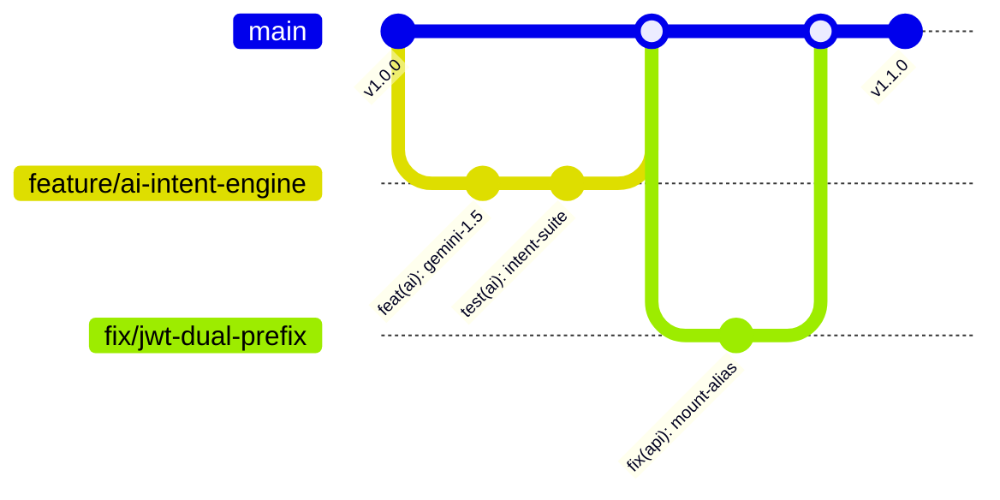

# Git Workflow & Version Control Guidelines

*Last Reviewed: October 2026*

This document defines the branching strategy, commit conventions, pull request lifecycle, code review requirements, and repository maintenance workflows for the **NextCampus** project.

---

## 1. Branching Strategy

NextCampus uses a streamlined **Trunk-Based / GitHub Flow** branching model optimized for continuous integration and multi-agent development.



### Branch Naming Conventions

| Branch Type | Pattern | Example | Purpose |
| :--- | :--- | :--- | :--- |
| **Main** | `main` | `main` | Production-ready trunk. Always deployable and passing tests. |
| **Feature** | `feature/<short-desc>` | `feature/smartroom-hvac-control` | New user-facing or platform features. |
| **Bugfix** | `fix/<short-desc>` | `fix/map-pin-coordinate-offset` | Bug repairs targeting non-critical issues. |
| **Hotfix** | `hotfix/<short-desc>` | `hotfix/auth-token-expiry-crash` | Urgent repairs applied directly to main. |
| **Documentation** | `docs/<short-desc>` | `docs/complete-project-library` | Markdown, schemas, or architectural docs. |
| **Refactor** | `refactor/<short-desc>` | `refactor/api-dual-prefix-cleanup` | Code reorganization without functional changes. |
| **Chore / Test** | `chore/<short-desc>` | `chore/update-vitest-runner` | Dependency upgrades, CI pipeline changes, test additions. |

---

## 2. Commit Message Standards

NextCampus adheres strictly to the **Conventional Commits v1.0.0** specification.

### Format
```text
<type>(<scope>): <short imperative summary>

[optional body explaining rationale and technical context]

[optional footer(s) like Closes #123, Breaking Changes]
```

### Allowed Types

- `feat`: A new feature for the user or API consumer.
- `fix`: A bug fix.
- `docs`: Documentation-only changes.
- `style`: Formatting, missing semicolons, CSS tweaks (no code logic changes).
- `refactor`: A code change that neither fixes a bug nor adds a feature.
- `perf`: A code change that improves performance.
- `test`: Adding missing tests or correcting existing tests.
- `chore`: Changes to build process, package dependencies, auxiliary tools.
- `ci`: Changes to CI/CD scripts or workflows.

### Scope Identifiers
Recommended scopes corresponding to NextCampus architecture:
- `auth`: Authentication and JWT sessions
- `map`: Campus map and GIS coordinates
- `directory`: Faculty and department listings
- `smartroom`: IoT telemetry and indoor floor plans
- `complaints`: Grievance submission and staff triage
- `ai`: AI assistant, Gemini provider, and fallback intent engine
- `eco`: EcoCampus sustainability charts and solar metrics
- `skills`: SkillCampus project marketplace
- `admin`: Administrative dashboard and campus management
- `ui`: Shared UI components and design tokens
- `db`: Database schemas, seeds, or connection handlers
- `api`: Express routing, middleware, and request pipeline

### Examples
```bash
# Feature commit
git commit -m "feat(map): enable admin interactive drag-and-drop marker relocation"

# Fix commit
git commit -m "fix(auth): handle expired JWT tokens gracefully without infinite redirect loop"

# Docs commit
git commit -m "docs: add comprehensive NextCampus project documentation"
```

---

## 3. Local Development Git Lifecycle

### Step 1: Sync Trunk
Before branching, always pull the latest commits from origin:
```bash
git checkout main
git pull origin main
```

### Step 2: Create a Feature Branch
```bash
git checkout -b feature/smartroom-preset-automation
```

### Step 3: Incremental Commits
Commit atomic changes accompanied by passing tests:
```bash
git add src/pages/SmartRoom.jsx
git commit -m "feat(smartroom): add quick-preset buttons for study and presentation modes"
```

### Step 4: Verification Before Pushing
Always run the local verification suite prior to pushing:
```bash
npm test
npm run build
```

### Step 5: Push Branch to Remote
```bash
git push -u origin feature/smartroom-preset-automation
```

---

## 4. Code Review and Pull Request Standards

Every Pull Request (PR) must fulfill the following criteria prior to merging into `main`:

1. **Descriptive Title**: Follows conventional commits (e.g., `feat(smartroom): implement room booking presets`).
2. **PR Template Summary**:
   - **What changes were made?**
   - **Why are they needed?**
   - **Which pages or APIs are impacted?**
   - **How was it tested?** (Include console test output or screenshots).
3. **Automated CI Validation**:
   - `npm test` passes with 0 failures (10/10 test suites pass).
   - `npm run build` generates clean production assets without bundle or syntax errors.
4. **No Secret Commits**:
   - Ensure `.env` or plain-text credentials are never committed.
5. **Clean Merge Strategy**:
   - **Squash and Merge** is preferred for multi-commit feature branches to maintain a clean git history on `main`.
   - **Rebase and Merge** is acceptable for clean linear series.
   - Never use direct merge commits with untracked merge artifacts.

---

## 5. Protected Branches and Release Tags

### `main` Branch Rules
- Direct force pushes (`git push --force`) are strictly prohibited.
- Branch deletion is disabled.
- Merges must pass CI status checks.

### Semantic Versioning and Tags
NextCampus uses **SemVer** (`MAJOR.MINOR.PATCH`):
- `v1.0.0`: Initial release across all 14 modules.
- `v1.1.0`: Introduction of live Gemini AI integration and interactive admin GIS editor.
- `v1.1.1`: Bug fixes and dual-API route compatibility enhancements.

To create a release tag:
```bash
git tag -a v1.1.0 -m "Release v1.1.0: Real-time map editing and Gemini 1.5 Flash AI integration"
git push origin v1.1.0
```

---

## 6. Pre-Commit Verification Checklist

Before pushing any changes:
- [ ] No temporary debug statements (`console.log("here")`, `debugger`).
- [ ] No uncommitted `.env` files or secrets.
- [ ] `npm test` runs and passes completely.
- [ ] `npm run build` succeeds cleanly.
- [ ] Relative Markdown documentation links are valid.

---

## 7. Related Documentation
- [Development Guide](file:///run/media/rudra/534a134c-69cb-49e5-9a9c-284e9ad8ee1b/NextCampus/docs/DEVELOPMENT_GUIDE.md)
- [CI/CD Pipeline](file:///run/media/rudra/534a134c-69cb-49e5-9a9c-284e9ad8ee1b/NextCampus/docs/CI_CD.md)
- [Release Checklist](file:///run/media/rudra/534a134c-69cb-49e5-9a9c-284e9ad8ee1b/NextCampus/docs/RELEASE_CHECKLIST.md)
- [Contributing Guide](file:///run/media/rudra/534a134c-69cb-49e5-9a9c-284e9ad8ee1b/NextCampus/docs/CONTRIBUTING.md)
