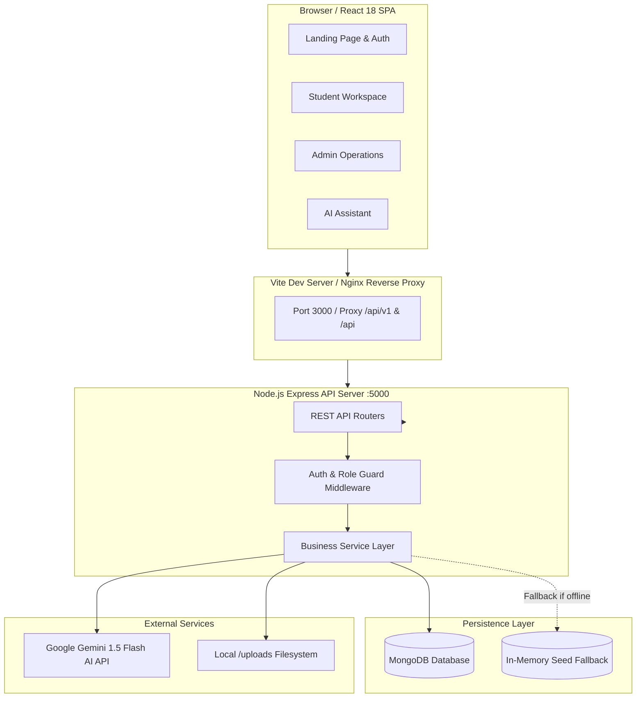

# Project Overview

> **Document:** `docs/PROJECT_OVERVIEW.md`  
> **Last Reviewed:** 2026-10-10  
> **System Scope:** Complete Full-Stack Platform Overview

---

## 1. Executive Summary

**NextCampus** is a single-page application (SPA) backed by a lightweight Node.js/Express REST microservice and MongoDB document repository. It delivers 14 dedicated user-facing and administrative pages designed to orchestrate campus life, physical assets, and academic workflows.

---

## 2. Core Problem & Solution Matrix

| Challenge in Modern Campuses | NextCampus Solution | Primary Module |
| :--- | :--- | :--- |
| First-year students and visitors get lost; standard GPS lacks indoor and skybridge details. | Custom SVG campus map with route calculation (Walk, Step-free Wheelchair, EV Shuttle) and indoor room highlighting. | [Campus Map](modules/CAMPUS_MAP.md) |
| Library and study rooms are crowded; students walk between blocks looking for quiet seats. | IoT desk density monitoring, live CO₂ and temperature readings, and one-tap reservation status. | [SmartRoom](modules/SMARTROOM.md) |
| Classroom hardware (HDMI, lights, AV) breaks and takes days to get fixed without status tracking. | Rapid dispatch ticketing with categorized SLA countdowns (<45 min Tier-1), staff assignments, and update history. | [Complaints](modules/COMPLAINT_MANAGEMENT.md) |
| Siloed departments hinder collaborative hackathon teaming across faculties. | SkillCampus peer incubator with tech tags, team sizes, open roles, and duplicate membership protection. | [SkillCampus](modules/SKILLCAMPUS.md) |
| Campus sustainability efforts are invisible to everyday students. | EcoCampus live dashboard showing solar yields (88.8 MWh), microgrid load, and 48 IoT SmartBin metrics. | [EcoCampus](modules/ECOCAMPUS.md) |
| Campus administrators struggle to update map coordinates and building records. | In-browser Admin Map Mode with click-to-move repositioning, 4-way coordinate nudging, and live GIS sync. | [Campus Management](modules/CAMPUS_MANAGEMENT.md) |

---

## 3. High-Level System Architecture

---

## 4. User Roles & Access Hierarchy

The platform enforces strict Role-Based Access Control (RBAC):

1. **Guest / Public**:
   - Access: `/` (Platform Landing Page), `/auth` (Login & Registration).
   - Behavior: Cannot view internal sidebars or enter workspaces without authenticating.
2. **Student**:
   - Access: `/dashboard`, `/campus-map`, `/directory`, `/smartroom`, `/complaints`, `/ai-assistant`, `/ecocampus`, `/skillcampus`, `/profile`.
   - Restrictions: Blocked from all `/admin/*` routes (automatically redirected to `/dashboard`).
3. **Staff**:
   - Access: Student features + facility maintenance updates, room administration, directory management.
4. **Admin & Care Admin**:
   - Access: Complete system privileges: `/admin` (Admin Overview), `/admin/campus-management` (Facility CRUD), `/admin/complaints` (Complaint assignment & internal notes), and Admin Map Mode on `/campus-map`.

---

## 5. Technology Highlights

* **Frontend**: React 18 with pure JSX functional components, React Router v6 nested layouts, Lucide icons, and zero heavy UI framework overhead.
* **Styling**: Tailored vanilla CSS variables (`src/index.css`) guaranteeing micro-second render times, zero style hydration mismatches, and responsive fluid grids.
* **Backend**: Express 4 REST microservice with modular `routes -> controllers -> services` separation.
* **Dual Routing Compatibility**: Seamlessly supports both `/api/v1/*` and `/api/*` endpoints.
* **Fault-Tolerant Persistence**: Connects to MongoDB when available; seamlessly falls back to pre-seeded memory stores during test execution or offline deployment.

---

## 6. Next Steps & Reading Guide
* Learn about platform requirements in [REQUIREMENTS.md](REQUIREMENTS.md).
* Explore detailed feature breakdowns in [FEATURES.md](FEATURES.md).
* Review implementation details in [PROJECT_STRUCTURE.md](PROJECT_STRUCTURE.md).
