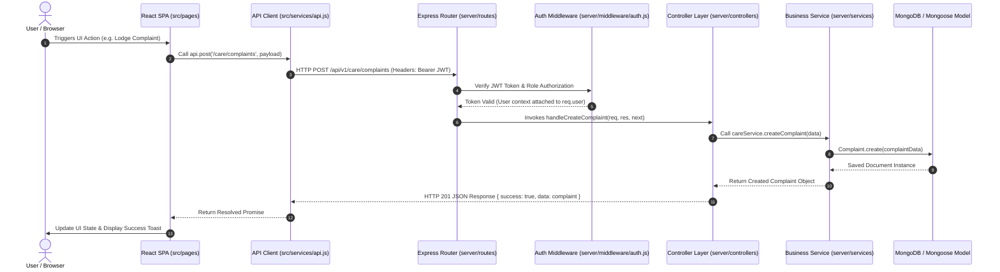

# NextCampus Full-Stack Architectural Specification & Project Structure

## 1. Executive Summary & Design System Alignment

NextCampus is a modern smart campus management platform built with React, Vite, Node.js, Express, and MongoDB. The system strictly adheres to the official NextCampus visual identity and 5-color palette:

* **Canvas Base (Licorice):** `#191516`
* **Surface Container (Raisin Black):** `#382E31`
* **Primary Brand & CTA (Amaranth Purple):** `#AC274F`
* **Secondary Accent & Focus (Blush):** `#EB638B`
* **Soft Text Accent (Misty Rose):** `#FFD9DA`

---

## 2. Complete Folder Tree

```text
NextCampus/
├── .env                              # Local environment variables
├── .env.example                      # Template environment variable placeholders
├── .gitignore                        # Git exclusion rules (node_modules, .env, dist, uploads)
├── index.html                        # Main HTML entry with Google Fonts (Plus Jakarta Sans & Inter)
├── package.json                      # Project dependencies & full-stack concurrency scripts
├── vite.config.js                    # Vite frontend bundler & backend API proxy configuration
├── docs/
│   └── PROJECT_STRUCTURE.md          # Architectural specification & route mapping (This File)
├── public/
│   └── favicon.svg                   # NextCampus isometric 'N' mark brand favicon
├── server/                           # Node.js + Express Backend Service
│   ├── index.js                      # Express application entry point & API middleware
│   ├── config/
│   │   └── db.js                     # MongoDB Mongoose database connection handler
│   ├── controllers/                  # Controller layer handling HTTP requests & responses
│   │   ├── ai.controller.js
│   │   ├── auth.controller.js
│   │   ├── campus.controller.js
│   │   ├── care.controller.js
│   │   ├── room.controller.js
│   │   ├── skill.controller.js
│   │   └── sustainability.controller.js
│   ├── middleware/                   # Express middleware
│   │   ├── auth.js                   # JWT authentication & Role-Based Access Control (RBAC)
│   │   ├── errorHandler.js           # Global REST API error formatting middleware
│   │   ├── upload.js                 # Multer secure file upload handler
│   │   └── validation.js             # Input validation middleware
│   ├── models/                       # Mongoose database schemas
│   │   ├── Announcement.js
│   │   ├── Complaint.js
│   │   ├── Location.js
│   │   ├── Project.js
│   │   ├── Room.js
│   │   ├── Sustainability.js
│   │   └── User.js
│   ├── routes/                       # REST API route definitions
│   │   ├── ai.routes.js
│   │   ├── auth.routes.js
│   │   ├── campus.routes.js
│   │   ├── care.routes.js
│   │   ├── room.routes.js
│   │   ├── skill.routes.js
│   │   └── sustainability.routes.js
│   ├── services/                     # Business logic service layer
│   │   ├── ai.service.js
│   │   ├── auth.service.js
│   │   ├── campus.service.js
│   │   ├── care.service.js
│   │   ├── room.service.js
│   │   ├── skill.service.js
│   │   └── sustainability.service.js
│   └── utils/
│       └── helpers.js                # JWT token helpers and standard response handlers
├── src/                              # React Frontend SPA
│   ├── App.jsx                       # Application routing table & Provider wrapper
│   ├── index.css                     # Global master CSS design tokens, typography, surfaces
│   ├── main.jsx                      # React DOM rendering entry point
│   ├── components/
│   │   ├── common/                   # Reusable UI Design System components
│   │   │   ├── Badge.jsx             # Status pills (Active, Pending, Resolved)
│   │   │   ├── Button.jsx            # Action triggers (Primary, Secondary, Ghost)
│   │   │   ├── Card.jsx              # Surface elevation container cards
│   │   │   ├── Input.jsx             # Text, search & form inputs
│   │   │   ├── Logo.jsx              # NextCampus emblem & wordmark lockup
│   │   │   └── Modal.jsx             # Backdrop blurred overlay modal dialogs
│   │   └── layout/                   # Global layout frame
│   │       ├── AppLayout.jsx         # Outer layout shell
│   │       ├── MobileNav.jsx         # Mobile viewport bottom navigation drawer
│   │       ├── Navbar.jsx            # Header with search, status & profile pill
│   │       └── Sidebar.jsx           # Desktop/Tablet navigation rail
│   ├── context/
│   │   └── AuthContext.jsx           # Global user authentication state provider
│   ├── hooks/
│   │   ├── useAuth.js                # Auth context hook
│   │   └── useFetch.js               # Data fetching hook
│   ├── pages/                        # Planned Application Page Shells
│   │   ├── AdminDashboard.jsx
│   │   ├── AiAssistant.jsx
│   │   ├── AuthPage.jsx
│   │   ├── CampusDirectory.jsx
│   │   ├── CampusManagement.jsx
│   │   ├── CampusMap.jsx
│   │   ├── CareComplaints.jsx
│   │   ├── ComplaintAdmin.jsx
│   │   ├── EcoCampus.jsx
│   │   ├── LandingPage.jsx
│   │   ├── NotFoundPage.jsx
│   │   ├── ProfileSettings.jsx
│   │   ├── SkillCampus.jsx
│   │   ├── SmartRooms.jsx
│   │   └── StudentDashboard.jsx
│   ├── services/
│   │   └── api.js                    # REST API client wrapper with JWT header injection
│   └── utils/                        # Formatting utilities & constants
├── stitch_nextcampus_design_system/# Unzipped Stitch design assets & specs
└── tests/                            # Automated Testing Suite
    ├── fixtures/
    │   └── seedData.js               # Initial seed data for test suites
    ├── integration/
    │   └── api.test.js               # API integration health check
    └── unit/
        └── auth.test.js              # Unit tests for JWT security functions
```

---

## 3. Mapping of Planned 14 Application Pages

| Phase | Application Page Title | Route Path | Frontend Component | Backend API Endpoint | Mongoose Model | Authorized Roles |
| :--- | :--- | :--- | :--- | :--- | :--- | :--- |
| **Phase 2** | Platform Landing Page | `/` | `LandingPage.jsx` | `/api/health` | — | All / Public |
| **Phase 2** | Student Dashboard | `/dashboard` | `StudentDashboard.jsx` | `/api/v1/auth/me` | `User`, `Announcement` | Student, Admin |
| **Phase 3** | Interactive Campus Map | `/campus-map` | `CampusMap.jsx` | `/api/v1/campus/locations` | `Location` | All Users |
| **Phase 3** | Campus Directory | `/directory` | `CampusDirectory.jsx` | `/api/v1/campus/locations` | `Location`, `User` | All Users |
| **Phase 4** | SmartRooms IoT & Capacity | `/smartroom` | `SmartRooms.jsx` | `/api/v1/smartrooms/rooms` | `Room` | All Users |
| **Phase 4** | NextCampus Care (Complaints) | `/complaints` | `CareComplaints.jsx` | `/api/v1/care/complaints` | `Complaint` | Student, Staff |
| **Phase 5** | NextCampus AI Assistant | `/ai-assistant` | `AiAssistant.jsx` | `/api/v1/ai/query` | — | All Users |
| **Phase 5** | EcoCampus Sustainability | `/ecocampus` | `EcoCampus.jsx` | `/api/v1/sustainability/metrics` | `Sustainability` | All Users |
| **Phase 6** | SkillCampus Collaboration | `/skillcampus` | `SkillCampus.jsx` | `/api/v1/skillcampus/projects` | `Project` | Student |
| **Phase 6** | Admin Dashboard | `/admin` | `AdminDashboard.jsx` | `/api/v1/care/complaints` | All Models | Admin |
| **Phase 7** | Campus Management | `/admin/campus-management` | `CampusManagement.jsx` | `/api/v1/campus/locations` | `Location` | Admin |
| **Phase 7** | Complaint Administration | `/admin/complaints` | `ComplaintAdmin.jsx` | `/api/v1/care/complaints` | `Complaint` | Admin, Care Admin |
| **Phase 8** | Login & Registration | `/auth` | `AuthPage.jsx` | `/api/v1/auth/login`, `/register` | `User` | Public |
| **Phase 8** | Profile & Settings | `/profile` | `ProfileSettings.jsx` | `/api/v1/auth/me` | `User` | Authenticated |

---

## 4. End-to-End Request Lifecycle Architecture



---

## 5. Startup & Operational Instructions

### Concurrent Full-Stack Development Mode
```bash
npm run dev
```
Starts both Express API Server (Port 5000) and Vite React Client (Port 3000) simultaneously via `concurrently`.

### Individual Components
```bash
# Start Client Only
npm run client

# Start Server Only
npm run server
```

### Production Build & Preview
```bash
npm run build
npm run preview
```
