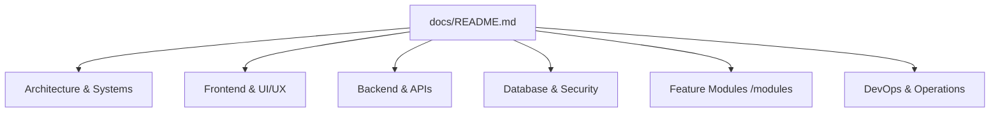

# NextCampus Technical Documentation Library

> **Project:** NextCampus — The Next Generation of Smart Campuses  
> **Repository:** `pixel-library/NextCampus`  
> **Stack:** React 18, Vite 5, Node.js, Express, MongoDB (Mongoose), JWT, Tailwind/Vanilla CSS  
> **Design Language:** Google Stitch Brand Identity (Licorice `#191516`, Raisin Black `#382E31`, Amaranth Purple `#AC274F`, Blush `#EB638B`, Misty Rose `#FFD9DA`)  
> **Last Reviewed:** 2026-10-10  
> **Build Status:** Passing (`npm test` 10/10 Master Audit workflows verified)

---

## Welcome to the NextCampus Documentation

NextCampus is an enterprise-grade smart campus operating platform providing unified facilities management, IoT telemetry, wayfinding, predictive complaint dispatch, sustainability intelligence, peer student incubation, and multi-intent generative AI assistance.

This directory (`/docs`) contains the official, verified, cross-linked technical documentation for both human developers and autonomous AI coding agents.



---

## Documentation Directory Index

### 1. Getting Started & Overview
| Document | Description |
| :--- | :--- |
| [ABOUT.md](ABOUT.md) | Mission, vision, core values, institutional context, and hackathon origins. |
| [PROJECT_OVERVIEW.md](PROJECT_OVERVIEW.md) | High-level executive overview, target personas, problem statement, and solution. |
| [REQUIREMENTS.md](REQUIREMENTS.md) | Functional, non-functional, security, and accessibility specifications. |
| [FEATURES.md](FEATURES.md) | Comprehensive catalog of all 14 platform capabilities and role matrices. |
| [ROADMAP.md](ROADMAP.md) | Multi-phase development roadmap, completed milestones, and future horizons. |
| [COMPLETION_STATUS.md](COMPLETION_STATUS.md) | Audit report of implemented, partially implemented, and verified features. |

### 2. Architecture & Technology Stack
| Document | Description |
| :--- | :--- |
| [ARCHITECTURE.md](ARCHITECTURE.md) | High-level systems architecture, layered boundaries, and concurrency model. |
| [TECH_STACK.md](TECH_STACK.md) | Full breakdown of runtime, libraries, frameworks, dependencies, and rationale. |
| [PROJECT_STRUCTURE.md](PROJECT_STRUCTURE.md) | Canonical codebase folder hierarchy, entry points, and directory map. |
| [DATA_FLOW.md](DATA_FLOW.md) | Sequence diagrams of student, IoT, and administrative data lifecycles. |
| [BUSINESS_LOGIC.md](BUSINESS_LOGIC.md) | Core institutional rules (RBAC, SLA calculations, GIS coordinates, seat limits). |

### 3. Frontend Architecture
| Document | Description |
| :--- | :--- |
| [FRONTEND.md](FRONTEND.md) | React 18 SPA architecture, routing setup, hooks, and bundle pipeline. |
| [ROUTES_AND_PAGES.md](ROUTES_AND_PAGES.md) | Complete table of all 14 routes, layouts, role guards, and transitions. |
| [COMPONENTS.md](COMPONENTS.md) | Catalog of reusable common components (`Badge`, `Button`, `Card`, `Modal`, `Input`, `Logo`) and spatial GIS engine (`CampusGisMap`). |
| [STATE_MANAGEMENT.md](STATE_MANAGEMENT.md) | Authentication context, local state, URL synchronization, and caching. |
| [FORMS_AND_VALIDATION.md](FORMS_AND_VALIDATION.md) | Form architecture, inputs, real-time validations, and submission handlers. |
| [RESPONSIVE_DESIGN.md](RESPONSIVE_DESIGN.md) | 12-column grid, fluid breakpoints (Mobile, Tablet, Desktop), and touch ergonomics. |

### 4. UI/UX Design & Google Stitch System
| Document | Description |
| :--- | :--- |
| [DESIGN_SYSTEM.md](DESIGN_SYSTEM.md) | CSS custom properties, official 5-color palette, typography, and elevations. |
| [UI_UX_DESIGN.md](UI_UX_DESIGN.md) | Interaction philosophy, dark-mode licorice theme, glassmorphism, and micro-interactions. |
| [STITCH_DESIGN_REFERENCE.md](STITCH_DESIGN_REFERENCE.md) | Mapping of Figma/Google Stitch design export assets to React implementation. |
| [ACCESSIBILITY.md](ACCESSIBILITY.md) | WCAG 2.1 AA/AAA compliance, tactile cues, screen reader tags, and high-contrast modes. |

### 5. Backend & REST API Reference
| Document | Description |
| :--- | :--- |
| [BACKEND.md](BACKEND.md) | Node.js + Express backend service, controller/service layers, and middleware pipeline. |
| [API_REFERENCE.md](API_REFERENCE.md) | Exhaustive REST API reference covering `/api/v1` and `/api` dual endpoints. |
| [ERROR_HANDLING.md](ERROR_HANDLING.md) | Global error handling middleware, sanitization, HTTP status codes, and logging. |
| [FILE_UPLOADS.md](FILE_UPLOADS.md) | Multer multipart upload pipeline, file size limits (10MB), and security filters. |
| [INTEGRATIONS.md](INTEGRATIONS.md) | External integrations (Google Gemini AI, Revit IFC4 CAD, Keycloak SSO, IoT sensors). |

### 6. Database & Security
| Document | Description |
| :--- | :--- |
| [DATABASE.md](DATABASE.md) | MongoDB Mongoose schemas, relationships, indexes, dual in-memory fallback store. |
| [AUTHENTICATION.md](AUTHENTICATION.md) | JWT token creation/verification, bcrypt salt rounds, session lifecycle, and auth routes. |
| [AUTHORIZATION.md](AUTHORIZATION.md) | Role-Based Access Control (RBAC) matrix (`student`, `admin`, `staff`, `care_admin`). |
| [SECURITY.md](SECURITY.md) | Attack surface audit, XSS/CORS defenses, input sanitization, and credential safety. |

### 7. DevOps, Quality & Development Workflows
| Document | Description |
| :--- | :--- |
| [INSTALLATION.md](INSTALLATION.md) | Step-by-step local workstation installation, prerequisites, and setup guides. |
| [DEVELOPMENT_GUIDE.md](DEVELOPMENT_GUIDE.md) | Day-to-day developer handbook, concurrency setup (`npm run dev`), and conventions. |
| [CONFIGURATION.md](CONFIGURATION.md) | Configuration files (`package.json`, `vite.config.js`, `.env`). |
| [ENVIRONMENT_VARIABLES.md](ENVIRONMENT_VARIABLES.md) | Complete dictionary of environment variables, defaults, and secrets handling. |
| [TESTING.md](TESTING.md) | Automated testing strategy, master audit suite, and GIS geometry unit tests. |
| [DEBUGGING.md](DEBUGGING.md) | Diagnostic runbooks, common runtime failures, and network inspect guides. |
| [TROUBLESHOOTING.md](TROUBLESHOOTING.md) | Solutions to known errors (e.g. Brave Shield cross-origin blocks, port mismatch). |
| [PERFORMANCE.md](PERFORMANCE.md) | Bundle optimization, gzip sizes, SVG rendering efficiency, and caching. |
| [DEPLOYMENT.md](DEPLOYMENT.md) | Production deployment runbook (Docker, Linux VPS, Vercel/Render, PM2). |
| [CI_CD.md](CI_CD.md) | Continuous Integration pipeline architecture, GitHub Actions workflows, and audits. |
| [GIT_WORKFLOW.md](GIT_WORKFLOW.md) | Branching policy, commit message conventions, and pull request hygiene. |
| [BACKUP_AND_RECOVERY.md](BACKUP_AND_RECOVERY.md) | MongoDB dump/restore strategies, disaster recovery runbooks, and failovers. |
| [RELEASE_CHECKLIST.md](RELEASE_CHECKLIST.md) | Pre-flight production deployment and release verification checklist. |
| [TECHNICAL_DEBT.md](TECHNICAL_DEBT.md) | Catalog of recognized shortcuts, refactor candidates, and future optimizations. |
| [KNOWN_ISSUES.md](KNOWN_ISSUES.md) | Transparent register of current edge cases, non-blocking caveats, and workarounds. |
| [CHANGELOG.md](CHANGELOG.md) | Reverse-chronological record of releases, phase master prompts, and bugfixes. |
| [CONTRIBUTING.md](CONTRIBUTING.md) | Guidelines for contributing code, issues, design enhancements, and documentation. |
| [DECISIONS.md](DECISIONS.md) | Architecture Decision Records (ADRs) explaining technical choices. |
| [GLOSSARY.md](GLOSSARY.md) | Standardized domain dictionary for campus terms, acronyms, and technical concepts. |

---

## Platform Modules Reference (`/docs/modules`)

Each planned application page is comprehensively documented in its own dedicated module file:

| Module Document | Route | Primary Component | Primary Role |
| :--- | :--- | :--- | :--- |
| [LANDING_PAGE.md](modules/LANDING_PAGE.md) | `/` | `LandingPage.jsx` | Public Unauthenticated |
| [STUDENT_DASHBOARD.md](modules/STUDENT_DASHBOARD.md) | `/dashboard` | `StudentDashboard.jsx` | Student, Admin |
| [CAMPUS_MAP.md](modules/CAMPUS_MAP.md) | `/campus-map` | `CampusGisMap.jsx` / `CampusMap.jsx` | Student, Staff, Admin |
| [CAMPUS_DIRECTORY.md](modules/CAMPUS_DIRECTORY.md) | `/directory` | `CampusDirectory.jsx` | Student, Staff, Admin |
| [SMARTROOM.md](modules/SMARTROOM.md) | `/smartroom` | `SmartRooms.jsx` | Student, Staff, Admin |
| [COMPLAINT_MANAGEMENT.md](modules/COMPLAINT_MANAGEMENT.md) | `/complaints` | `CareComplaints.jsx` | Student, Staff |
| [AI_ASSISTANT.md](modules/AI_ASSISTANT.md) | `/ai-assistant` | `AiAssistant.jsx` | Student, Admin |
| [ECOCAMPUS.md](modules/ECOCAMPUS.md) | `/ecocampus` | `EcoCampus.jsx` | Student, Staff, Admin |
| [SKILLCAMPUS.md](modules/SKILLCAMPUS.md) | `/skillcampus` | `SkillCampus.jsx` | Student |
| [ADMIN_DASHBOARD.md](modules/ADMIN_DASHBOARD.md) | `/admin` | `AdminDashboard.jsx` | Admin |
| [CAMPUS_MANAGEMENT.md](modules/CAMPUS_MANAGEMENT.md) | `/admin/campus-management` | `CampusManagement.jsx` | Admin, Staff |
| [COMPLAINT_ADMINISTRATION.md](modules/COMPLAINT_ADMINISTRATION.md) | `/admin/complaints` | `ComplaintAdmin.jsx` | Admin, Care Admin |
| [AUTHENTICATION_PAGES.md](modules/AUTHENTICATION_PAGES.md) | `/auth` | `AuthPage.jsx` | Public Guest |
| [STUDENT_PROFILE_SETTINGS.md](modules/STUDENT_PROFILE_SETTINGS.md) | `/profile` | `ProfileSettings.jsx` | Authenticated |

---

## Core Institutional Palettes & Tokens

NextCampus adopts an immersive, low-strain dark licorice visual foundation:

```text
Licorice        #191516  (Base canvas & backdrop)
Raisin Black    #382E31  (Elevated cards & navigation)
Amaranth Purple #AC274F  (Primary CTAs & active tabs)
Blush           #EB638B  (Interactive focus & brand accent)
Misty Rose      #FFD9DA  (Light headings & soft badges)
```

For design details, see [DESIGN_SYSTEM.md](DESIGN_SYSTEM.md).

---

## Verification & Quick Audit Run

Execute the automated test suite to confirm end-to-end integration:

```bash
# 1. Execute GIS geometry unit test
node tests/unit/campus_locations_update.test.js

# 2. Execute 10-phase Master Integration & Security Audit
npm test

# 3. Build production bundle
npm run build
```

