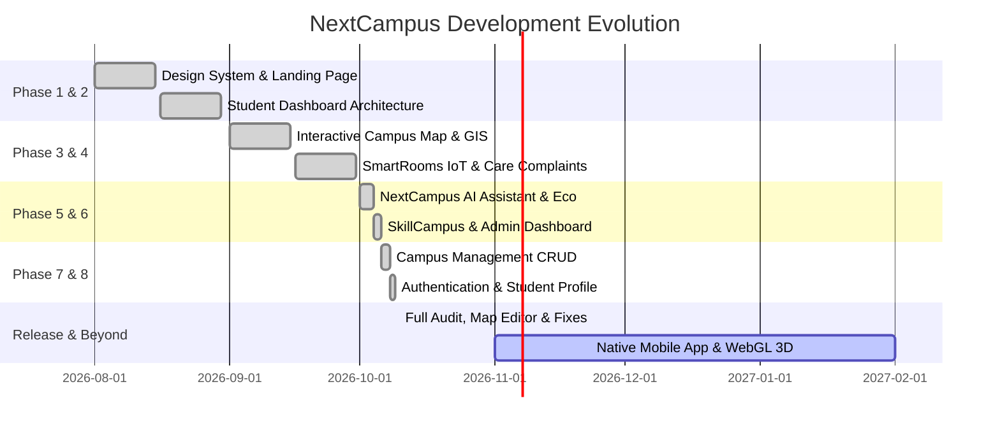

# Development Roadmap

> **Document:** `docs/ROADMAP.md`  
> **Last Reviewed:** 2026-10-10  
> **Status:** Phase 1–8 Master Prompts Completed • Production Readiness Reached

---

## 1. Multi-Phase Evolutionary Timeline

---

## 2. Completed Milestones

### Phase 1: Architectural Foundation
- Configured React 18, Vite 5, Express 4, and Mongoose structure.
- Defined Google Stitch Design System tokens (Licorice, Raisin Black, Amaranth Purple, Blush, Misty Rose).
- Established dual routing and fault-tolerant in-memory persistence.

### Phase 2: Landing Page & Student Dashboard
- Implemented `/` standalone public landing page.
- Created `/dashboard` student portal with lecture HUD, notice boards, and quick AI prompts.

### Phase 3: Interactive Campus Map & Directory
- Implemented vector SVG map with dynamic pathing and building selections.
- Developed searchable Campus Directory with faculty office hours.

### Phase 4: SmartRooms IoT & Complaint Management
- Built SmartRooms indoor floor views with live telemetry (temp, CO₂, occupancy).
- Developed NextCampus Care with Tier-1 SLA triage (<45 min resolution).

### Phase 5: NextCampus AI Assistant & EcoCampus
- Integrated NextCampus AI with multi-intent parsing and Google Gemini 1.5 Flash support.
- Built EcoCampus sustainability telemetry (88.8 MWh solar yield, 82% waste diversion).

### Phase 6: SkillCampus & Admin Dashboard
- Created SkillCampus project discovery with duplicate join protection.
- Designed Admin Dashboard with campus population and operations metrics.

### Phase 7: Campus Management & Complaint Administration
- Full database-backed CRUD for buildings, floors, and rooms.
- Safe cascading deletion validation for dependent facilities.
- Complaint administration with staff assignments and private internal notes.

### Phase 8: Authentication & Student Profile
- JWT authentication with 10-round bcrypt password hashing.
- Student profile settings with password rotation and accessibility configurations.

### Phase 9: Stabilization, Admin Map Editor & Production Audit
- Fixed Student Dashboard `Navigation` icon crash.
- Enforced public vs. private workspace route isolation.
- Implemented in-browser Admin Map Editor with marker repositioning and 4-way coordinate nudging.
- Upgraded AI Assistant to 12-domain institutional reasoning.
- Resolved `/api` vs `/api/v1` prefix mismatch and Brave Shield cross-origin blocking.
- Verified 10/10 Master Integration & Security workflows.

---

## 3. Future Horizons (2027+)

### Horizon 1: Real-Time WebSockets & Telemetry Push (Q1 2027)
* Replace REST polling with WebSocket / SSE streams for room occupancy and live shuttle GPS markers.
* Instant push notifications for complaint status changes.

### Horizon 2: Three.js / WebGL 3D Campus Isometric Engine (Q2 2027)
* Upgrade SVG canvas into an interactive WebGL 3D model with realistic shadows, sun positioning, and building slicing.

### Horizon 3: React Native Mobile Client (Q3 2027)
* Deliver cross-platform iOS and Android apps using React Native, utilizing existing `/api/v1` endpoints.
* Bluetooth Low Energy (BLE) indoor positioning for turn-by-turn guidance.

### Horizon 4: Enterprise SSO (SAML 2.0 / Shibboleth) (Q4 2027)
* Integrate higher-education federation gateways (InCommon, eduGAIN) alongside existing JWT infrastructure.

---

## 4. Related Documentation
* [COMPLETION_STATUS.md](COMPLETION_STATUS.md) — Detailed verification status of all components.
* [TECHNICAL_DEBT.md](TECHNICAL_DEBT.md) — Architectural enhancements earmarked for future releases.
