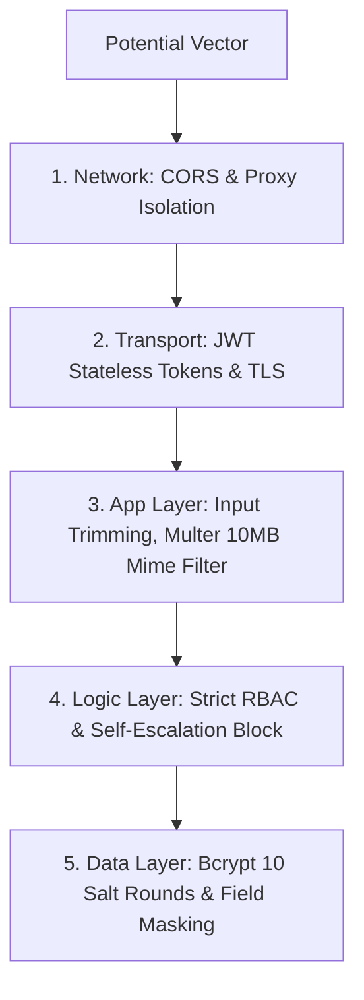

# Security, Privacy & Threat Mitigation

> **Document:** `docs/SECURITY.md`  
> **Last Reviewed:** 2026-10-10  
> **Scope:** Attack Surface Analysis, OWASP Defenses, Data Privacy, and Secrets Management

---

## 1. Security Architecture Overview

NextCampus applies defense-in-depth principles across all client, network, and server boundaries:

---

## 2. OWASP Threat Analysis & Defenses

### 1. Broken Access Control (OWASP Top 10: A01)
* **Threat**: Student forging client requests to `/admin/complaints` or modifying other users' profiles.
* **Defense**: Every sensitive endpoint evaluates `req.user.role` via `authorizeRoles(...)`. User profile updates verify that `req.user.role === 'admin'` before allowing edits to another user's `userId`.

### 2. Cryptographic Failures (OWASP Top 10: A02)
* **Threat**: Password compromise via database leak or brute force.
* **Defense**: Passwords hashed with `bcryptjs` using 10 salt rounds. Database schema excludes passwords by default (`select: false`). JWT secrets stored in environment variables, never hardcoded.

### 3. Injection (OWASP Top 10: A03)
* **Threat**: NoSQL query injection via malicious `{ $gt: '' }` payloads.
* **Defense**: Mongoose strictly validates schemas and casts types before execution. Identifiers and search queries are explicitly coerced to trimmed lowercase strings.

### 4. Security Misconfiguration (OWASP Top 10: A05)
* **Threat**: Production servers leaking database stack traces and internal filenames.
* **Defense**: `server/middleware/errorHandler.js` strips error stacks and returns sanitized generic notices when `NODE_ENV === 'production'`.

### 5. File Upload Vulnerabilities (OWASP Top 10: A10)
* **Threat**: Uploading executable `.sh`, `.exe`, or oversized files.
* **Defense**: Multer limits files to 10MB and restricts mime types strictly to images (`image/jpeg`, `image/png`, `image/webp`).

---

## 3. Privacy & Dual-Note Information Separation

* In NextCampus Care, internal technical observations (`internalNotes`) are scrubbed before payload transmission to students, protecting facility staff discussions and internal operational data.

---

## 4. Related Documentation
* [AUTHENTICATION.md](AUTHENTICATION.md) — Hashing and token details.
* [AUTHORIZATION.md](AUTHORIZATION.md) — Permission matrices.
