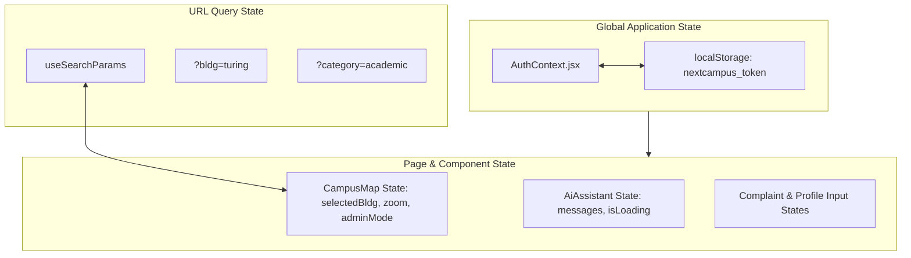

# State Management Architecture

> **Document:** `docs/STATE_MANAGEMENT.md`  
> **Last Reviewed:** 2026-10-10  
> **Scope:** Authentication Context, Local Component State, URL Query Sync, and Persistence

---

## 1. State Management Philosophy

NextCampus utilizes a lightweight, native React state architecture without heavyweight external state libraries (Redux, MobX, Zustand), minimizing bundle size and preventing state synchronization lag.



---

## 2. Global Authentication State (`AuthContext.jsx`)

Located at `src/context/AuthContext.jsx`, the `AuthProvider` exposes:

```javascript
{
  user,              // Current authenticated user object (name, email, role, etc.)
  loading,           // Boolean indicating initial token verification on mount
  login,             // Function: async (identifier, password) => res
  register,          // Function: async (userData) => res
  updateProfile,     // Function: async (profileData) => res
  changePassword,    // Function: async (currentPass, newPass) => res
  logout,            // Function: () => clears token & resets state
  isAuthenticated    // Boolean helper: !!user
}
```

### Initial Session Hydration Lifecycle
1. On initial mount, `useEffect` checks `localStorage.getItem('nextcampus_token')`.
2. If token exists, calls `api.get('/auth/me')`.
3. If verified, sets `user` state; if expired, removes the dead token from `localStorage` and resets `user` to `null`.
4. Sets `loading = false`, releasing route guards.

---

## 3. URL Query Parameter Synchronization

Key components synchronize their active selections with browser URL query parameters via React Router's `useSearchParams`:

* **Campus Map (`/campus-map?bldg=turing`)**:
  - Selecting building updates URL `?bldg=turing`.
  - Copying and sharing the link automatically opens the building detail drawer on another workstation.
* **Campus Directory (`/directory?building=turing`)**:
  - Clicking "Directory Info" from the map transitions to `/directory?building=turing`, filtering faculty to that department.

---

## 4. Local State Patterns

* **Complex Forms**: Managed via unified state objects (e.g. `editFormData` in `CampusMap.jsx`, `buildingForm` in `CampusManagement.jsx`).
* **Optimistic UI Updates**: State updates locally first for instant feedback, then syncs with the REST API in the background.

---

## 5. Related Documentation
* [AUTHENTICATION.md](AUTHENTICATION.md) — Authentication workflows.
* [FRONTEND.md](FRONTEND.md) — Component hierarchy.
