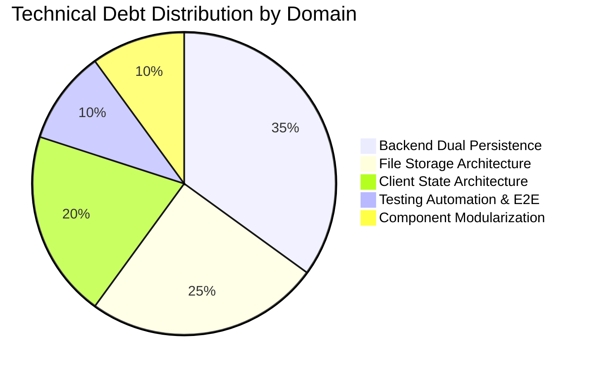

# Technical Debt & Refactoring Backlog

*Last Reviewed: October 2026*

This document catalogs technical debt items, architectural compromises made during rapid phase delivery, and recommended refactoring initiatives for **NextCampus**.

---

## 1. Technical Debt Overview

NextCampus was constructed across 8 structured delivery phases, achieving complete feature implementation across 14 interactive application pages. To maintain velocity and zero-dependency offline resilience, certain architectural compromises were accepted.



---

## 2. Priority Debt Items

### Debt-01: Dual Persistence Logic in Backend Services
- **Location**: All files in `server/services/*.service.js`
- **Current Approach**: Every service method branches on `mongoose.connection.readyState === 1`:
  ```javascript
  if (mongoose.connection.readyState === 1) {
    return await Facility.find();
  }
  return inMemoryFacilities;
  ```
- **Drawback**: Violates Single Responsibility Principle; duplicates validation and mutation logic across both MongoDB queries and in-memory array manipulation.
- **Refactoring Recommendation**: Implement a formal **Repository Pattern**:
  - `IFacilityRepository` interface with `MongoFacilityRepository` and `MemoryFacilityRepository` implementations.
  - Dependency Injection (DI) container or factory resolves the appropriate repository on startup based on database connection state.

---

### Debt-02: Local Filesystem Storage for Media Uploads
- **Location**: `server/middleware/upload.js`, `server/uploads/`
- **Current Approach**: Multer writes binary uploads directly to `server/uploads/` on the local machine.
- **Drawback**: Prevents horizontal autoscaling in cloud container clusters (e.g., Kubernetes, AWS ECS) because nodes do not share disk volumes.
- **Refactoring Recommendation**:
  - Abstract storage operations behind a `StorageService` interface (`saveFile(buffer, filename)`, `getFileUrl(filename)`).
  - Provide an S3/GCS adapter utilizing AWS SDK or Google Cloud Storage client with presigned upload URLs.

---

### Debt-03: Local Storage / State Synchronization
- **Location**: `src/context/AuthContext.jsx`, `src/services/api.js`
- **Current Approach**: Authentication tokens and current user profiles are persisted in `localStorage`.
- **Drawback**: Direct `localStorage` access across disparate files can cause race conditions if token refresh is introduced.
- **Refactoring Recommendation**:
  - Centralize all token storage behind a secure `TokenStorageService`.
  - Store access tokens in in-memory state and use HttpOnly cookies for refresh tokens to eliminate XSS token theft vectors.

---

### Debt-04: Large Page Component Reusability
- **Location**: `src/pages/CampusMap.jsx`, `src/pages/SmartRoom.jsx`, `src/pages/CampusManagement.jsx`
- **Current Approach**: Certain page components contain over 600 lines of code combining local state, UI presentation, canvas/SVG rendering, and modal controllers.
- **Drawback**: Increases maintenance friction and cognitive load for developers modifying single features.
- **Refactoring Recommendation**:
  - Extract subcomponents:
    - `CampusMap.jsx` -> `MapCanvas.jsx`, `FacilityInfoDrawer.jsx`, `RouteControls.jsx`, `AdminMapEditorModal.jsx`.
    - `SmartRoom.jsx` -> `FloorPlanSvg.jsx`, `RoomTelemetryCard.jsx`, `EquipmentBadgeList.jsx`.

---

### Debt-05: Test Coverage Expansion
- **Location**: `tests/master_audit.test.js`
- **Current Approach**: A master integration test suite executes 10 comprehensive end-to-end integration workflows against live Express routes.
- **Drawback**: Excellent integration coverage, but limited isolated unit test suites for individual React hooks and utility functions.
- **Refactoring Recommendation**:
  - Introduce Vitest and React Testing Library for frontend component unit testing.
  - Add Cypress or Playwright for headless browser interaction testing.

---

## 3. Remediation Roadmap

| Quarter | Focus Area | Action Items |
| :--- | :--- | :--- |
| **Q1** | Storage & Repository | Implement Storage Provider (S3/Local) and abstract Repository Pattern for backend services. |
| **Q2** | Frontend Deconstruction | Deconstruct large page files (`CampusMap`, `SmartRoom`) into atomic presentation components. |
| **Q3** | Real-Time Architecture | Migrate complaint status updates and smart room telemetry from polling to WebSockets (`socket.io`). |
| **Q4** | E2E Testing Suite | Add Playwright browser tests covering all 14 routes and authentication flows. |

---

## 4. Related Documentation
- [Known Issues](file:///run/media/rudra/534a134c-69cb-49e5-9a9c-284e9ad8ee1b/NextCampus/docs/KNOWN_ISSUES.md)
- [Roadmap](file:///run/media/rudra/534a134c-69cb-49e5-9a9c-284e9ad8ee1b/NextCampus/docs/ROADMAP.md)
- [Architecture](file:///run/media/rudra/534a134c-69cb-49e5-9a9c-284e9ad8ee1b/NextCampus/docs/ARCHITECTURE.md)
