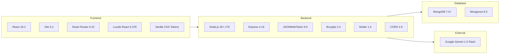

# Technology Stack Specification

> **Document:** `docs/TECH_STACK.md`  
> **Last Reviewed:** 2026-10-10  
> **Scope:** Full Runtime, Framework, Library, and Tooling Inventory

---

## 1. Technology Overview

NextCampus is built on an enterprise JavaScript/Node.js stack prioritizing speed, zero unnecessary dependencies, and standard compliance.

---

## 2. Core Dependencies & Versions

### Frontend Dependencies (`package.json`)

| Package | Version | Purpose & Rationale |
| :--- | :---: | :--- |
| `react` | `^18.2.0` | Declarative UI framework with functional components and hooks. |
| `react-dom` | `^18.2.0` | DOM rendering and reconciliation engine. |
| `react-router-dom` | `^6.23.0` | Client-side routing, nested routes (`<Outlet />`), route guards, and query parameters. |
| `lucide-react` | `^0.378.0` | Lightweight, scalable SVG icon system consistent with modern SaaS interfaces. |

### Backend Dependencies (`package.json`)

| Package | Version | Purpose & Rationale |
| :--- | :---: | :--- |
| `express` | `^4.19.2` | Fast, minimalist HTTP web framework for REST API routing and middleware. |
| `mongoose` | `^8.3.1` | ODM library providing schema validation, casting, business logic, and queries. |
| `bcryptjs` | `^2.4.3` | Pure JavaScript implementation of bcrypt for secure password hashing (10 salt rounds). |
| `jsonwebtoken` | `^9.0.2` | Signed JWT token generation and verification for stateless authentication. |
| `cors` | `^2.8.5` | Cross-Origin Resource Sharing configuration allowing secure browser communication. |
| `multer` | `^1.4.5-lts.1`| Middleware for handling `multipart/form-data` uploads (incident photo attachments). |
| `dotenv` | `^16.4.5` | Zero-dependency module that loads environment variables from `.env`. |

### Development & Build Tooling

| Package | Version | Purpose & Rationale |
| :--- | :---: | :--- |
| `vite` | `^5.2.11` | Next-generation frontend build tool with instant HMR and rollup production bundler. |
| `@vitejs/plugin-react` | `^4.2.1` | Babel/Fast Refresh integration for Vite React projects. |
| `concurrently` | `^8.2.2` | Runs both backend Express server and Vite frontend concurrently with unified stdout. |
| `nodemon` | `^3.1.0` | Development utility that automatically restarts the Node.js server upon file changes. |

---

## 3. Tooling Decisions & Justifications

### Why Vite over Create React App (CRA)?
CRA is deprecated and uses sluggish Webpack bundling. Vite starts up in milliseconds via native ES modules and produces optimized, minified production assets (`dist/`) via Rollup in under 6 seconds.

### Why Vanilla CSS over TailwindCSS?
The NextCampus design is calibrated around the official Google Stitch design tokens (Licorice `#191516`, Raisin Black `#382E31`, Amaranth Purple `#AC274F`, Blush `#EB638B`, Misty Rose `#FFD9DA`). Using CSS custom properties (`var(--brand-primary)`, `var(--bg-canvas)`) eliminates CSS build bloat, prevents class-name churn, and ensures zero runtime style overhead.

### Why Mongoose with In-Memory Fallback?
University hackathons, automated test runners, and developer machines often run without a local MongoDB daemon installed. The dual-persistence architecture ensures tests (`tests/master_audit.test.js`) and UI development run flawlessly whether MongoDB is connected or offline.

---

## 4. Related Documentation
* [ARCHITECTURE.md](ARCHITECTURE.md) — System boundaries and layer responsibilities.
* [CONFIGURATION.md](CONFIGURATION.md) — Configuration file specifications.
* [INSTALLATION.md](INSTALLATION.md) — Workstation prerequisites and setup.
