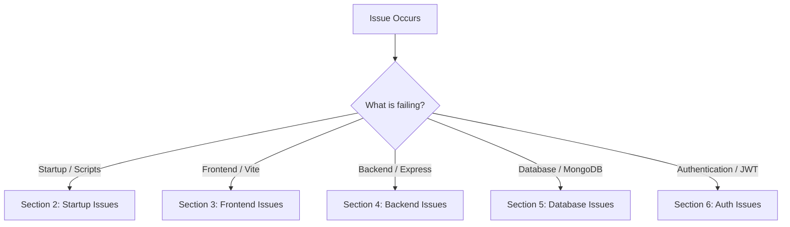

# Troubleshooting Guide

*Last Reviewed: October 2026*

This guide outlines common issues encountered during development, installation, runtime, and deployment of **NextCampus**, along with validated solutions.

---

## 1. Quick Diagnostic Flowchart



---

## 2. Startup and Installation Issues

### Issue 2.1: `EADDRINUSE: address already in use :::5000` or `:::5173`
- **Symptom**: Running `npm run dev` fails with `Error: listen EADDRINUSE: address already in use :::5000`.
- **Cause**: A previous Express backend server or Vite dev instance is still running in the background.
- **Solution**:
  1. Find and terminate the process holding the port:
     ```bash
     # Find port 5000 PID
     lsof -ti :5000 | xargs kill -9
     
     # Find port 5173 PID
     lsof -ti :5173 | xargs kill -9
     ```
  2. Verify with `lsof -i :5000` that the port is freed.
  3. Restart the dev environment: `npm run dev`.

---

### Issue 2.2: `npm install` Dependency Resolution Failure
- **Symptom**: `npm install` errors with `ERESOLVE unable to resolve dependency tree` or version conflicts.
- **Cause**: Node.js version mismatch or conflicting peer dependencies between legacy packages.
- **Solution**:
  1. Verify you are using Node.js `>= 18.0.0`:
     ```bash
     node -v
     ```
  2. Clear npm cache and retry with legacy peer deps if needed:
     ```bash
     npm cache clean --force
     npm install --legacy-peer-deps
     ```

---

## 3. Frontend & Vite Development Issues

### Issue 3.1: White Screen with Console Error `Failed to fetch dynamically imported module`
- **Symptom**: Opening `http://localhost:5173` renders a blank screen. DevTools console shows dynamic import errors or MIME type mismatch.
- **Cause**: Stale Vite cache in `node_modules/.vite` or unbuilt asset references.
- **Solution**:
  1. Clear Vite dependency cache:
     ```bash
     rm -rf node_modules/.vite
     ```
  2. Force Vite to re-bundle:
     ```bash
     npx vite --force
     ```

---

### Issue 3.2: 404 Not Found on Hard Page Refresh (e.g., `/campus-map` or `/smartroom`)
- **Symptom**: Clicking internal navigation works, but pressing `F5` / Refresh in browser returns `404 Not Found`.
- **Cause**: In production or standalone preview servers, the static file server does not route unhandled GET requests back to `index.html`.
- **Solution**:
  - In Vite dev mode (`npm run dev`), SPA fallback is automatic.
  - In production Nginx:
    ```nginx
    location / {
        try_files $uri $uri/ /index.html;
    }
    ```
  - In Express static hosting:
    ```javascript
    app.get('*', (req, res) => {
      res.sendFile(path.resolve(__dirname, '../dist/index.html'));
    });
    ```

---

## 4. Backend & API Issues

### Issue 4.1: API Calls Return 404 (`/api/v1/...` vs `/api/...`)
- **Symptom**: Requests to `/api/facilities` fail with 404, or `/api/v1/facilities` work while others fail.
- **Cause**: Mismatch between the frontend API client request URL and backend route mount points.
- **Solution**:
  - The NextCampus Express server mounts routes under **both** prefixes in `server/index.js`:
    ```javascript
    const mountAll = (prefix) => {
      app.use(`${prefix}/auth`, authRoutes);
      app.use(`${prefix}/facilities`, facilityRoutes);
      // ...
    };
    mountAll('/api/v1');
    mountAll('/api');
    ```
  - The client `src/services/api.js` automatically retries without `/v1` if a 404 occurs.
  - Ensure any new route modules are registered in `mountAll()` in `server/index.js`.

---

### Issue 4.2: CORS Error in Browser Console (`Access-Control-Allow-Origin missing`)
- **Symptom**: `Access to fetch at 'http://localhost:5000/api/...' from origin 'http://localhost:5173' has been blocked by CORS policy`.
- **Cause**: Backend CORS middleware is misconfigured or Vite proxy is bypassed.
- **Solution**:
  1. Ensure `server/index.js` enables CORS with origin reflection or credentials:
     ```javascript
     app.use(cors({ origin: ['http://localhost:5173', 'http://127.0.0.1:5173'], credentials: true }));
     ```
  2. Use relative API paths in `src/services/api.js` so Vite proxy (`vite.config.js`) handles forwarding seamlessly:
     ```javascript
     server: {
       proxy: {
         '/api': {
           target: 'http://localhost:5000',
           changeOrigin: true
         }
       }
     }
     ```

---

## 5. Database & Persistence Issues

### Issue 5.1: `MongooseServerSelectionError: connect ECONNREFUSED 127.0.0.1:27017`
- **Symptom**: Terminal logs: `[DB] MongoDB connection failed: connect ECONNREFUSED 127.0.0.1:27017`.
- **Does it stop NextCampus?**: **No.** NextCampus is built with a resilient dual-persistence engine. All services automatically fall back to high-fidelity in-memory stores (`IN_MEMORY_*`) with pre-seeded campus data.
- **To enable persistent MongoDB**:
  1. Start MongoDB service locally:
     ```bash
     sudo systemctl start mongod
     # Or via Docker:
     docker run -d -p 27017:27017 --name nextcampus-mongo mongo:7.0
     ```
  2. Verify connection string in `.env`:
     ```env
     MONGODB_URI=mongodb://localhost:27017/nextcampus
     ```
  3. Restart backend. Terminal should log: `[DB] Connected successfully to MongoDB`.

---

### Issue 5.2: In-Memory Data Resets After Server Restart
- **Symptom**: Changes made to complaints, facilities, or users revert back to initial defaults after restarting Express.
- **Cause**: When MongoDB is not running, the backend operates in-memory. In-memory arrays reset when the Node.js process terminates.
- **Solution**:
  - Connect a persistent MongoDB instance using `MONGODB_URI` in `.env`.

---

## 6. Authentication & Session Issues

### Issue 6.1: Endless Login Loop / Dashboard Redirects to `/auth`
- **Symptom**: User logs in successfully, but navigating to `/dashboard` immediately redirects back to `/auth`.
- **Cause**: Expired JWT token, corrupted `localStorage`, or missing token header.
- **Solution**:
  1. Open Browser DevTools -> Application -> Local Storage (`http://localhost:5173`).
  2. Inspect keys `token` and `user`.
  3. Clear `localStorage` or click "Log Out" on the navbar.
  4. Re-authenticate with default credentials:
     - Student: `student@nextcampus.edu` / `student123`
     - Admin: `admin@nextcampus.edu` / `admin123`

---

### Issue 6.2: Admin Pages Return 403 Forbidden
- **Symptom**: User visits `/admin` or `/admin/campus-management` and sees `Access Denied (403 Forbidden)` or redirected to home.
- **Cause**: Logged-in user has role `student` instead of `admin`.
- **Solution**:
  1. Check user role in `localStorage.getItem('user')`.
  2. Log out and log in with the administrator account (`admin@nextcampus.edu`).

---

## 7. AI Assistant & External Integrations

### Issue 7.1: AI Assistant Only Returns Generic Pre-Programmed Responses
- **Symptom**: Asking custom or non-campus questions returns structured campus recommendations instead of open-ended conversational output.
- **Cause**: `GEMINI_API_KEY` is not configured in `.env`, triggering the offline campus intent fallback engine.
- **Solution**:
  1. Obtain a Google Gemini API key from [Google AI Studio](https://aistudio.google.com/).
  2. Add it to `.env`:
     ```env
     GEMINI_API_KEY=AIzaSy...your-gemini-key
     ```
  3. Restart backend server: `npm run server`.

---

## 8. Summary Table of Common Diagnostics

| Error Code / Log | Root Cause | Immediate Action |
| :--- | :--- | :--- |
| `EADDRINUSE 5000` | Stale Express server | Run `lsof -ti :5000 \| xargs kill -9` |
| `ECONNREFUSED 27017` | Local MongoDB stopped | Normal fallback active; start Mongo if persistence required |
| `JWT Expired / Invalid` | Stale localStorage token | Clear browser storage and re-login |
| `404 on API endpoint` | Route prefix mismatch | Use `/api/v1/` or `/api/` (both supported) |
| `Leaflet map blank grey` | CSS missing or bounds invalid | Ensure `leaflet.css` imported in entrypoint |

---

## 9. Related Documentation
- [Debugging Guide](file:///run/media/rudra/534a134c-69cb-49e5-9a9c-284e9ad8ee1b/NextCampus/docs/DEBUGGING.md)
- [Known Issues](file:///run/media/rudra/534a134c-69cb-49e5-9a9c-284e9ad8ee1b/NextCampus/docs/KNOWN_ISSUES.md)
- [Configuration](file:///run/media/rudra/534a134c-69cb-49e5-9a9c-284e9ad8ee1b/NextCampus/docs/CONFIGURATION.md)
- [Installation Guide](file:///run/media/rudra/534a134c-69cb-49e5-9a9c-284e9ad8ee1b/NextCampus/docs/INSTALLATION.md)
