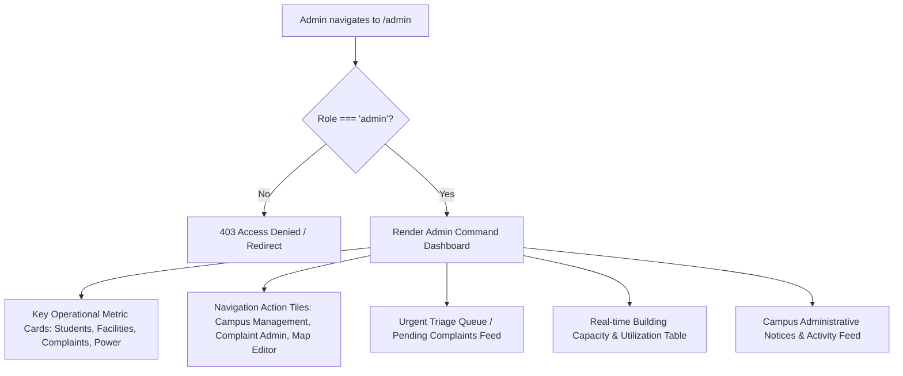

# Admin Dashboard Module Specification

*Last Reviewed: October 2026*

This document provides complete technical, security, and administrative documentation for the **NextCampus Admin Command Dashboard** (`/admin`).

---

## 1. Module Overview

The Admin Dashboard serves as the central operational hub for campus facilities managers, deans, and IT system administrators. It surfaces high-level campus health analytics, building occupancy metrics, unresolved student complaints, energy telemetry, administrative action alerts, and direct gateways into management sub-portals.

- **Route**: `/admin`
- **Access Level**: Protected (**Admin Role Only**: `user.role === 'admin'`)
- **Primary Goal**: Provide administrators with real-time operational visibility and decision support across all campus facilities.

---

## 2. Source Files & Architecture

### Frontend Files
- **Page Component**: [`src/pages/AdminDashboard.jsx`](file:///run/media/rudra/534a134c-69cb-49e5-9a9c-284e9ad8ee1b/NextCampus/src/pages/AdminDashboard.jsx)
- **Shared Components**:
  - `src/components/Navbar.jsx`
  - `src/components/ProtectedRoute.jsx` (enforces `allowedRoles={['admin']}`)
  - `src/components/Footer.jsx`
- **Dependencies**: `lucide-react` (icons: `Building2`, `AlertCircle`, `Users`, `Zap`, `CheckSquare`, `TrendingUp`, `Settings`)

### Backend Endpoints
- `GET /api/v1/admin/stats` (or `GET /api/admin/stats`): Aggregates campus metrics (active students, facilities, open complaints, energy stats).
- `GET /api/v1/complaints` (or `GET /api/complaints`): Fetches pending complaints for the urgent triage queue.
- `GET /api/v1/facilities` (or `GET /api/facilities`): Supplies facility counts and status.

---

## 3. UI Sections & Data Presentation



### 3.1 Primary Metric KPI Cards
- **Enrolled Students & Faculty**: `12,840` Active accounts.
- **Campus Buildings & Facilities**: `48` Managed facilities (18 Academic, 12 Labs, 8 Residential).
- **Pending Maintenance Complaints**: `14` Tickets awaiting staff assignment.
- **Campus Power Demand**: `3.4 MW` (38% supplied by rooftop solar).

### 3.2 Quick Administrative Navigation Tiles
Direct action tiles with prominent icons and counters:
- **Campus Management** (`/admin/campus-management`): Add, edit, or archive campus buildings, floors, and rooms.
- **Complaint Triage** (`/admin/complaints`): Review student grievance tickets, assign technicians, and update status.
- **Interactive Map Editor** (`/campus-map`): Relocate building GPS pins and adjust facility coordinates.

### 3.3 Urgent Complaint Triage Queue
- Displays top 5 highest-priority tickets marked `Urgent` or `High`.
- Shows issue subject, building location, student name, and a one-click `Assign Staff` action button.

### 3.4 Facility Utilization Table
- Breakdown of campus buildings with live occupancy percentages:
  - Turing Hall: 68% Capacity (Nominal)
  - Curie Science Complex: 84% Capacity (High)
  - Central Library: 92% Capacity (Near Full)
  - Student Union: 45% Capacity (Low)

---

## 4. Security & Role-Based Access Control

The route is strictly protected on both client and server:

```javascript
// Route protection in src/App.jsx
<Route
  path="/admin"
  element={
    <ProtectedRoute allowedRoles={['admin']}>
      <AdminDashboard />
    </ProtectedRoute>
  }
/>
```

Any API request originating from a non-admin token to administrative stats returns `HTTP 403 Forbidden`:
```javascript
// Middleware check in server/middleware/auth.js
if (req.user.role !== 'admin') {
  return res.status(403).json({ success: false, message: 'Forbidden: Admin access required' });
}
```

---

## 5. Responsive Behavior

- **Desktop (>= 1200px)**: 4-column KPI cards; 2-column split between triage queue and facility utilization table.
- **Tablet (768px - 1199px)**: 2-column KPI cards; full-width stacked tables.
- **Mobile (< 768px)**: Single-column layout; horizontally scrolling data tables with clear sticky headers.

---

## 6. Testing & Quality Verification

- **Automated Integration**: Admin stats and access controls verified in `tests/master_audit.test.js`.
- **Role Guarding**: Verified that student tokens cannot fetch admin stats or render the admin dashboard.

---

## 7. Related Documentation
- [Campus Management](file:///run/media/rudra/534a134c-69cb-49e5-9a9c-284e9ad8ee1b/NextCampus/docs/modules/CAMPUS_MANAGEMENT.md)
- [Complaint Administration](file:///run/media/rudra/534a134c-69cb-49e5-9a9c-284e9ad8ee1b/NextCampus/docs/modules/COMPLAINT_ADMINISTRATION.md)
- [Authorization](file:///run/media/rudra/534a134c-69cb-49e5-9a9c-284e9ad8ee1b/NextCampus/docs/AUTHORIZATION.md)
