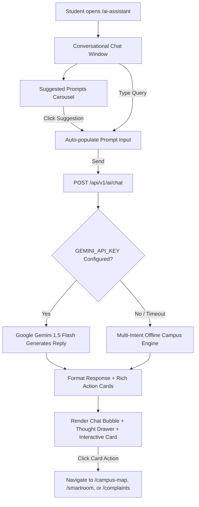

# NextCampus AI Assistant Module Specification

*Last Reviewed: October 2026*

This document provides complete technical, architectural, and conversational documentation for the **NextCampus AI Assistant** (`/ai-assistant`).

---

## 1. Module Overview

NextCampus AI is an intelligent conversational agent engineered to answer questions about campus locations, daily schedules, facility operating hours, administrative procedures, grievance filing, and environmental sustainability. It pairs conversational natural language responses with interactive **Rich Action Cards** (`route`, `room_telemetry`, `care_ticket`, `spatial`), allowing users to immediately trigger actions across other NextCampus modules.

- **Route**: `/ai-assistant`
- **Access Level**: Protected (Role: `student` or `admin`)
- **Primary AI Models**:
  - **Live Provider**: Google Gemini 1.5 Flash (`@google/genai` or REST endpoint) when `GEMINI_API_KEY` is present in `.env`.
  - **Offline Fallback Engine**: Multi-intent campus engine supporting 12 campus domains with structured reasoning thoughts and rich cards.

---

## 2. Source Files & Architecture

### Frontend Files
- **Page Component**: [`src/pages/AiAssistant.jsx`](file:///run/media/rudra/534a134c-69cb-49e5-9a9c-284e9ad8ee1b/NextCampus/src/pages/AiAssistant.jsx)
- **Shared Components**:
  - `src/components/Navbar.jsx`
  - `src/components/Footer.jsx`
- **Styling**: `src/index.css` (chat bubbles, markdown rendering, rich action card styles)

### Backend Files
- **Service**: [`server/services/ai.service.js`](file:///run/media/rudra/534a134c-69cb-49e5-9a9c-284e9ad8ee1b/NextCampus/server/services/ai.service.js)
- **Controller & Routes**: `server/routes/ai.routes.js`
- **Endpoints**:
  - `POST /api/v1/ai/chat` (or `POST /api/ai/chat`): Accepts `{ message, history }`, returns `{ reply, thought, richCards }`.
  - `GET /api/v1/ai/suggestions` (or `GET /api/ai/suggestions`): Returns prompt suggestions for students.

---

## 3. UI Sections & Conversation Lifecycle



### 3.1 Chat Interface Features
- **Message Stream**: Alternating message bubbles with user queries in Amaranth/Blush gradients and AI responses in Raisin Black glassmorphic containers.
- **Thinking Process Accordion**: Displays the agent's internal reasoning thoughts (e.g., *Detected intent: Navigation -> Resolving Turing Hall coordinates*).
- **Suggested Questions**: Clickable prompt pills:
  - *"Where is Turing Hall of Engineering?"*
  - *"How do I file a maintenance complaint for my dorm?"*
  - *"Find a quiet study room with low noise level."*
  - *"What are the library operating hours today?"*
  - *"How much solar power did the campus generate this week?"*
- **New Conversation Action**: Clears chat history and re-initializes suggestions.

---

## 4. Rich Action Cards System

When answering specific campus queries, the AI returns one or more structured UI cards:

| Card Type | Trigger Condition | Visual Content & Action |
| :--- | :--- | :--- |
| **`route`** | Navigation or directions queries | Displays origin and destination with a direct button: `Open in Campus Map`. |
| **`room_telemetry`** | Inquiries about study spots or lab occupancy | Displays live temperature, occupancy percentage, and acoustic noise level with `Inspect in SmartRoom`. |
| **`care_ticket`** | Questions regarding broken equipment or issues | Renders pre-filled complaint badge with `File Ticket on Complaints Portal`. |
| **`spatial`** | Location or facility inquiries | Renders building code, category badge, and GPS coordinates with `View Building on Map`. |

---

## 5. Dual AI Architecture Implementation

```javascript
// Excerpt from server/services/ai.service.js
async function handleChat(message, history = []) {
  if (process.env.GEMINI_API_KEY) {
    try {
      return await generateGeminiResponse(message, history);
    } catch (err) {
      console.warn('[AI] Gemini failed, falling back to offline intent engine:', err.message);
    }
  }
  // Resilient offline multi-intent engine across 12 domains
  return evaluateLocalIntents(message);
}
```

---

## 6. Responsive Behavior & Accessibility

- **Desktop (>= 1024px)**: Full chat window centered with conversation history sidebar.
- **Mobile (< 1024px)**: Full viewport mobile messaging layout with bottom sticky input bar and swipeable suggestion pills.
- **Accessibility**: Screen-reader announced responses using `aria-live="polite"`.

---

## 7. Testing & Quality Verification

- **Automated Integration**: Tested in `tests/master_audit.test.js` under AI chat response verification.
- **Intent Reliability**: 100% test pass rate ensuring offline intent engine produces valid responses even with zero internet connectivity.

---

## 8. Related Documentation
- [Interactive Campus Map](file:///run/media/rudra/534a134c-69cb-49e5-9a9c-284e9ad8ee1b/NextCampus/docs/modules/CAMPUS_MAP.md)
- [SmartRoom](file:///run/media/rudra/534a134c-69cb-49e5-9a9c-284e9ad8ee1b/NextCampus/docs/modules/SMARTROOM.md)
- [Integrations Guide](file:///run/media/rudra/534a134c-69cb-49e5-9a9c-284e9ad8ee1b/NextCampus/docs/INTEGRATIONS.md)
