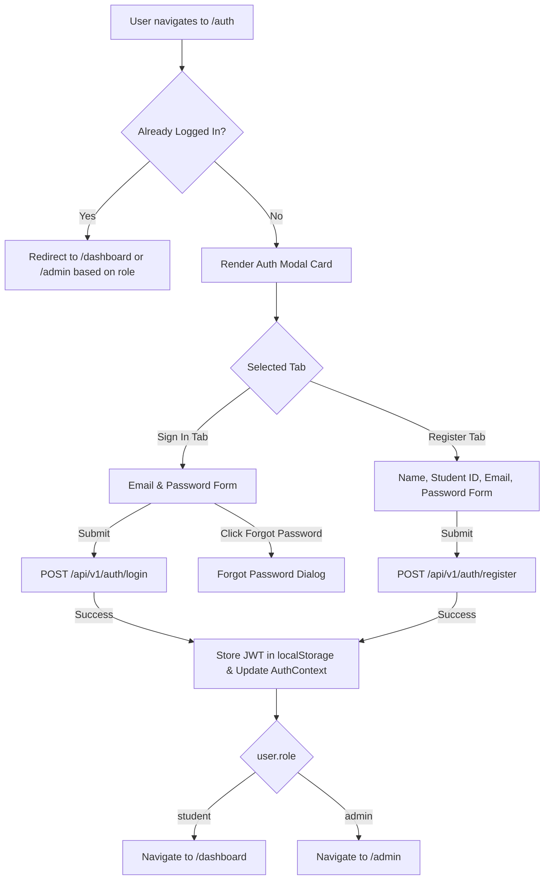

# Authentication Pages Module Specification

*Last Reviewed: October 2026*

This document provides complete technical, security, and UI documentation for the **NextCampus Login & Registration System** (`/auth`).

---

## 1. Module Overview

The Authentication module governs access to the protected sectors of NextCampus. It features an interactive, tabbed authentication portal implementing both Sign-In and Registration flows, real-time client validation, password visibility controls, a Forgot Password modal, and intelligent role-based redirects.

- **Route**: `/auth`
- **Access Level**: Public (Redirects to dashboard if already authenticated)
- **Primary Goal**: Deliver a secure, frictionless sign-in and account registration experience adhering to the Google Stitch visual palette.

---

## 2. Source Files & Architecture

### Frontend Files
- **Page Component**: [`src/pages/Auth.jsx`](file:///run/media/rudra/534a134c-69cb-49e5-9a9c-284e9ad8ee1b/NextCampus/src/pages/Auth.jsx)
- **Shared Components**:
  - `src/components/Navbar.jsx`
  - `src/components/Footer.jsx`
- **Context**: [`src/context/AuthContext.jsx`](file:///run/media/rudra/534a134c-69cb-49e5-9a9c-284e9ad8ee1b/NextCampus/src/context/AuthContext.jsx)

### Backend Endpoints
- `POST /api/v1/auth/login` (or `POST /api/auth/login`): Validates email & password, returns signed JWT and user profile.
- `POST /api/v1/auth/register` (or `POST /api/auth/register`): Creates new student account, hashes password, returns JWT.
- `POST /api/v1/auth/forgot-password`: Generates secure password reset token (logs token in development).

---

## 3. UI Sections & Authentication Flows



### 3.1 Sign-In Flow
- **Fields**:
  - Campus Email Address (validated for `@nextcampus.edu` or valid email pattern)
  - Password input with interactive eye icon toggle (`Show / Hide password`)
  - "Remember this device" checkbox
- **Pre-Seeded Demo Accounts**:
  - **Student Account**: `student@nextcampus.edu` / `student123` (Routes to `/dashboard`)
  - **Admin Account**: `admin@nextcampus.edu` / `admin123` (Routes to `/admin`)
- **Quick-Fill Buttons**: Development convenience buttons to populate student or admin credentials with one click.

### 3.2 Registration Flow
- **Fields**:
  - Full Name (minimum 2 characters)
  - Student ID / University ID (e.g., `STU-2026-4401`)
  - Campus Email
  - Password (minimum 6 characters)
  - Confirm Password (must match)
- Submitting registers a new user with default role `student`, hashes the password with bcrypt, and logs the user in immediately.

### 3.3 Forgot Password Modal
- Opens a lightweight modal requesting the user's registered email address.
- In development/testing environments, logs the password reset token to server console and presents an on-screen confirmation toast.

---

## 4. Security Implementation Details

1. **Stateless JWT**: Backend signs tokens with `JWT_SECRET` and a 7-day expiration.
2. **Password Hashing**: Backend hashes all passwords using `bcryptjs` with salt rounds = 10. Plain-text passwords are never persisted.
3. **Role-Based Redirects**: Upon successful authentication, `AuthContext` inspects `user.role`:
   ```javascript
   if (user.role === 'admin') {
     navigate('/admin');
   } else {
     navigate('/dashboard');
   }
   ```
4. **Secure Logout**:
   - Clears `token` and `user` keys from `localStorage`.
   - Clears `AuthContext` in-memory state.
   - Redirects browser to public landing page (`/`).

---

## 5. Responsive Behavior

- **Desktop (>= 1024px)**: Centered glassmorphic card (max-width: 480px) on ambient Licorice gradient with glowing Amaranth backdrop.
- **Mobile (< 768px)**: Full viewport mobile card with edge-to-edge touch inputs and accessible keypad triggers (`type="email"`, `type="password"`).

---

## 6. Testing & Quality Verification

- **Automated Integration**: Login, registration, token verification, and bad password rejection validated in `tests/master_audit.test.js`.
- **Credential Integrity**: Verified that malformed passwords or invalid credentials return `401 Unauthorized`.

---

## 7. Related Documentation
- [Authentication Architecture](file:///run/media/rudra/534a134c-69cb-49e5-9a9c-284e9ad8ee1b/NextCampus/docs/AUTHENTICATION.md)
- [Authorization & RBAC](file:///run/media/rudra/534a134c-69cb-49e5-9a9c-284e9ad8ee1b/NextCampus/docs/AUTHORIZATION.md)
- [Student Dashboard](file:///run/media/rudra/534a134c-69cb-49e5-9a9c-284e9ad8ee1b/NextCampus/docs/modules/STUDENT_DASHBOARD.md)
