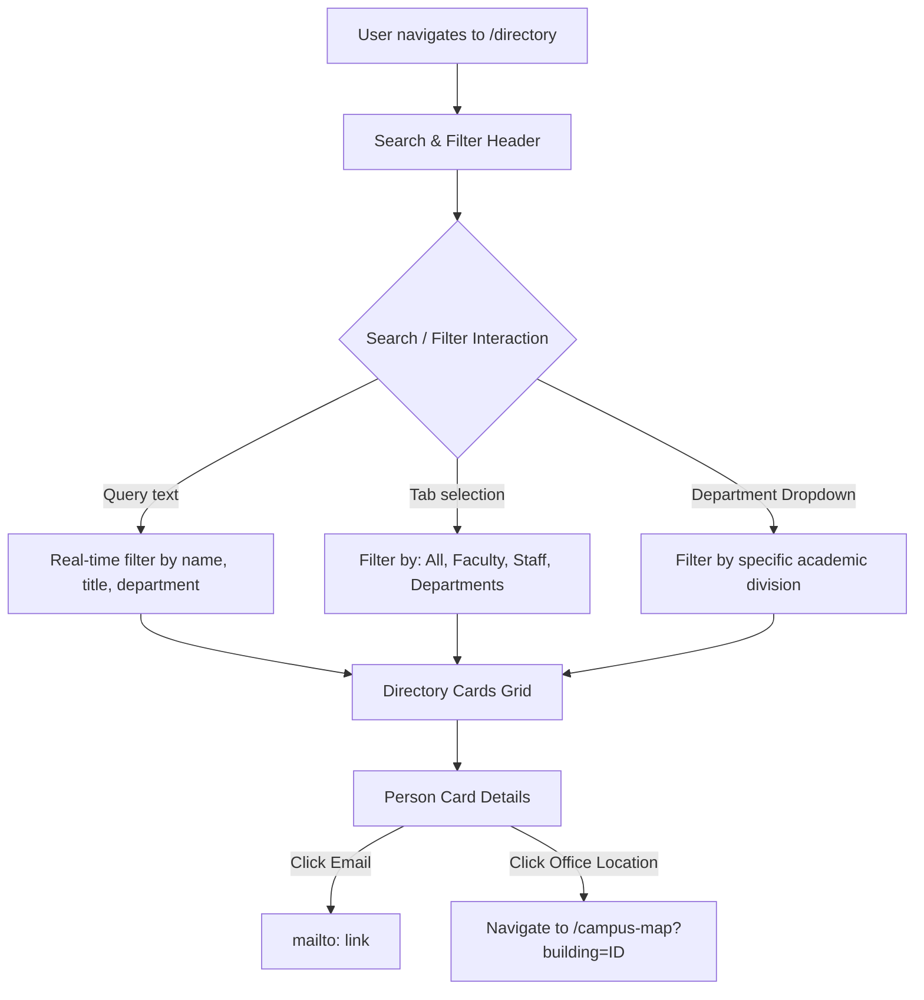

# Campus Directory Module Specification

*Last Reviewed: October 2026*

This document provides complete technical and design documentation for the **NextCampus Campus Directory** (`/directory`).

---

## 1. Module Overview

The Campus Directory serves as the comprehensive search and contact index for campus buildings, academic departments, faculty professors, administrative staff, and student services. It enables students and staff to quickly locate personnel, view office hours, initiate emails, and bridge directly into campus navigation.

- **Route**: `/directory`
- **Access Level**: Protected (Role: `student` or `admin`)
- **Primary Goal**: Facilitate quick communication and physical navigation between students, faculty members, and administrative departments.

---

## 2. Source Files & Architecture

### Frontend Files
- **Page Component**: [`src/pages/CampusDirectory.jsx`](file:///run/media/rudra/534a134c-69cb-49e5-9a9c-284e9ad8ee1b/NextCampus/src/pages/CampusDirectory.jsx)
- **Shared Components**:
  - `src/components/Navbar.jsx`
  - `src/components/Footer.jsx`
- **Dependencies**: `lucide-react` (icons: `Search`, `Mail`, `Phone`, `MapPin`, `Clock`, `User`, `Building`)

### Backend Endpoints
- `GET /api/v1/directory` (or `GET /api/directory`): Fetches array of directory entries (departments, faculty, and staff).
- `GET /api/v1/facilities` (or `GET /api/facilities`): Supplies facility metadata for linking office rooms to buildings.

---

## 3. UI Sections & User Workflows

### 3.1 Directory Search & Filtering Controls
- **Real-Time Search Bar**: Instant debounced query matching on person name, title, department, or office room.
- **Role Tabs**:
  - **All**: Complete directory view.
  - **Faculty**: Professors, associate professors, lecturers, and lab researchers.
  - **Staff**: Department administrators, academic advisors, registrars, and IT specialists.
  - **Departments**: Direct department overview cards (Head of Department, main office, phone extension).
- **Department Dropdown Filter**: Filter across Computer Science, Electrical Engineering, Physics, Humanities, Business, and Student Affairs.

### 3.2 Directory Profile Cards
Each personnel card includes:
- Profile picture / avatar initials badge.
- Full name and academic title (e.g., *Dr. Sarah Jenkins, Associate Professor*).
- Department badge (e.g., *Computer Science & Engineering*).
- Office Room assignment (e.g., *Turing Hall, Room 412*).
- Contact triggers:
  - Email button (`mailto:s.jenkins@nextcampus.edu`)
  - Phone extension button (`tel:+1555019283`)
  - Office hours pill (e.g., *Mon/Wed 2:00 PM - 4:00 PM*)
  - "Locate on Map" action button linking directly to `/campus-map`.

---

## 4. State Management & Loading States

- **Directory State**: Managed in component local state (`entries`, `searchTerm`, `selectedTab`, `selectedDept`).
- **Loading State**: Displays clean grid of glassmorphic skeleton cards while directory records load from backend.
- **Empty State**: Friendly illustration and "No directory entries match your search criteria" prompt with a "Reset Filters" button.

---

## 5. Responsive Behavior

- **Desktop (>= 1200px)**: 3-column responsive card grid.
- **Tablet (768px - 1199px)**: 2-column card grid.
- **Mobile (< 768px)**: 1-column vertical card stream with stacked action buttons.

---

## 6. Testing & Quality Verification

- **Automated Integration**: Directory endpoint verified in `tests/master_audit.test.js`.
- **Search Filtering**: Tested query combinations including partial names, room codes, and department filters.

---

## 7. Related Documentation
- [Interactive Campus Map](file:///run/media/rudra/534a134c-69cb-49e5-9a9c-284e9ad8ee1b/NextCampus/docs/modules/CAMPUS_MAP.md)
- [Campus Management](file:///run/media/rudra/534a134c-69cb-49e5-9a9c-284e9ad8ee1b/NextCampus/docs/modules/CAMPUS_MANAGEMENT.md)
- [Routes & Pages](file:///run/media/rudra/534a134c-69cb-49e5-9a9c-284e9ad8ee1b/NextCampus/docs/ROUTES_AND_PAGES.md)
