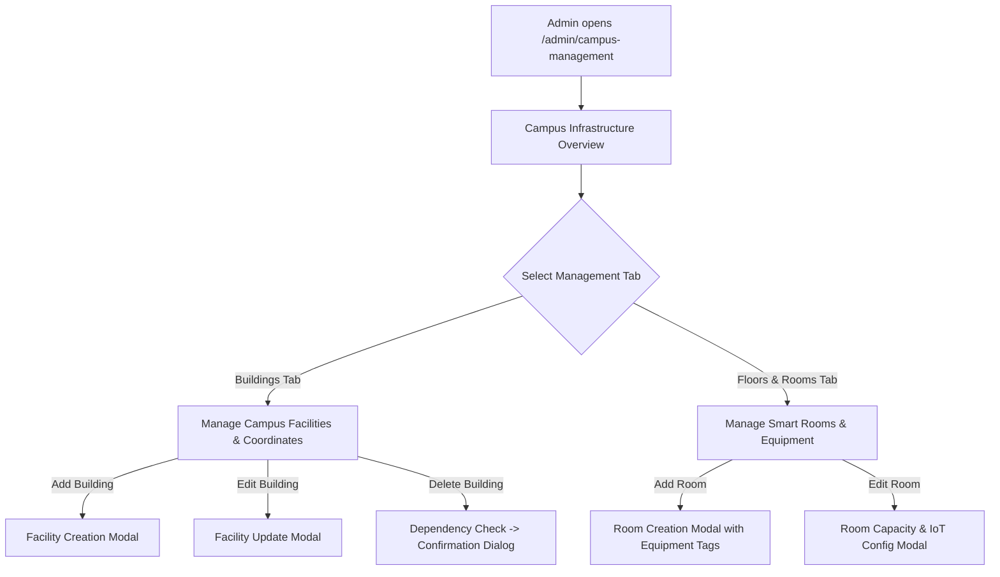

# Campus Management Module Specification

*Last Reviewed: October 2026*

This document provides complete technical, database, and administrative documentation for the **NextCampus Campus Management** portal (`/admin/campus-management`).

---

## 1. Module Overview

Campus Management provides comprehensive administrative CRUD (Create, Read, Update, Delete) capabilities over physical campus infrastructure: buildings, departments, floors, and smart rooms. Changes made here immediately propagate across the **Interactive Campus Map**, **Campus Directory**, and **SmartRoom** indoor visualization systems.

- **Route**: `/admin/campus-management`
- **Access Level**: Protected (**Admin Role Only**: `user.role === 'admin'`)
- **Primary Goal**: Empower campus infrastructure administrators to manage buildings, floors, and room facilities with relational integrity.

---

## 2. Source Files & Architecture

### Frontend Files
- **Page Component**: [`src/pages/CampusManagement.jsx`](file:///run/media/rudra/534a134c-69cb-49e5-9a9c-284e9ad8ee1b/NextCampus/src/pages/CampusManagement.jsx)
- **Shared Components**:
  - `src/components/Navbar.jsx`
  - `src/components/ProtectedRoute.jsx`
  - `src/components/Footer.jsx`
- **Styling**: `src/index.css` (admin tables, CRUD modals, delete confirmation modals)

### Backend Endpoints
- `GET /api/v1/facilities`: Lists all managed buildings.
- `POST /api/v1/facilities`: Creates a new building record.
- `PUT /api/v1/facilities/:id`: Updates building metadata or coordinates.
- `DELETE /api/v1/facilities/:id`: Deletes a building record (with dependency validation).
- `GET /api/v1/rooms`: Lists all rooms.
- `POST /api/v1/rooms`: Creates a new room associated with a building and floor.
- `PUT /api/v1/rooms/:id`: Updates room capacity, equipment, or telemetry thresholds.
- `DELETE /api/v1/rooms/:id`: Deletes a room record.

---

## 3. UI Sections & Administrative Workflows

### 3.1 Buildings & Facilities Management
- **Searchable Facility Table**: Displays Building Name, Code (e.g., `ENG-01`), Category, Floor Count, GPS Coordinates (`lat`, `lng`), and Action buttons.
- **Add / Edit Facility Modal**:
  - Name: e.g., *Alan Turing Hall of Engineering*
  - Code: e.g., *ENG-01*
  - Category: Academic, Lab, Library, Dining, Admin, Sports
  - Latitude & Longitude inputs with live preview
  - Total Floors: Number input (1 to 10)
  - Operating Hours: e.g., *07:00 AM - 10:00 PM*
- **Deletion Safeguard**: Attempting to delete a building with registered rooms or unresolved complaints displays a confirmation warning dialog detailing dependent assets.

### 3.2 Smart Rooms Management
- **Room Registry Table**: Displays Room Number, Building, Floor, Room Type (Lecture Hall, Lab, Seminar, Study), Max Seating Capacity, and Equipment Badges.
- **Add / Edit Room Modal**:
  - Room Number / Code: e.g., *Room 302*
  - Building Selector: Links to parent facility
  - Floor Number: e.g., *Floor 3*
  - Room Capacity: Seating capacity integer
  - Equipment Multi-Select: Projector, Smart Board, Video Conference, Sound System, AC
  - Baseline IoT Telemetry Thresholds: Target Temp (22°C), Max Noise (65 dB).

---

## 4. Relational Integrity & Validation Rules

1. **Unique Building Codes**: Building codes must be unique across the campus system (enforced in Mongoose model `unique: true`).
2. **Coordinate Boundaries**: Validates that coordinates fall within campus perimeter bounds:
   - Latitude between `-90` and `90`
   - Longitude between `-180` and `180`
3. **Safe Cascade Deletion**: Deleting a facility cleans up or disassociates child rooms to prevent orphaned room references.

---

## 5. Responsive Behavior

- **Desktop (>= 1200px)**: Full administrative data tables with multi-column sorting and filtering.
- **Tablet / Mobile (< 1200px)**: Card-based representation of facilities and rooms with touch-friendly edit and delete action sheets.

---

## 6. Testing & Quality Verification

- **Automated Integration**: Facility and room CRUD workflows tested in `tests/master_audit.test.js`.
- **RBAC Enforced**: Verified non-admin requests to facility creation endpoints return `403 Forbidden`.

---

## 7. Related Documentation
- [Interactive Campus Map](file:///run/media/rudra/534a134c-69cb-49e5-9a9c-284e9ad8ee1b/NextCampus/docs/modules/CAMPUS_MAP.md)
- [SmartRoom](file:///run/media/rudra/534a134c-69cb-49e5-9a9c-284e9ad8ee1b/NextCampus/docs/modules/SMARTROOM.md)
- [Admin Dashboard](file:///run/media/rudra/534a134c-69cb-49e5-9a9c-284e9ad8ee1b/NextCampus/docs/modules/ADMIN_DASHBOARD.md)
