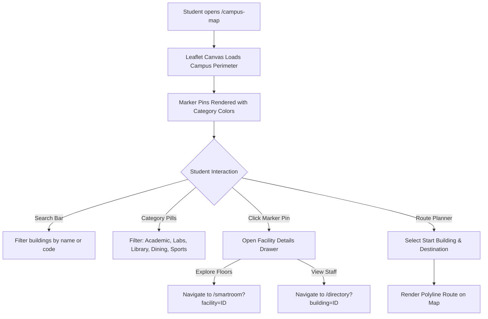
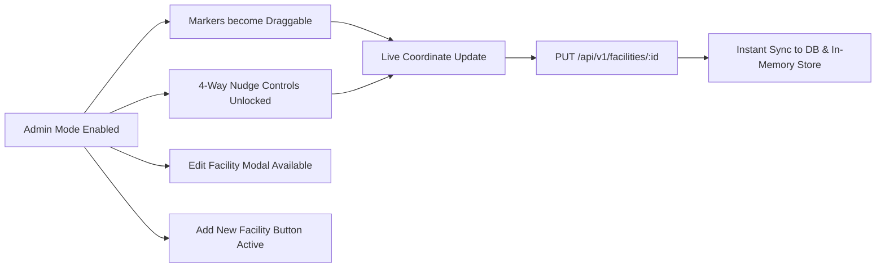

# Interactive Campus Map Module Specification

*Last Reviewed: October 2026*

This document provides complete technical, design, and administrative documentation for the **NextCampus Interactive Campus Map** (`/campus-map`).

---

## 1. Module Overview

The Interactive Campus Map provides a responsive, high-performance spatial navigation system for the entire campus. It integrates real-time GIS coordinates, building categorizations, intelligent origin-to-destination route planning, and dedicated facility information panels. 

Additionally, for authenticated **administrators**, the map dynamically unlocks an **Interactive GIS Map Editor**, allowing direct drag-and-drop marker relocation, 4-way arrow nudge controls, and in-place building editing.

- **Route**: `/campus-map`
- **Access Level**: Protected (Role: `student` or `admin`)
- **Core Technology**: React + Leaflet.js (`react-leaflet` / `leaflet`) with OpenStreetMap tiles.

---

## 2. Source Files & Architecture

### Frontend Files
- **Page Component**: [`src/pages/CampusMap.jsx`](file:///run/media/rudra/534a134c-69cb-49e5-9a9c-284e9ad8ee1b/NextCampus/src/pages/CampusMap.jsx)
- **Map Assets**:
  - `leaflet/dist/leaflet.css`
  - Custom SVG marker icons styled in NextCampus palette (`#AC274F`, `#EB638B`).
- **Dependencies**: `leaflet`, `lucide-react`

### Backend Endpoints
- `GET /api/v1/facilities` (or `GET /api/facilities`): Returns array of campus buildings, coordinates (`lat`, `lng`), categories, and floor info.
- `GET /api/v1/facilities/:id`: Returns detailed facility record including departments, rooms, and hours.
- `PUT /api/v1/facilities/:id`: **(Admin Only)** Updates building details and coordinates (`lat`, `lng`).
- `POST /api/v1/facilities`: **(Admin Only)** Creates a new campus building record.

---

## 3. Student Navigation Workflows

### 3.1 Facility Category Filters
Filters allow instant toggling of campus marker types:
- **Academic** (`#AC274F` Amaranth Purple): Lecture halls, classrooms.
- **Laboratories** (`#EB638B` Blush): Computer labs, science centers.
- **Libraries & Study**: Central Library, research archives.
- **Dining & Social**: Student cafeteria, coffee commons.
- **Administration**: Registrar, student affairs, admissions.
- **Sports & Recreation**: Gymnasium, campus stadium, pool.

### 3.2 Origin & Destination Route Planning
- Students can select an **Origin** and **Destination** facility from dropdowns.
- The map draws an animated polyline connecting the points across campus walkways.
- Displays calculated walking distance (meters) and estimated walking time (minutes).

### 3.3 Facility Information Drawer
Clicking any building marker opens a sliding drawer containing:
- Building photograph and full name.
- Building code (e.g., `ENG-01`, `LIB-CENTRAL`).
- Operating hours and accessibility features (wheelchair access, elevator).
- Direct link to **SmartRoom** indoor floor plans.
- Direct link to **Campus Directory** staff listings.

---

## 4. Administrative Interactive Map Editor

When logged in as an **Administrator** (`role === 'admin'`), the top control bar reveals the **Admin GIS Mode Toggle**:

### 4.1 Click-to-Move & Marker Dragging
- Dragging any building pin across the map immediately recalculates its latitude and longitude.
- Displays live coordinate feedback tooltip with 6 decimal places of precision.

### 4.2 4-Way Arrow Nudge Controls
- Precision directional pad (Up, Down, Left, Right arrows) for sub-meter adjustments:
  - Nudge increment: `0.0001°` latitude/longitude per click.
  - Ensures pixel-perfect alignment with underlying satellite or aerial cartography.

### 4.3 Facility Edit & Creation Modals
- Modal dialog allowing admins to edit:
  - Facility Name
  - Building Code
  - Primary Category
  - Number of Floors
  - Latitude & Longitude manual inputs
- Saves via `PUT /api/v1/facilities/:id` or creates via `POST /api/v1/facilities`.

---

## 5. State Management & Offline Resilience

- Map markers are stored in local React state initialized via `apiClient.get('/facilities')`.
- In offline or disconnected environments, coordinates default to the high-fidelity pre-seeded campus GIS dataset centered at latitude `12.9716`, longitude `77.5946`.
- Coordinates update optimistically in the UI before server confirmation.

---

## 6. Responsive Behavior

- **Desktop (>= 1024px)**: Full-bleed Leaflet map with left-docked floating search filter bar and right-docked facility detail drawer.
- **Tablet / Mobile (< 1024px)**:
  - Bottom sheet drawer for building details.
  - Collapsible filter accordion above the map.
  - Multi-touch pinch-to-zoom and pan navigation.

---

## 7. Testing & Quality Verification

- **Automated Integration**: Tested in `tests/master_audit.test.js` under facility listing and update suites.
- **Marker Relocation**: Verified admin role authorization check prevents unauthorized students from triggering `PUT /api/facilities/:id`.

---

## 8. Related Documentation
- [SmartRoom Module](file:///run/media/rudra/534a134c-69cb-49e5-9a9c-284e9ad8ee1b/NextCampus/docs/modules/SMARTROOM.md)
- [Campus Directory](file:///run/media/rudra/534a134c-69cb-49e5-9a9c-284e9ad8ee1b/NextCampus/docs/modules/CAMPUS_DIRECTORY.md)
- [Campus Management](file:///run/media/rudra/534a134c-69cb-49e5-9a9c-284e9ad8ee1b/NextCampus/docs/modules/CAMPUS_MANAGEMENT.md)
- [Design System](file:///run/media/rudra/534a134c-69cb-49e5-9a9c-284e9ad8ee1b/NextCampus/docs/DESIGN_SYSTEM.md)
