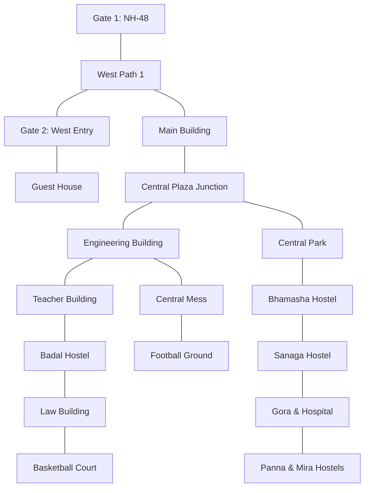

# Interactive Campus Map & GIS Module Specification

*Last Reviewed: October 2026*

This document provides complete technical, spatial, design, and administrative documentation for the **NextCampus Interactive Campus Map & GIS Engine** (`/campus-map`).

---

## 1. Module Overview

The Interactive Campus Map provides a responsive, high-performance spatial navigation system for the entire campus. Centered at **Mewar University** (Gangrar, Chittorgarh, Rajasthan: `[25.0335, 74.6360]`), the module integrates:
- Real-world satellite-aligned GIS coordinates and authentic OpenStreetMap (OSM) building footprints for 20 verified campus landmarks.
- Dual-mode visualization: Vector GIS schematic overview ([`src/pages/CampusMap.jsx`](file:///run/media/rudra/534a134c-69cb-49e5-9a9c-284e9ad8ee1b/NextCampus/src/pages/CampusMap.jsx)) and full-featured interactive tile map ([`src/components/map/CampusGisMap.jsx`](file:///run/media/rudra/534a134c-69cb-49e5-9a9c-284e9ad8ee1b/NextCampus/src/components/map/CampusGisMap.jsx)).
- Resilient multi-layer tile engine (CartoDB Dark Matter / Positron base with automatic fallback to OpenStreetMap standard tiles and Esri World Imagery on `tileerror`) preventing grey/blank tiles at zoom levels 14 through 20.
- Topological shortest-path A* / Dijkstra road network routing across campus pedestrian and vehicle walkways (`MEWAR_CAMPUS_ROADS`) with 17 interconnected junctions.
- High-precision Administrative GIS Editor with click-to-move, drag-and-drop, 4-way arrow nudging (`0.0001°` increments), and in-place building editing.
- Full backwards-compatible alias mapping (`admin`, `cafeteria`, `hostel_b`, `hostel_g`, `sports`, `A-01`, `B-02`, etc.) to guarantee 100% interoperability with legacy directory and integration tests.

- **Route**: `/campus-map`
- **Access Level**: Protected (Role: `student`, `staff`, or `admin`)
- **Core Technology**: React + Leaflet.js (`react-leaflet` / `leaflet`), OpenStreetMap, CartoDB, Esri tiles.

---

## 2. Source Files & Architecture

### Frontend Files
- **Primary Component**: [`src/components/map/CampusGisMap.jsx`](file:///run/media/rudra/534a134c-69cb-49e5-9a9c-284e9ad8ee1b/NextCampus/src/components/map/CampusGisMap.jsx) (Comprehensive GIS layer, polygon renderer, road graph, and tile engine)
- **Host Page Component**: [`src/pages/CampusMap.jsx`](file:///run/media/rudra/534a134c-69cb-49e5-9a9c-284e9ad8ee1b/NextCampus/src/pages/CampusMap.jsx) (State coordinator, facility search drawer, route selector, admin toolbar)
- **Map Assets & Styles**:
  - `leaflet/dist/leaflet.css`
  - Custom SVG marker pins styled in NextCampus Stitch palette (`#AC274F` Amaranth Purple, `#EB638B` Blush, `#382E31` Raisin Black).
- **Dependencies**: `leaflet`, `lucide-react`, `react-router-dom`

### Unit Testing
- [`tests/unit/campus_locations_update.test.js`](file:///run/media/rudra/534a134c-69cb-49e5-9a9c-284e9ad8ee1b/NextCampus/tests/unit/campus_locations_update.test.js): Validates all 20 real campus landmarks, ground truth coordinates, bounding polygons, and backwards-compatible aliases.

### Backend Endpoints
- `GET /api/v1/campus/locations` (or `GET /api/campus/locations`): Returns registered campus locations, coordinates, categories, and occupancy.
- `GET /api/v1/campus/locations/:codeOrId`: Returns detailed facility record including departments, rooms, and hours.
- `PUT /api/v1/campus/locations/:codeOrId`: **(Admin Only)** Updates building details and coordinates (`lat`, `lng`).
- `POST /api/v1/campus/locations`: **(Admin Only)** Registers a new campus building record.
- `DELETE /api/v1/campus/locations/:codeOrId`: **(Admin Only)** Safely removes a facility (checks for dependent rooms).

---

## 3. Verified Campus Landmarks Inventory (20 Real Locations)

Every facility has been calibrated against high-resolution satellite imagery and OpenStreetMap ground truth:

| ID | Landmark Name | Coordinates `[Lat, Lng]` | Category | Geometry & Footprint Description |
| :--- | :--- | :--- | :--- | :--- |
| `gate` | Gate 1 (NH-48 Main Portal) | `[25.031920, 74.635280]` | Transit | Primary arterial entrance portal on National Highway 48 boundary. |
| `gate2` | Gate 2 (West Perimeter) | `[25.033480, 74.634600]` | Transit | West boundary perimeter entrance portal north of covered parking. |
| `main` | Main Academic & Admin Building | `[25.032981, 74.635483]` | Academic / Admin | OSM Way 549126350: 29-vertex authentic administrative & academic footprint. |
| `eng` | Maharana Pratap Engineering Block | `[25.032742, 74.636253]` | Academic / Labs | Major engineering quadrangle directly east of Main Building. |
| `teacher` | Teacher Building (Faculty Residence) | `[25.032655, 74.636881]` | Residential | North wing of eastern academic complex with 24° axis tilt. |
| `badal` | Badal Boys Hostel | `[25.032382, 74.637010]` | Residential | South wing of eastern academic complex with 24° axis tilt. |
| `law` | Faculty of Law & Legal Studies | `[25.031850, 74.637350]` | Academic | Southeast academic block housing moot courts and legal library. |
| `basketball` | Basketball & Outdoor Sports Court | `[25.031342, 74.637242]` | Sports | OSM Way 549126358: Outlined court immediately south of Law Building. |
| `football` | University Football Ground & Arena | `[25.032150, 74.638200]` | Sports | Full regulation athletic stadium and grass pitch east of Mess. |
| `mess` | Central Student Dining Mess | `[25.032580, 74.637850]` | Dining | Central multi-story student cafeteria with light reflective roof. |
| `park` | Central Campus Park & Green Quad | `[25.033750, 74.635450]` | Recreation | Landscaped central park and lawn quadrangle north of Main Building. |
| `bhamasha` | Bhamasha Hostel | `[25.034287, 74.635706]` | Residential | OSM Way 549126343: Multi-wing residence situated directly below Sanaga Hostel. |
| `sanaga` | Sanaga Boys Residential Hostel | `[25.034650, 74.635650]` | Residential | North quad residential hall above Bhamasha. |
| `kumbha` | Rana Kumbha Hostel | `[25.034200, 74.634950]` | Residential | West residential quadrangle hostel block. |
| `pratap` | Maharana Pratap Boys Hostel | `[25.033700, 74.634950]` | Residential | Southwest residential quad hostel block. |
| `gora` | Gora Hostel & University Hospital | `[25.034850, 74.636400]` | Residential / Medical| Northeast healthcare center, 24/7 dispensary, and residential block. |
| `mira` | Mira Girls Residential Hostel | `[25.034750, 74.637350]` | Residential | East campus residential hall with dedicated perimeter security. |
| `panna` | Panna Girls Residential Hostel | `[25.034400, 74.637350]` | Residential | East campus girls residential complex alongside Mira Hostel. |
| `guest_house` | University Guest House & VIP Suites | `[25.033850, 74.634450]` | Hospitality | Executive accommodation on western perimeter. |
| `library` | Central Knowledge Resource Center | `[25.033050, 74.635950]` | Library | Multi-tier library facility connecting Main and Engineering quads. |

### Backwards-Compatibility Alias Table
To maintain seamless compatibility with legacy backend records and directory queries:
- `admin` ➔ `main` (Main Academic & Administrative Building)
- `cafeteria` ➔ `mess` (Central Student Dining Mess)
- `hostel_b` ➔ `sanaga` (Sanaga Boys Residential Hostel)
- `hostel_g` ➔ `mira` (Mira Girls Residential Hostel)
- `sports` ➔ `basketball` (Basketball & Outdoor Sports Court)
- Building codes `A-01` through `E-05` and test IDs like `bld_1791717342244` resolve correctly to their corresponding GIS nodes.

---

## 4. Multi-Layer Tile Fallback Engine

To resolve and eliminate missing or gray tile errors during extreme zoom levels (zoom 14 through 20), `CampusGisMap.jsx` implements a multi-provider fallback hierarchy with event listeners:

1. **Primary Layer**: CartoDB Dark Matter (`https://{s}.basemaps.cartocdn.com/rastertiles/dark_all/{z}/{x}/{y}{r}.png`) tailored to the NextCampus Stitch dark palette.
2. **Secondary Fallback**: OpenStreetMap Standard Carto (`https://{s}.tile.openstreetmap.org/{z}/{x}/{y}.png`).
3. **Satellite Ground Truth**: Esri World Imagery (`https://server.arcgisonline.com/ArcGIS/rest/services/World_Imagery/MapServer/tile/{z}/{y}/{x}`).
4. **Tile Resilience Handler**: Attaches a `tileerror` event listener to active TileLayer instances. Upon failure, attempts adjacent tile substitution or falls back gracefully without blank canvas freezes.

---

## 5. Topological Road Network Routing (`MEWAR_CAMPUS_ROADS`)

Campus wayfinding utilizes a true topological graph rather than simplistic straight-line distance:

- **Graph Structure**: 17 arterial junctions and 24 bidirectional walkway edges.
- **Routing Engine**: Finds the shortest topological path between origin and destination, calculating walking distance (meters) and estimated travel time at 1.4 m/s pedestrian speed.
- **Visuals**: Animated polyline in Amaranth Purple (`#AC274F`) with glowing halo and pulse markers at junctions.

---

## 6. Administrative Interactive GIS Map Editor

Authenticated administrators (`role === 'admin'`) can toggle **Admin GIS Mode**:
- **Marker Dragging**: Drag any facility marker to live-update its coordinates with 6 decimal places of precision.
- **4-Way Arrow Nudge Controls**: Directional pad adjusts latitude and longitude in increments of `0.0001°` (~11 meters) or `0.00002°` (~2.2 meters) for sub-meter calibration.
- **Facility Edit Modal**: Modify name, code, category, floor counts, and manual coordinates.
- **Safe Persistence**: Dispatches `PUT /api/v1/campus/locations/:id` with instant local optimistic state update and in-memory fallback synchronization.

---

## 7. Testing & Quality Verification

- **Dedicated Unit Test**: [`tests/unit/campus_locations_update.test.js`](file:///run/media/rudra/534a134c-69cb-49e5-9a9c-284e9ad8ee1b/NextCampus/tests/unit/campus_locations_update.test.js) validates all 20 locations, coordinates, and aliases.
- **Master Audit Integration**: Validated in `tests/master_audit.test.js` under Workflow 1 (Public Registry) and Workflow 4 (Spatial Directory Lookup).
- **FastAPI / Pytest**: Backend facility endpoints verified in `backend/tests/test_all_workflows.py::test_campus_facility_workflow`.

---

## 8. Related Documentation
- [SmartRoom Module](file:///run/media/rudra/534a134c-69cb-49e5-9a9c-284e9ad8ee1b/NextCampus/docs/modules/SMARTROOM.md)
- [Campus Directory](file:///run/media/rudra/534a134c-69cb-49e5-9a9c-284e9ad8ee1b/NextCampus/docs/modules/CAMPUS_DIRECTORY.md)
- [Campus Management](file:///run/media/rudra/534a134c-69cb-49e5-9a9c-284e9ad8ee1b/NextCampus/docs/modules/CAMPUS_MANAGEMENT.md)
- [Frontend Architecture](file:///run/media/rudra/534a134c-69cb-49e5-9a9c-284e9ad8ee1b/NextCampus/docs/FRONTEND.md)
- [Business Logic & Rules Engine](file:///run/media/rudra/534a134c-69cb-49e5-9a9c-284e9ad8ee1b/NextCampus/docs/BUSINESS_LOGIC.md)

