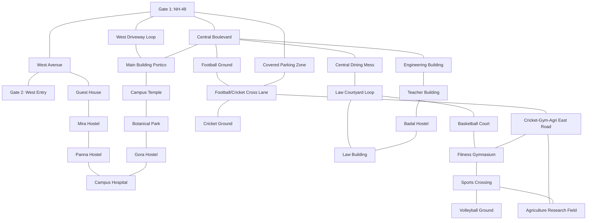

# Interactive Campus Map & GIS Module Specification

*Last Reviewed: October 2026*

This document provides complete technical, spatial, design, and administrative documentation for the **NextCampus Interactive Campus Map & GIS Engine** (`/campus-map`).

---

## 1. Module Overview

The Interactive Campus Map provides a responsive, high-performance spatial navigation system for the entire campus. Centered at **Mewar University** (Gangrar, Chittorgarh, Rajasthan: `[25.0335, 74.6360]`), the module integrates:
- Real-world satellite-aligned GIS coordinates and authentic OpenStreetMap (OSM) building footprints for 20 verified campus landmarks.
- Dual-mode visualization: Vector GIS schematic overview ([`src/pages/CampusMap.jsx`](file:///run/media/rudra/534a134c-69cb-49e5-9a9c-284e9ad8ee1b/NextCampus/src/pages/CampusMap.jsx)) and full-featured interactive tile map ([`src/components/map/CampusGisMap.jsx`](file:///run/media/rudra/534a134c-69cb-49e5-9a9c-284e9ad8ee1b/NextCampus/src/components/map/CampusGisMap.jsx)).
- Resilient multi-layer tile engine (CartoDB Dark Matter / Positron base with automatic fallback to OpenStreetMap standard tiles and Esri World Imagery on `tileerror`) preventing grey/blank tiles at zoom levels 14 through 20.
- Topological shortest-path A* / Dijkstra road network routing across campus pedestrian and vehicle walkways (`MEWAR_CAMPUS_ROADS`) with 17 interconnected junctions.
- High-precision Administrative GIS Editor with click-to-move, drag-and-drop, 4-way arrow nudging (`0.0001°` increments), and in-place building editing.
- Full backwards-compatible alias mapping (`admin`, `cafeteria`, `hostel_b`, `hostel_g`, `sports`, `A-01`, `B-02`, etc.) to guarantee 100% interoperability with legacy directory and integration tests.

- **Route**: `/campus-map`
- **Access Level**: Protected (Role: `student`, `staff`, or `admin`)
- **Core Technology**: React + Leaflet.js (`react-leaflet` / `leaflet`), OpenStreetMap, CartoDB, Esri tiles.

---

## 2. Source Files & Architecture

### Frontend Files
- **Primary Component**: [`src/components/map/CampusGisMap.jsx`](file:///run/media/rudra/534a134c-69cb-49e5-9a9c-284e9ad8ee1b/NextCampus/src/components/map/CampusGisMap.jsx) (Comprehensive GIS layer, polygon renderer, road graph, and tile engine)
- **Host Page Component**: [`src/pages/CampusMap.jsx`](file:///run/media/rudra/534a134c-69cb-49e5-9a9c-284e9ad8ee1b/NextCampus/src/pages/CampusMap.jsx) (State coordinator, facility search drawer, route selector, admin toolbar)
- **Map Assets & Styles**:
  - `leaflet/dist/leaflet.css`
  - Custom SVG marker pins styled in NextCampus Stitch palette (`#AC274F` Amaranth Purple, `#EB638B` Blush, `#382E31` Raisin Black).
- **Dependencies**: `leaflet`, `lucide-react`, `react-router-dom`

### Unit Testing
- [`tests/unit/campus_locations_update.test.js`](file:///run/media/rudra/534a134c-69cb-49e5-9a9c-284e9ad8ee1b/NextCampus/tests/unit/campus_locations_update.test.js): Validates all 20 real campus landmarks, ground truth coordinates, bounding polygons, and backwards-compatible aliases.

### Backend Endpoints
- `GET /api/v1/campus/locations` (or `GET /api/campus/locations`): Returns registered campus locations, coordinates, categories, and occupancy.
- `GET /api/v1/campus/locations/:codeOrId`: Returns detailed facility record including departments, rooms, and hours.
- `PUT /api/v1/campus/locations/:codeOrId`: **(Admin Only)** Updates building details and coordinates (`lat`, `lng`).
- `POST /api/v1/campus/locations`: **(Admin Only)** Registers a new campus building record.
- `DELETE /api/v1/campus/locations/:codeOrId`: **(Admin Only)** Safely removes a facility (checks for dependent rooms).

---

## 3. Verified Campus Landmarks Inventory (20 Real Locations)

Every facility has been calibrated against high-resolution satellite imagery and OpenStreetMap ground truth:

| ID | Landmark Name | Coordinates `[Lat, Lng]` | Category | Geometry & Footprint Description |
| :--- | :--- | :--- | :--- | :--- |
| `gate` | Gate 1 (NH-48 Main Portal) | `[25.032009, 74.634483]` | Transit | Primary arterial entrance portal on National Highway 48 boundary. |
| `gate2` | Gate 2 (West Perimeter) | `[25.034828, 74.633839]` | Transit | West boundary perimeter entrance portal north of covered parking. |
| `main` | Main Academic & Admin Building | `[25.032600, 74.635200]` | Academic / Admin | Central flagship complex with north courtyard abutting Temple. |
| `temple` | Mewar Campus Temple & Shrine | `[25.033719, 74.635288]` | Spiritual / Culture | Yellow boundary courtyard shrine north of Main Building, south of Park. |
| `eng` | Faculty of Engineering & Technology | `[25.032631, 74.636545]` | Academic / Labs | Major engineering quadrangle directly east of Main Building. |
| `teacher` | Teacher Building (Faculty Residence) | `[25.032655, 74.636881]` | Academic / Faculty | North wing of eastern academic complex with faculty consultation rooms. |
| `badal` | Badal Boys Hostel | `[25.032382, 74.637010]` | Residential | South wing of eastern academic complex directly below Teacher Building. |
| `mess` | Central Student Dining Mess | `[25.032203, 74.636307]` | Dining | Central multi-story student cafeteria with light reflective roof. |
| `law` | Faculty of Law & Legal Studies | `[25.032106, 74.636843]` | Academic | Southeast academic block with western courtyard loop. |
| `football` | University Football Ground & Arena | `[25.031522, 74.635609]` | Sports | Full regulation athletic football ground west of Mess. |
| `parking` | Main Campus Vehicle Parking Zone | `[25.031328, 74.635148]` | Transit / Parking | Orange boundary covered vehicle canopy bays along western highway perimeter. |
| `basketball` | Basketball & Outdoor Sports Court | `[25.031279, 74.637004]` | Sports | Outlined hard court surface immediately south of Law Building. |
| `cricket` | University Cricket Ground & Pavilion | `[25.030278, 74.636092]` | Sports | Red boundary turf cricket pitch, spectator lawns, and practice nets. |
| `gym` | University Gymnasium & Fitness Centre | `[25.030725, 74.636929]` | Sports / Fitness | Indoor strength training and workout hall between Cricket East Road and Volleyball. |
| `volleyball` | University Volleyball Arena & Courts | `[25.030725, 74.637337]` | Sports | Purple boundary outdoor regulation volleyball arena east of Gym. |
| `agriculture` | Faculty of Agriculture Research Field | `[25.030016, 74.637326]` | Academic / Agri | Green boundary experimental crop plots south of Gym and Volleyball. |
| `park` | Central Campus Park & Botanical Garden| `[25.033968, 74.635239]` | Recreation | Landscaped botanical gardens and shaded walking quadrangle. |
| `bhamasha` | Bhamasha Hostel | `[25.034287, 74.635706]` | Residential | Multi-wing residence situated directly below Sanaga Hostel. |
| `sanaga` | Sanaga Boys Residential Hostel | `[25.034645, 74.635783]` | Residential | North quad residential hall above Bhamasha. |
| `kumbha` | Maharana Kumbha Boys Hostel | `[25.033814, 74.636040]` | Residential | Central residential quadrangle hostel block. |
| `pratap` | Maharana Pratap Boys Hostel | `[25.033592, 74.636105]` | Residential | Residential hostel block south of Kumbha Hostel. |
| `gora` | Gora Boys Residential Hostel | `[25.034447, 74.635065]` | Residential | Central quadrangle hostel block north of Botanical Park. |
| `hospital` | University Hospital & Health Centre | `[25.034600, 74.634840]` | Medical / 24/7 | Healthcare dispensary and 24/7 emergency medical outpost. |
| `mira` | Mira Girls Residential Hostel | `[25.034085, 74.634523]` | Residential | Secure female student residence on western avenue. |
| `panna` | Panna Girls Residential Hostel | `[25.034450, 74.634320]` | Residential | Northwest campus female student residence. |
| `guest_house` | University Guest House & VIP Suites | `[25.033780, 74.634550]` | Hospitality | Executive suites on western perimeter near Gate 2. |

### Backwards-Compatibility Alias Table
To maintain seamless compatibility with legacy backend records and directory queries:
- `admin` ➔ `main` (Main Academic & Administrative Building)
- `cafeteria` ➔ `mess` (Central Student Dining Mess)
- `hostel_b` ➔ `sanaga` (Sanaga Boys Residential Hostel)
- `hostel_g` ➔ `mira` (Mira Girls Residential Hostel)
- `sports` ➔ `basketball` (Basketball & Outdoor Sports Court)
- `mandir` ➔ `temple` (Mewar Campus Temple & Shrine)
- `farm` ➔ `agriculture` (Agriculture Research Field)

---

## 4. Multi-Layer Tile Fallback Engine

To resolve and eliminate missing or gray tile errors during extreme zoom levels (zoom 14 through 20), `CampusGisMap.jsx` implements a multi-provider fallback hierarchy:

1. **Primary Aerial Layer**: Esri World Imagery (`https://server.arcgisonline.com/ArcGIS/rest/services/World_Imagery/MapServer/tile/{z}/{y}/{x}`) with `maxNativeZoom: 18` and `maxZoom: 20` preventing gray tile placeholders and providing high-resolution ground truth.
2. **Alternative Street Layer**: CartoDB Voyager Streets (`https://{s}.basemaps.cartocdn.com/rastertiles/voyager/{z}/{x}/{y}{r}.png`) with `maxNativeZoom: 19` and clean typography.
3. **Campus Hard Lock**: Bounded strictly to Mewar University perimeter (`MEWAR_CAMPUS_BOUNDS`) with `maxBoundsViscosity: 1.0` and dynamic drag clamp.

---

## 5. Topological Road Network Routing (`MEWAR_CAMPUS_ROADS` & Dijkstra Engine)

Campus wayfinding utilizes a true topological graph (`MEWAR_CAMPUS_GRAPH`) with Dijkstra shortest-path pathfinding along real university pathways (rendered in Google Maps blue styling):

- **Graph Structure**: 58 nodes and 60+ bidirectional walkway edges.
- **Dijkstra Engine (`findShortestCampusRoute`)**:
  - Finds closest graph nodes to start and destination coordinates.
  - Computes exact shortest path along campus roads.
  - Subdivides polyline with `subdividePolyline(points, maxStepMeters = 8)` for fluid animation.
  - Calculates true road distance in meters and walking ETA at pedestrian pace.
- **Google Maps Visual Presentation**:
  - Blue road network layer: Navy casing (`#1E3A8A`) + vibrant royal blue core (`#2563EB`).
  - Active navigation ribbon: White contrast halo (`#FFFFFF`, 8px) + deep royal navigation core (`#1D4ED8`, 4.8px) + animated directional pulse flow line (`#93C5FD`, `.route-nav-pulse`).
  - Interactive "Simulate Walk": Blue beacon smoothly walks waypoint-by-waypoint along the campus pathways.

---

## 6. Administrative Interactive GIS Map Editor

Authenticated administrators (`role === 'admin'`) can toggle **Admin GIS Mode**:
- **Marker Dragging**: Drag any facility marker to live-update its coordinates with 6 decimal places of precision.
- **4-Way Arrow Nudge Controls**: Directional pad adjusts latitude and longitude in increments of `0.0001°` (~11 meters) or `0.00002°` (~2.2 meters) for sub-meter calibration.
- **Facility Edit Modal**: Modify name, code, category, floor counts, and manual coordinates.
- **Safe Persistence**: Dispatches `PUT /api/v1/campus/locations/:id` with instant local optimistic state update and in-memory fallback synchronization.

---

## 7. Testing & Quality Verification

- **Dedicated Unit Test**: [`tests/unit/campus_locations_update.test.js`](file:///run/media/rudra/534a134c-69cb-49e5-9a9c-284e9ad8ee1b/NextCampus/tests/unit/campus_locations_update.test.js) validates all 20 locations, coordinates, and aliases.
- **Master Audit Integration**: Validated in `tests/master_audit.test.js` under Workflow 1 (Public Registry) and Workflow 4 (Spatial Directory Lookup).
- **FastAPI / Pytest**: Backend facility endpoints verified in `backend/tests/test_all_workflows.py::test_campus_facility_workflow`.

---

## 8. Related Documentation
- [SmartRoom Module](file:///run/media/rudra/534a134c-69cb-49e5-9a9c-284e9ad8ee1b/NextCampus/docs/modules/SMARTROOM.md)
- [Campus Directory](file:///run/media/rudra/534a134c-69cb-49e5-9a9c-284e9ad8ee1b/NextCampus/docs/modules/CAMPUS_DIRECTORY.md)
- [Campus Management](file:///run/media/rudra/534a134c-69cb-49e5-9a9c-284e9ad8ee1b/NextCampus/docs/modules/CAMPUS_MANAGEMENT.md)
- [Frontend Architecture](file:///run/media/rudra/534a134c-69cb-49e5-9a9c-284e9ad8ee1b/NextCampus/docs/FRONTEND.md)
- [Business Logic & Rules Engine](file:///run/media/rudra/534a134c-69cb-49e5-9a9c-284e9ad8ee1b/NextCampus/docs/BUSINESS_LOGIC.md)

