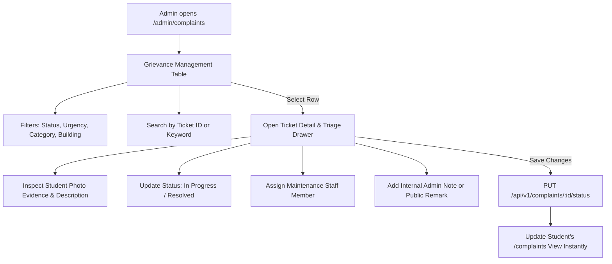

# Complaint Administration Module Specification

*Last Reviewed: October 2026*

This document provides complete technical, administrative, and workflow documentation for the **NextCampus Complaint Administration Portal** (`/admin/complaints`).

---

## 1. Module Overview

Complaint Administration is the campus facility operations command center for processing, prioritizing, assigning, and resolving maintenance grievances submitted by students. Administrators can search tickets across all buildings, filter by urgency, dispatch technicians, record internal administrative notes, and provide transparent resolution updates visible to the reporting student.

- **Route**: `/admin/complaints`
- **Access Level**: Protected (**Admin Role Only**: `user.role === 'admin'`)
- **Primary Goal**: Facilitate fast turnaround times for campus maintenance tickets and maintain an audited paper trail of facility repairs.

---

## 2. Source Files & Architecture

### Frontend Files
- **Page Component**: [`src/pages/ComplaintAdmin.jsx`](file:///run/media/rudra/534a134c-69cb-49e5-9a9c-284e9ad8ee1b/NextCampus/src/pages/ComplaintAdmin.jsx)
- **Shared Components**:
  - `src/components/Navbar.jsx`
  - `src/components/ProtectedRoute.jsx`
  - `src/components/Footer.jsx`
- **Styling**: `src/index.css` (triage table, urgency badges, slide-over ticket inspection drawer)

### Backend Endpoints
- `GET /api/v1/complaints` (or `GET /api/complaints`): Returns all campus complaints with pagination and filters.
- `GET /api/v1/complaints/:id`: Retrieves full details, attached photo, and history audit trail.
- `PUT /api/v1/complaints/:id/status`: Updates ticket status (`Pending`, `In Progress`, `Resolved`, `Closed`).
- `PUT /api/v1/complaints/:id/assign`: Assigns staff member or maintenance crew to the ticket.
- `POST /api/v1/complaints/:id/notes`: Adds internal administrative notes or student-facing resolution remarks.

---

## 3. UI Sections & Triage Workflows

### 3.1 Triage Table & Filters
- **Search Bar**: Quick lookup by Ticket ID (e.g., `#NC-8821`), reporting student name, or keyword.
- **Filter Controls**:
  - **Status**: `All`, `Pending`, `In Progress`, `Resolved`, `Closed`.
  - **Urgency / Priority**: `All`, `Urgent`, `High`, `Medium`, `Low`.
  - **Category**: Electrical, Plumbing, HVAC, Cleanliness, IT, Safety.
  - **Facility**: Filter by campus building.
- **Table Columns**:
  - Ticket ID
  - Date Submitted
  - Student Name & Email
  - Location (Building & Room)
  - Category & Issue Subject
  - Priority Badge (`Urgent` pulsing red, `High` orange)
  - Current Status Pill
  - Assigned Staff
  - Actions (Inspect / Quick Status Toggle)

### 3.2 Ticket Detail & Triage Drawer
Selecting any row opens a comprehensive side inspection drawer:
- **Evidence Inspection**: High-resolution lightbox preview of photos uploaded by the student.
- **Reporter Contact**: Student email and emergency contact information.
- **Status Selector**: Instant status transition dropdown (`Pending` -> `In Progress` -> `Resolved`).
- **Staff Assignment Dropdown**: Assign to specific facilities technicians (e.g., *Campus Electrician Crew A*, *Plumbing Team B*).
- **Dual Note Stream**:
  - **Public Resolution Remarks**: Messages sent to the student's dashboard (e.g., *"Technician replaced classroom projector bulb on Oct 10, 10:30 AM"*).
  - **Internal Admin Notes**: Private notes visible only to administrative users (e.g., *"Vendor PO #9910 requested for replacement unit"*).

---

## 4. State Management & Real-Time Sync

- State holds `complaints`, `activeFilter`, `searchTerm`, and `selectedComplaint`.
- Updating status or assigning staff updates the UI optimistically while firing backend PUT requests.
- The student's view on `/complaints` reflects status changes immediately upon next fetch.

---

## 5. Responsive Behavior

- **Desktop (>= 1200px)**: Multi-column spreadsheet table with right-side slide-over drawer.
- **Tablet / Mobile (< 1200px)**: Responsive card list format with full-screen ticket inspection modal.

---

## 6. Testing & Quality Verification

- **Automated Integration**: Complaint triage, status mutation, and staff assignment endpoints tested in `tests/master_audit.test.js`.
- **Role Enforcement**: Verified non-admin tokens cannot access or update complaints via administrative endpoints.

---

## 7. Related Documentation
- [Complaint Management (Student)](file:///run/media/rudra/534a134c-69cb-49e5-9a9c-284e9ad8ee1b/NextCampus/docs/modules/COMPLAINT_MANAGEMENT.md)
- [Admin Dashboard](file:///run/media/rudra/534a134c-69cb-49e5-9a9c-284e9ad8ee1b/NextCampus/docs/modules/ADMIN_DASHBOARD.md)
- [Authorization](file:///run/media/rudra/534a134c-69cb-49e5-9a9c-284e9ad8ee1b/NextCampus/docs/AUTHORIZATION.md)
