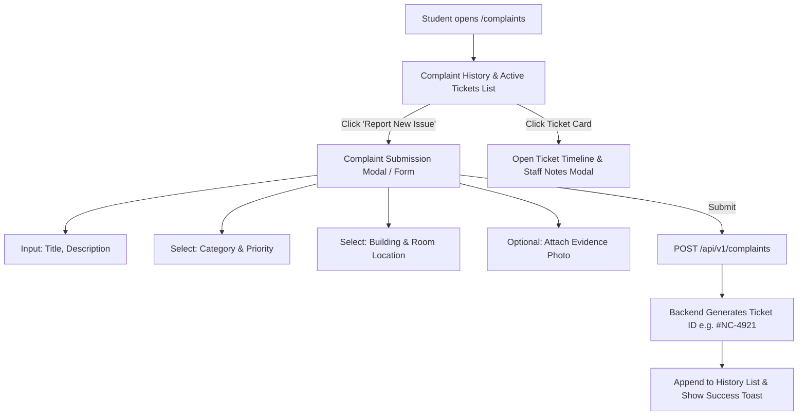

# Complaint Management Module Specification

*Last Reviewed: October 2026*

This document provides complete technical, design, and functional documentation for the **NextCampus Student Complaint & Care Management** module (`/complaints`).

---

## 1. Module Overview

The Complaint Management module empowers students to report campus infrastructure, academic, hygiene, or IT grievances directly to campus administration. It features a streamlined issue reporting form, optional photo evidence upload, automated ticket generation, and a transparent tracking timeline displaying real-time status updates from campus staff.

- **Route**: `/complaints`
- **Access Level**: Protected (Role: `student` or `admin`)
- **Primary Goal**: Provide students with an accountable, transparent grievance reporting mechanism with real-time resolution tracking.

---

## 2. Source Files & Architecture

### Frontend Files
- **Page Component**: [`src/pages/ComplaintManagement.jsx`](file:///run/media/rudra/534a134c-69cb-49e5-9a9c-284e9ad8ee1b/NextCampus/src/pages/ComplaintManagement.jsx)
- **Shared Components**:
  - `src/components/Navbar.jsx`
  - `src/components/Footer.jsx`
- **API Client**: `src/services/api.js` (multipart/form-data upload handling)

### Backend Endpoints
- `GET /api/v1/complaints/my` (or `GET /api/complaints/my`): Retrieves all grievances submitted by the authenticated student.
- `POST /api/v1/complaints` (or `POST /api/complaints`): Submits a new complaint (accepts `multipart/form-data` with optional image attachment).
- `GET /api/v1/complaints/:id`: Retrieves full details, history log, and administrative updates for a specific complaint.

---

## 3. UI Sections & User Workflows



### 3.1 New Complaint Submission Form
The submission form validates all user inputs:
- **Title**: Short summary (minimum 5 characters, max 100 characters).
- **Description**: Detailed description of the malfunction or issue (minimum 10 characters).
- **Category Dropdown**:
  - `Electrical / Power` (e.g., broken sockets, projector failure)
  - `Plumbing / Water` (e.g., restroom leaks, water cooler issues)
  - `HVAC / Temperature` (e.g., broken AC, excessive heat)
  - `Cleanliness / Hygiene` (e.g., waste bin overflow, spill)
  - `IT / Network` (e.g., campus Wi-Fi dead spot, printer issue)
  - `Safety & Security` (e.g., broken door lock, lighting)
- **Priority Selector**: `Low`, `Medium`, `High`, `Urgent`.
- **Location Selectors**:
  - Building dropdown (populated from campus facilities).
  - Specific Floor and Room number.
- **Evidence Attachment**:
  - Drag-and-drop file upload zone.
  - Supports image formats (`image/jpeg`, `image/png`, `image/webp`).
  - Maximum file size: 5 MB.
  - Shows instant client-side thumbnail preview and remove button.

### 3.2 Complaint History & Status Tracker
The student's dashboard displays cards for past and active submissions:
- **Ticket ID**: Highlighted badge (e.g., `#NC-8392`).
- **Submission Date & Time**: Formatted timestamp (e.g., *Oct 10, 2026, 09:15 AM*).
- **Status Indicator**:
  - `Pending`: Received by system; awaiting triage.
  - `In Progress`: Assigned to facility maintenance personnel.
  - `Resolved`: Work complete; verified by administrator.
  - `Closed`: Archived ticket.
- **Assigned Staff**: Displays name and department of maintenance technician if assigned.
- **Status Timeline**: Chronological event feed showing timestamped transitions from submission to resolution.

---

## 4. State Management & Multipart Upload

```javascript
// Form submission snippet in ComplaintManagement.jsx
const formData = new FormData();
formData.append('title', form.title);
formData.append('description', form.description);
formData.append('category', form.category);
formData.append('priority', form.priority);
formData.append('facilityId', form.building);
formData.append('location', form.room);
if (selectedFile) {
  formData.append('image', selectedFile);
}

const response = await apiClient.post('/complaints', formData, {
  headers: { 'Content-Type': 'multipart/form-data' }
});
```

---

## 5. Responsive Behavior

- **Desktop (>= 1024px)**: Dual-pane layout: submission panel on left, chronological ticket history cards on right.
- **Tablet / Mobile (< 1024px)**: Single-column view with an expandable "Submit New Issue" floating action button (FAB) opening a full-screen drawer.

---

## 6. Testing & Quality Verification

- **Automated Integration**: Complaint submission and retrieval validated in `tests/master_audit.test.js`.
- **Validation Testing**: Verified empty title or missing category properly displays inline validation error messages.

---

## 7. Related Documentation
- [Complaint Administration (Admin)](file:///run/media/rudra/534a134c-69cb-49e5-9a9c-284e9ad8ee1b/NextCampus/docs/modules/COMPLAINT_ADMINISTRATION.md)
- [File Uploads Architecture](file:///run/media/rudra/534a134c-69cb-49e5-9a9c-284e9ad8ee1b/NextCampus/docs/FILE_UPLOADS.md)
- [Student Dashboard](file:///run/media/rudra/534a134c-69cb-49e5-9a9c-284e9ad8ee1b/NextCampus/docs/modules/STUDENT_DASHBOARD.md)
