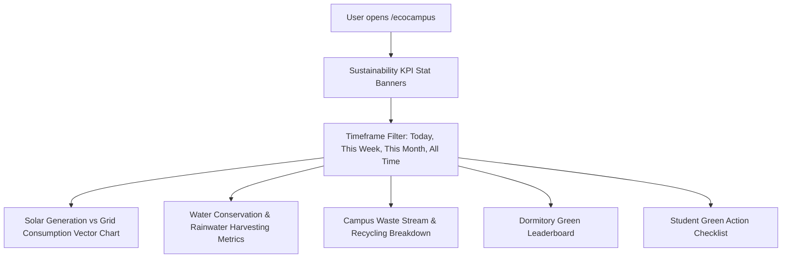

# EcoCampus Module Specification

*Last Reviewed: October 2026*

This document provides complete technical, design, and environmental telemetry documentation for the **NextCampus EcoCampus Sustainability Portal** (`/ecocampus`).

---

## 1. Module Overview

EcoCampus is the dedicated environmental intelligence and sustainability analytics portal for NextCampus. It visualizes campus-wide renewable energy generation (rooftop solar arrays), water conservation metrics, waste reduction leaderboards, and carbon offset milestones, motivating students and campus departments toward carbon-neutral living.

- **Route**: `/ecocampus`
- **Access Level**: Protected (Role: `student` or `admin`)
- **Primary Goal**: Provide real-time visibility into campus environmental telemetry and incentivize green student initiatives.

---

## 2. Source Files & Architecture

### Frontend Files
- **Page Component**: [`src/pages/EcoCampus.jsx`](file:///run/media/rudra/534a134c-69cb-49e5-9a9c-284e9ad8ee1b/NextCampus/src/pages/EcoCampus.jsx)
- **Shared Components**:
  - `src/components/Navbar.jsx`
  - `src/components/Footer.jsx`
- **Dependencies**: Custom SVG charting, `lucide-react` (icons: `Sun`, `Droplets`, `Recycle`, `Leaf`, `Award`, `TrendingDown`)

### Backend Endpoints
- `GET /api/v1/eco/metrics` (or `GET /api/eco/metrics`): Fetches consolidated environmental metrics (energy, water, waste, carbon).
- `GET /api/v1/eco/leaderboard` (or `GET /api/eco/leaderboard`): Retrieves dormitory and department recycling rankings.

---

## 3. UI Sections & Data Presentation

### 3.1 Sustainability KPI Highlights
- **Solar Energy Generated**: `1,420 kWh` today (+14% vs last week).
- **Water Saved**: `18,500 Liters` via greywater recycling.
- **Waste Diverted from Landfill**: `74.2%` recycling rate.
- **Net Carbon Avoided**: `2.8 Metric Tons CO2e`.

### 3.2 Timeframe Filtering
- Allows filtering chart data across:
  - `Today`
  - `This Week`
  - `This Month`
  - `All Time`

### 3.3 Solar Power & Energy Chart
- Vector chart comparing campus rooftop solar generation against campus grid reliance across hourly or daily time buckets.
- Peak solar generation window indicator (11:00 AM - 02:30 PM).

### 3.4 Water Management
- Live reservoir storage capacity bar (`84% Full`).
- Daily reclaimed water utilization by facility (Irrigation 55%, Cooling Towers 30%, Sanitation 15%).

### 3.5 Dormitory Recycling Leaderboard
Gamified ranking of campus residence halls based on per-capita recycling and energy conservation:
1. **Curie Hall** — 940 Green Points (Rank 1 - Gold Medal)
2. **Turing Tower** — 890 Green Points (Rank 2 - Silver Medal)
3. **Lovelace Quad** — 815 Green Points (Rank 3 - Bronze Medal)
4. **Newton House** — 760 Green Points

### 3.6 Student Action Pledge
Interactive checklists for students:
- *"I turned off laboratory computers after 6 PM"*
- *"I used a reusable tumbler at the campus cafe"*
- *"I commuted via campus electric shuttle or bicycle"*

---

## 4. State Management & Data Flow

- On page load, `EcoCampus.jsx` invokes `apiClient.get('/eco/metrics?range=' + range)`.
- Updates dynamically recompute chart axes and summary counters.
- In offline mode or with disconnected database, seeded campus eco-telemetry fixtures ensure full chart rendering without errors.

---

## 5. Responsive Behavior

- **Desktop (>= 1200px)**: 4-column KPI banner; dual-column side-by-side layout for energy chart and recycling breakdown.
- **Tablet (768px - 1199px)**: 2-column KPI grid; stacked chart containers.
- **Mobile (< 768px)**: Single-column cards with touch-scrolling leaderboards.

---

## 6. Testing & Quality Verification

- **Automated Integration**: Verified in `tests/master_audit.test.js` under eco metric data endpoints.
- **Chart Precision**: Validated SVG aspect ratio scaling without pixel distortion.

---

## 7. Related Documentation
- [Student Dashboard](file:///run/media/rudra/534a134c-69cb-49e5-9a9c-284e9ad8ee1b/NextCampus/docs/modules/STUDENT_DASHBOARD.md)
- [Admin Dashboard](file:///run/media/rudra/534a134c-69cb-49e5-9a9c-284e9ad8ee1b/NextCampus/docs/modules/ADMIN_DASHBOARD.md)
- [Design System](file:///run/media/rudra/534a134c-69cb-49e5-9a9c-284e9ad8ee1b/NextCampus/docs/DESIGN_SYSTEM.md)
