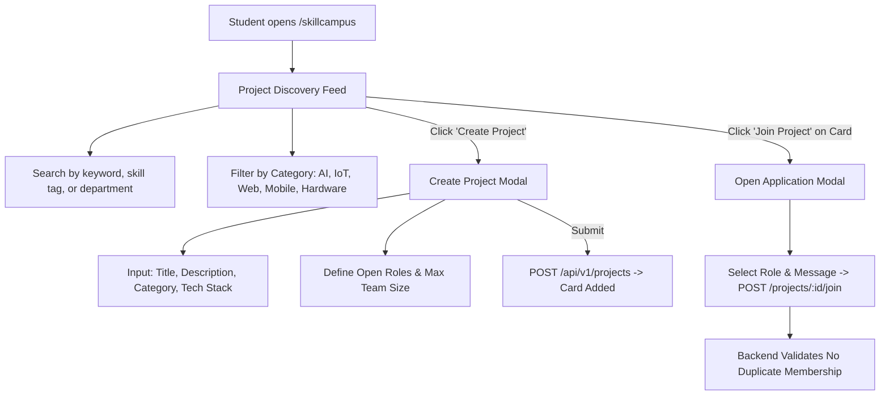

# SkillCampus Module Specification

*Last Reviewed: October 2026*

This document provides complete technical, design, and collaboration documentation for the **NextCampus SkillCampus Project Marketplace** (`/skillcampus`).

---

## 1. Module Overview

SkillCampus is a peer-to-peer student project marketplace that connects multidisciplinary student creators, developers, designers, and researchers across campus. Students can pitch innovative capstone or extracurricular projects, list open roles with required skill tags, browse existing projects, and submit membership applications to join active teams.

- **Route**: `/skillcampus`
- **Access Level**: Protected (Role: `student` or `admin`)
- **Primary Goal**: Facilitate student collaboration and cross-departmental project discovery.

---

## 2. Source Files & Architecture

### Frontend Files
- **Page Component**: [`src/pages/SkillCampus.jsx`](file:///run/media/rudra/534a134c-69cb-49e5-9a9c-284e9ad8ee1b/NextCampus/src/pages/SkillCampus.jsx)
- **Shared Components**:
  - `src/components/Navbar.jsx`
  - `src/components/Footer.jsx`
- **Styling**: `src/index.css` (project card glassmorphism, skill badge pills)

### Backend Files
- **Service**: `server/services/project.service.js`
- **Model**: `server/models/Project.js`
- **Endpoints**:
  - `GET /api/v1/projects` (or `GET /api/projects`): Fetches array of campus projects with skill tags, roles, and member counts.
  - `POST /api/v1/projects` (or `POST /api/projects`): Creates a new student project.
  - `POST /api/v1/projects/:id/join`: Submits a request to join a project or role.
  - `GET /api/v1/projects/:id`: Retrieves full project details, members, and application status.

---

## 3. UI Sections & User Workflows



### 3.1 Project Search and Filtering
- **Keyword Search**: Matches against project title, description, or creator name.
- **Skill Filter Pills**: Instant filter by required technologies: `React`, `Python`, `Node.js`, `TensorFlow`, `Figma`, `Embedded C`, `Robotics`.
- **Category Filter**: `All`, `Artificial Intelligence`, `IoT & Robotics`, `Mobile & Web Apps`, `Sustainability & CleanTech`.

### 3.2 Project Card Structure
Each card in the marketplace displays:
- Project title and creator avatar.
- Category badge and creation date.
- Detailed project description.
- Skill and technology tags (`#Python`, `#OpenCV`, `#ROS`).
- Team metrics:
  - Current team members vs. max team capacity (e.g., `3 / 5 members`).
  - Progress bar illustrating team completion.
- Open Role badges (e.g., `Needs: Frontend Lead`, `Needs: UX Designer`).
- Interactive Actions:
  - "Join Project" / "Apply for Role" button.
  - If already a member: "Member" badge (disabled button).

### 3.3 Create Project Modal
Modal dialog validating project creation:
- **Title**: Project name (minimum 5 characters).
- **Description**: Summary of objectives and goals.
- **Category**: Dropdown selection.
- **Skills Required**: Comma-separated or tag chips.
- **Maximum Team Size**: Number input (2 to 10).
- **Open Roles**: Specifying open positions.

---

## 4. Business Logic & Validation Rules

1. **Duplicate Membership Protection**: Backend checks if the authenticated user is already an author or registered member of the project:
   ```javascript
   if (project.members.some(m => m.user.toString() === req.user.id)) {
     return res.status(400).json({ success: false, message: 'You are already a member of this project' });
   }
   ```
2. **Capacity Validation**: Prevents new memberships if `project.members.length >= project.maxTeamSize`.
3. **Creator Ownership**: The project creator is automatically assigned as the Project Lead and member on creation.

---

## 5. Responsive Behavior

- **Desktop (>= 1200px)**: 3-column marketplace grid.
- **Tablet (768px - 1199px)**: 2-column grid.
- **Mobile (< 768px)**: 1-column responsive card stream with sticky "Pitch Project" action button.

---

## 6. Testing & Quality Verification

- **Automated Integration**: Project creation, retrieval, and join flows verified in `tests/master_audit.test.js`.
- **Duplicate Prevention**: Verified 400 error returns when attempting to join a project twice.

---

## 7. Related Documentation
- [Student Dashboard](file:///run/media/rudra/534a134c-69cb-49e5-9a9c-284e9ad8ee1b/NextCampus/docs/modules/STUDENT_DASHBOARD.md)
- [Student Profile](file:///run/media/rudra/534a134c-69cb-49e5-9a9c-284e9ad8ee1b/NextCampus/docs/modules/STUDENT_PROFILE_SETTINGS.md)
- [Database](file:///run/media/rudra/534a134c-69cb-49e5-9a9c-284e9ad8ee1b/NextCampus/docs/DATABASE.md)
