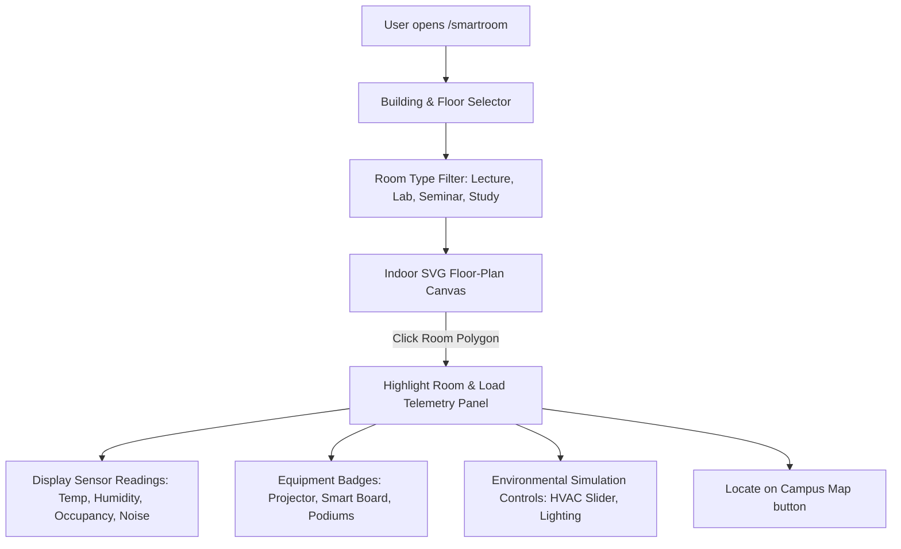

# SmartRoom Module Specification

*Last Reviewed: October 2026*

This document provides complete technical, architectural, and design documentation for the **NextCampus SmartRoom** system (`/smartroom`).

---

## 1. Module Overview

SmartRoom provides an intelligent IoT-connected indoor room management and floor-plan visualization interface. Students and staff can explore campus buildings by floor, inspect real-time sensor telemetry (room occupancy, ambient temperature, relative humidity, acoustic noise levels), review equipment availability, and simulate environmental controls.

- **Route**: `/smartroom`
- **Access Level**: Protected (Role: `student` or `admin`)
- **Primary Goal**: Bridge high-level campus navigation with indoor architectural spaces and live IoT telemetry.

---

## 2. Source Files & Architecture

### Frontend Files
- **Page Component**: [`src/pages/SmartRoom.jsx`](file:///run/media/rudra/534a134c-69cb-49e5-9a9c-284e9ad8ee1b/NextCampus/src/pages/SmartRoom.jsx)
- **Shared Components**:
  - `src/components/Navbar.jsx`
  - `src/components/Footer.jsx`
- **Styling**: `src/index.css` (custom SVG floor-plan styles, sensor badge tokens)

### Backend Endpoints
- `GET /api/v1/facilities` (or `GET /api/facilities`): Supplies list of buildings and floor lists.
- `GET /api/v1/rooms` (or `GET /api/rooms`): Returns room records including capacity, floor number, equipment tags, and IoT metrics.
- `GET /api/v1/rooms/:id/telemetry`: Returns live environmental sensor readings for a specified room.
- `POST /api/v1/rooms/:id/control`: Updates simulated HVAC temperature and lighting presets.

---

## 3. UI Sections & User Workflows

### 3.1 Building and Floor Navigation
- Dropdown selector to choose campus buildings (e.g., *Turing Hall of Engineering*, *Curie Science Complex*, *Ada Lovelace Tech Hub*).
- Interactive horizontal Floor Selector pills (`Floor 1`, `Floor 2`, `Floor 3`, `Floor 4`).
- Changing floors updates the SVG floor-plan vector layout and active room list instantly.

### 3.2 Indoor SVG Floor-Plan Visualization
- Custom vector canvas rendering floor rooms as clickable polygons.
- Color-coded room occupancy states:
  - **Available** (Green `#10B981` / Soft Emerald): Low occupancy (< 40%).
  - **Moderate** (Yellow `#F59E0B` / Amber): Medium occupancy (40% - 80%).
  - **Occupied / Full** (Red `#EF4444` / Amaranth `#AC274F`): High occupancy (> 80%).
- Clicking any room polygon highlights the room boundary with an animated Amaranth Purple pulse and opens the right-hand telemetry inspector.

### 3.3 Environmental Telemetry & Sensor Inspector
The telemetry card displays live simulated IoT sensor telemetry:
- **Current Occupancy**: e.g., `18 / 45 seats` (40% utilized).
- **Ambient Temperature**: e.g., `21.5°C` (70.7°F).
- **Relative Humidity**: e.g., `48%` (Comfortable).
- **Acoustic Noise Level**: e.g., `42 dB` (Quiet / Study-friendly).
- **Air Quality**: e.g., `CO2 420 ppm` (Optimal).

### 3.4 Equipment and Facility Tags
Lists available room hardware:
- 4K Laser Projector
- Dual Smart Interactive Whiteboards
- Lecture Recording Microphones & Cameras
- AC Power Outlets at every desk
- Wheelchair Accessible Stations

### 3.5 Environmental Simulation Controls
Interactive controls allowing staff/students to adjust room conditions:
- **Temperature Slider**: Adjust climate target between 18°C and 26°C.
- **Lighting Presets**: Toggles for `Presentation Mode`, `Focus Study Mode`, and `Energy Saver Mode`.

---

## 4. State Management & Loading Lifecycle

- **Selected State**: Tracks `selectedBuilding`, `selectedFloor`, `selectedRoomId`, and `roomTypeFilter`.
- **Telemetry State**: Fetched via REST call and refreshed when room selection changes.
- **Optimistic UI**: Climate preset toggles update local state immediately, sending asynchronous updates to the backend.

---

## 5. Responsive Behavior

- **Desktop (>= 1200px)**: Two-column layout: SVG floor-plan canvas occupies 65% width; right-hand Telemetry Inspector occupies 35%.
- **Tablet (768px - 1199px)**: Stacked view with floor plan above telemetry summary cards.
- **Mobile (< 768px)**: Scrollable room list pills, responsive SVG viewport scaling, and bottom modal sheet for detailed telemetry readings.

---

## 6. Testing & Quality Verification

- **Automated Integration**: Room listing and telemetry endpoints verified in `tests/master_audit.test.js`.
- **SVG Vector Integrity**: Verified across modern browsers with zero clipping or layout shifts.

---

## 7. Related Documentation
- [Interactive Campus Map](file:///run/media/rudra/534a134c-69cb-49e5-9a9c-284e9ad8ee1b/NextCampus/docs/modules/CAMPUS_MAP.md)
- [Campus Management](file:///run/media/rudra/534a134c-69cb-49e5-9a9c-284e9ad8ee1b/NextCampus/docs/modules/CAMPUS_MANAGEMENT.md)
- [Design System](file:///run/media/rudra/534a134c-69cb-49e5-9a9c-284e9ad8ee1b/NextCampus/docs/DESIGN_SYSTEM.md)
