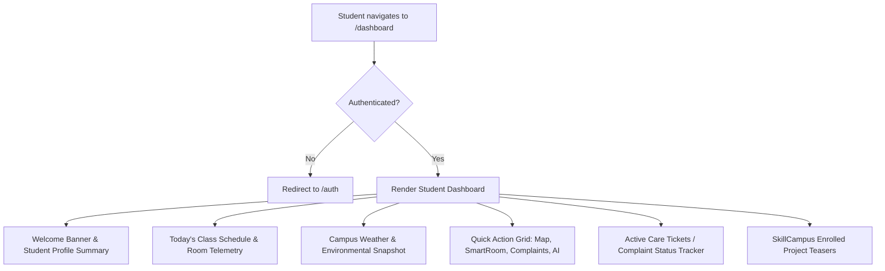

# Student Dashboard Module Specification

*Last Reviewed: October 2026*

This document provides complete technical and design documentation for the **NextCampus Student Dashboard** (`/dashboard`).

---

## 1. Module Overview

The Student Dashboard is the central command center for authenticated students. It consolidates daily academic schedules, live campus weather telemetry, urgent campus notices, quick navigation shortcuts, active project participation, and a rapid maintenance complaint submission drawer.

- **Route**: `/dashboard`
- **Access Level**: Protected (Role: `student` or `admin`)
- **Primary Goal**: Provide students with an actionable summary of their daily campus life within a unified, high-performance interface.

---

## 2. Source Files & Architecture

### Frontend Files
- **Page Component**: [`src/pages/StudentDashboard.jsx`](file:///run/media/rudra/534a134c-69cb-49e5-9a9c-284e9ad8ee1b/NextCampus/src/pages/StudentDashboard.jsx)
- **Shared Components**:
  - `src/components/Navbar.jsx`
  - `src/components/Footer.jsx`
  - `src/components/ProtectedRoute.jsx` (ensures unauthenticated visitors are redirected to `/auth`)
- **State & Context**:
  - `src/context/AuthContext.jsx` (provides active `user` profile)

### Backend Endpoints
- `GET /api/v1/profile` (or `GET /api/profile`): Retrieves current student profile, enrolled major, and courses.
- `GET /api/v1/complaints/my` (or `GET /api/complaints/my`): Fetches tickets submitted by the logged-in student.
- `GET /api/v1/projects` (or `GET /api/projects`): Fetches SkillCampus projects for active team memberships.
- `GET /api/v1/facilities` (or `GET /api/facilities`): Preloads campus facilities for quick location shortcuts.

---

## 3. UI Sections & Data Presentation

### 3.1 Welcome Banner
- Personalized greeting: "Welcome back, {user.name}!"
- Displays Student ID, Major (e.g., *B.Tech Computer Science*), Academic Year, and Cumulative GPA badge.

### 3.2 Today's Class Schedule
- Displays timeline of scheduled lectures, seminars, and labs:
  - Subject code and name (e.g., *CS401: Distributed Systems*)
  - Time window (e.g., *09:30 AM - 11:00 AM*)
  - Room assignment (e.g., *Turing Hall, Room 302*)
  - Clickable shortcut to view room on `/smartroom` or navigate via `/campus-map`.

### 3.3 Live Campus Weather & Air Quality
- Real-time weather indicator: Temperature (24°C / 75°F), Conditions (Partly Cloudy), Campus Air Quality Index (AQI 42 - Good).

### 3.4 Quick Action Cards
- Instant navigation tiles with hover micro-animations:
  - **Campus Map**: Find a building or plan walking path.
  - **SmartRoom**: Reserve a desk or inspect lab occupancy.
  - **Submit Grievance**: Report broken facility equipment.
  - **AI Assistant**: Ask questions about campus policies.

### 3.5 My Active Maintenance Tickets
- Displays status cards for recently submitted complaints:
  - Ticket ID (e.g., `#NC-8821`)
  - Category, Subject, and Location
  - Status pill: `Pending` (Misty Rose), `In Progress` (Blush), or `Resolved` (Green/Emerald).

---

## 4. State Management & Loading Lifecycle

1. **Mounting**: On component mount, the dashboard reads `user` from `useAuth()`.
2. **Parallel Fetching**: Executes parallel requests via `apiClient`:
   - Enrolled courses and schedule data
   - User's recent complaint tickets
   - Enrolled SkillCampus projects
3. **Loading State**: Displays subtle skeleton shimmer loaders while asynchronous calls resolve.
4. **Error Handling**: Graceful fallback to cached local profile information if network connectivity lapses.

---

## 5. Responsive Behavior

- **Desktop (>= 1200px)**: 3-column asymmetric grid (Main schedule & metrics on left, tickets & shortcuts on right).
- **Tablet (768px - 1199px)**: 2-column stacked layout.
- **Mobile (< 768px)**: Single-column vertical stream, full-width schedule cards, tap-optimized action buttons.

---

## 6. Testing & Quality Verification

- **Automated Integration**: Tested in `tests/master_audit.test.js` under student authenticated session tests.
- **RBAC Verification**: Verified that unauthenticated users attempting to access `/dashboard` are prevented from rendering dashboard content and safely redirected to `/auth`.

---

## 7. Related Documentation
- [Landing Page](file:///run/media/rudra/534a134c-69cb-49e5-9a9c-284e9ad8ee1b/NextCampus/docs/modules/LANDING_PAGE.md)
- [Interactive Campus Map](file:///run/media/rudra/534a134c-69cb-49e5-9a9c-284e9ad8ee1b/NextCampus/docs/modules/CAMPUS_MAP.md)
- [SmartRoom](file:///run/media/rudra/534a134c-69cb-49e5-9a9c-284e9ad8ee1b/NextCampus/docs/modules/SMARTROOM.md)
- [Authentication](file:///run/media/rudra/534a134c-69cb-49e5-9a9c-284e9ad8ee1b/NextCampus/docs/AUTHENTICATION.md)
