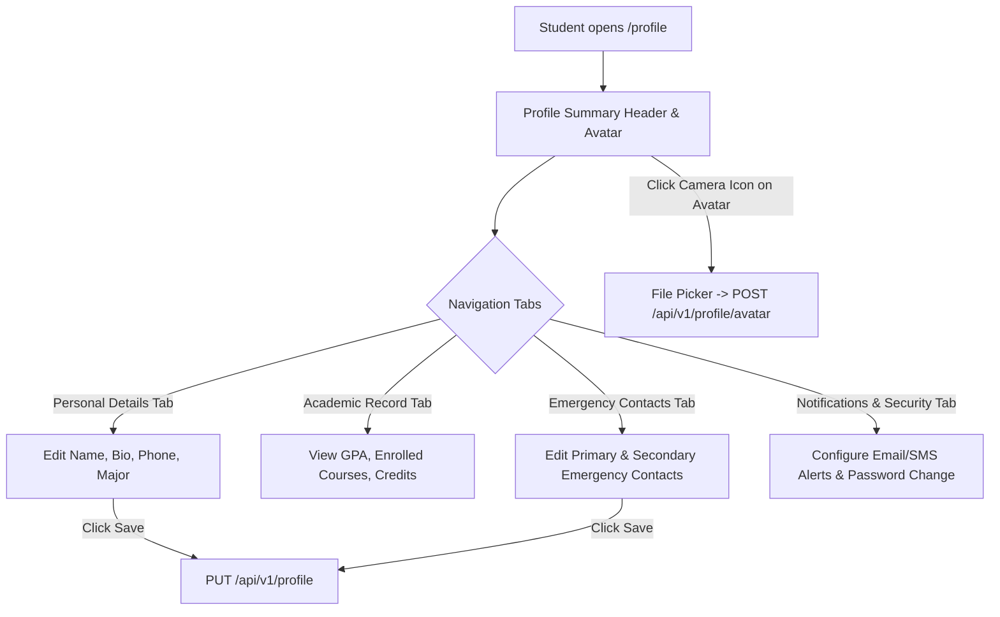

# Student Profile & Settings Module Specification

*Last Reviewed: October 2026*

This document provides complete technical, design, and user settings documentation for the **NextCampus Student Profile and Settings Portal** (`/profile`).

---

## 1. Module Overview

The Student Profile & Settings module provides students with direct control over their digital campus identity, academic information, emergency contact records, notification preferences, security credentials, and profile avatar image.

- **Route**: `/profile`
- **Access Level**: Protected (Role: `student` or `admin`)
- **Primary Goal**: Deliver a centralized, intuitive interface for managing personal student details, profile photo uploads, and campus notification settings.

---

## 2. Source Files & Architecture

### Frontend Files
- **Page Component**: [`src/pages/StudentProfile.jsx`](file:///run/media/rudra/534a134c-69cb-49e5-9a9c-284e9ad8ee1b/NextCampus/src/pages/StudentProfile.jsx)
- **Shared Components**:
  - `src/components/Navbar.jsx`
  - `src/components/ProtectedRoute.jsx`
  - `src/components/Footer.jsx`
- **API Integration**: `src/services/api.js` (multipart/form-data avatar upload & JSON updates)

### Backend Endpoints
- `GET /api/v1/profile` (or `GET /api/profile`): Retrieves current student profile details.
- `PUT /api/v1/profile` (or `PUT /api/profile`): Updates student personal fields (phone, major, emergency contact, bio).
- `POST /api/v1/profile/avatar`: Uploads a new profile picture (`multipart/form-data`).
- `PUT /api/v1/auth/change-password`: Updates password with current password verification.

---

## 3. UI Sections & User Workflows

### 3.1 Profile Header & Avatar Upload
- Large circular avatar with current picture or stylized initials badge.
- Interactive camera icon button triggers local file selection.
- File upload criteria:
  - Formats: JPEG, PNG, WEBP.
  - Max size: 2 MB.
  - Live client preview followed by upload to `/api/profile/avatar`.
- Quick-stat summary: Student Name, Major, Academic Year, Student ID badge.

### 3.2 Personal Details Tab
Editable student fields:
- Full Name
- Campus Email (read-only for security)
- Phone Number (formatted input)
- Academic Major / Department
- Graduation Year
- Biography / Research Interests summary

### 3.3 Academic Record Tab (Read-Only)
- Cumulative GPA badge (e.g., `3.85 / 4.00`).
- Earned Credits vs. Degree Requirement progress bar (e.g., `88 / 120 Credits`).
- Enrolled Courses list with instructor names and credit counts.

### 3.4 Emergency Contacts Tab
Safety and health emergency records:
- Primary Emergency Contact: Name, Relationship (e.g., *Parent / Guardian*), Phone Number.
- Secondary Contact: Name, Relationship, Phone Number.
- Medical Notes / Allergies field (optional).

### 3.5 Notification Preferences & Security
- **Email Notifications**: Toggles for *Complaint Updates*, *Classroom Relocation Notices*, and *Campus Safety Bulletins*.
- **SMS Alerts**: Toggle for *Urgent Campus Weather / Safety Alerts*.
- **Change Password Action**:
  - Current Password
  - New Password
  - Confirm New Password
  - Validates complexity and returns confirmation toast.

---

## 4. State Management & Data Flow

- Form state initialized from `user` profile in `AuthContext` and verified via `apiClient.get('/profile')`.
- Form modifications update local React state.
- Clicking "Save Changes" invokes `apiClient.put('/profile', updatedData)`.
- Updates the active user profile across all components by synchronizing with `AuthContext.updateUser(data)`.

---

## 5. Responsive Behavior

- **Desktop (>= 1024px)**: Two-column layout: left column contains avatar card and quick stats; right column contains tabbed settings panels.
- **Tablet / Mobile (< 1024px)**: Single-column vertically stacked layout with horizontal scroll tabs.

---

## 6. Testing & Quality Verification

- **Automated Integration**: Profile retrieval and update endpoints verified in `tests/master_audit.test.js`.
- **Validation**: Verified invalid phone number formats or mismatching password inputs display clear validation errors.

---

## 7. Related Documentation
- [Authentication Pages](file:///run/media/rudra/534a134c-69cb-49e5-9a9c-284e9ad8ee1b/NextCampus/docs/modules/AUTHENTICATION_PAGES.md)
- [Student Dashboard](file:///run/media/rudra/534a134c-69cb-49e5-9a9c-284e9ad8ee1b/NextCampus/docs/modules/STUDENT_DASHBOARD.md)
- [File Uploads Architecture](file:///run/media/rudra/534a134c-69cb-49e5-9a9c-284e9ad8ee1b/NextCampus/docs/FILE_UPLOADS.md)
